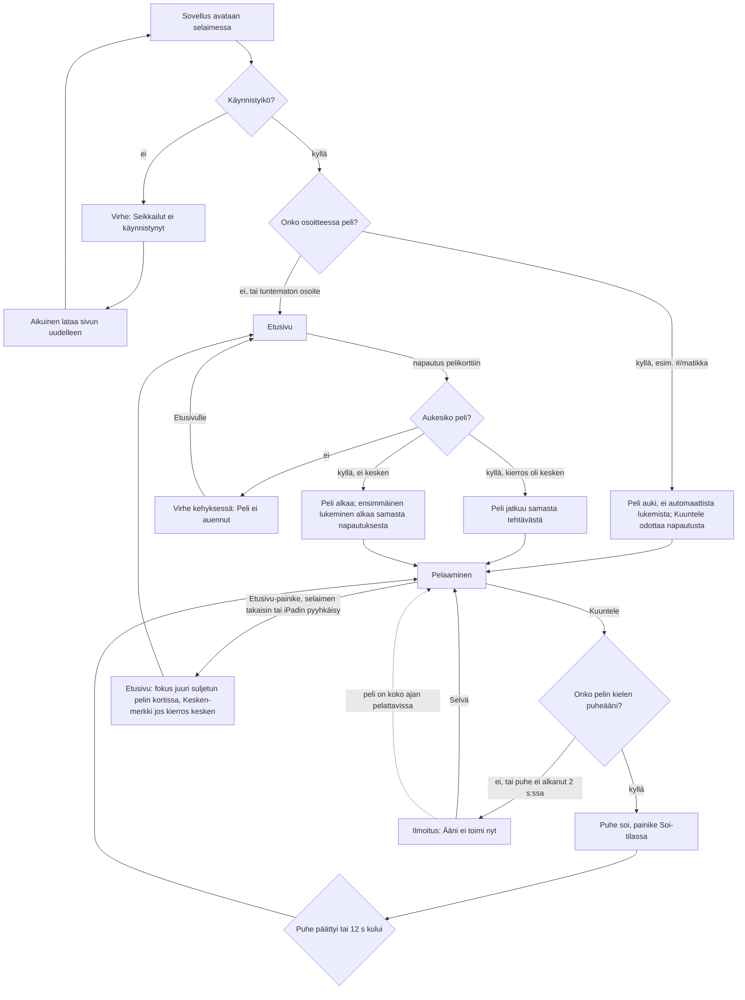

# SEI-1 — Seikkailut: etusivu, pelin valinta ja yhteinen kehys

Designer, 2026-10-22. Kuvat jokaisesta tilasta: `docs/design/sei-1.html`.
Tämä dokumentti on rakentamisen lähde; HTML-sivu näyttää saman omistajalle.

Rajaus: etusivu, siirtyminen etusivun ja pelin välillä, ja kehys, jonka
sisään kolme peliä myöhemmin tulevat (yläpalkki, Etusivu-painike,
Kuuntele-painike, koot, värit, kirjasin). Pelien omat ruudut (laskut,
laatat, vaihtoehdot, loppuruudut) suunnitellaan SEI-2 – SEI-4:ssä. Ei
profiileja eikä nimen valintaa (SEI-11).

---

## 1. Palvelutaso

**Käyttäjä.** 1.–2.-luokkalaiset. He lukevat, osa vasta vähän aikaa, joten jokaisen tekstin on oltava lyhyt ja jokaisella
valinnalla on oltava myös kuva, jota ei tarvitse lukea. Aikuinen avaa
sovelluksen ensimmäisellä kerralla ja korjaa asiat, joita lapsi ei osaa
(ääni, uudelleenlataus).

**Tehtävä.** "Haluan pelata matikkaa / sanoja / espanjaa." Lapsi tietää
yleensä jo, minkä pelin haluaa. Etusivun ainoa työ on viedä hänet sinne
yhdellä napautuksella ja tuoda takaisin yhdellä napautuksella.

**Missä matkalla.**
- *Ennen:* aikuinen avaa selaimen (iPadin Safari tai tietokoneen
  Safari/Chrome) ja osoitteen. Nykyään lapsella on auki yksi kolmesta
  erillisestä sivusta, joista kullakin on eri ulkoasu.
- *Aikana:* lapsi valitsee pelin, pelaa kierroksen (10 tehtävää), ehkä
  vaihtaa peliä kesken.
- *Jälkeen:* lapsi palaa etusivulle ja valitsee toisen pelin tai lopettaa.
  Edistymistä ei tässä versiossa tallenneta (paitsi Espanjan tähdet, jotka
  ovat pelin omia, SEI-4).

**Jos tätä ei tehdä:** kolme peliä pysyvät kolmena eri osoitteena ja kolmena
eri ulkoasuna; pelin vaihto vaatii aikuisen.

**Mitä jo noudatetaan (nykyiset mallit).** Kaksi kolmesta pelistä
(`originals/matikkaseikkailu.html`, `originals/sanaseikkailu.html`) jakavat
saman rakenteen, ja kehys jatkaa sitä:

| Nykyinen malli | Missä | Kehyksessä |
|---|---|---|
| Kirjasin `'Comic Sans MS', 'Chalkboard SE', cursive` | Matikka r. 11, Sana r. 11 | Säilyy (järjestys Chalkboard SE ensin, koska se on iPadin oma). Yksikerroksinen a ja g auttavat aloittelevaa lukijaa. |
| Valkoinen kortti, pyöristys 30 px, max-leveys 700 px, varjo | Matikka r. 31–40, Sana r. 31–40 | Pelikortti: pyöristys 30 px, max-leveys 760 px. |
| Pelin oma tunnusväri (Matikka vihreä–sininen, Sana violetti, Espanja punainen–keltainen) | kaikki kolme | Jokainen peli pitää värinsä; ks. kohta 4. |
| Painettu tila: `translateY(4–5px)` ja varjo pois | Matikka r. 136, Sana r. 166 | Sama kaikille kehyksen painikkeille. |
| Pillerinmuotoinen Kuuntele-painike kaiuttimen kanssa, `.playing`-tila | Matikka r. 110–120, Sana r. 125–135 | Sama muoto, uusi väri ja tilat (kohta 3.4). |
| Saavutettavuusmerkinnät: `aria-pressed`, `aria-live`, `.sr-only` | Espanja r. 137, 155–167 | Säilyvät ja laajenevat kehykseen. |

**Mistä luovutaan ja miksi.**
- Otsikon jatkuva pomppuanimaatio (Matikka/Sana r. 25–27): vie katseen
  luettavasta tekstistä. Ei animaatiota otsikoissa.
- Valkoinen teksti vaaleilla liukuväreillä (esim. `#43e97b`, kontrasti noin
  1,9:1): tunnusvärit tummennetaan tekstin taustoiksi (kohta 4).
- Emojit kehyksen kuvakkeina: ulkoasu vaihtelee laitteittain (backlogin
  riski). Kehyksen kuvakkeet (nuoli, kaiutin) ovat SVG:tä; pelikorttien
  kuvat ovat tekstiä ("1 + 2", "A B C", "¡Hola!"). Pelien omat emojikuvat
  ovat pelien asia.
- Kuuntele-painikkeen lukitseminen puheen ajaksi (Sana r. 491–492, avataan
  vasta `onend`-tapahtumassa): jos puhe ei käynnisty, `onend` ei tule ja
  painike jää lukkoon. Tämä on juuri kriteerin 5 tilanne. Kehyksessä
  painiketta ei lukita koskaan (kohta 3.4).
- Puheen viivästetty automaattinen käynnistys (Matikka r. 493 `500 ms`,
  Sana r. 592 `550 ms`): iPadin Safari sallii puheen vain napautuksen
  yhteydessä, ja viive katkaisee yhteyden. Ks. kohta 3.5.

---

## 2. Kulku

Polut, jotka eivät ole onnellisia:
- **Sivu ladataan uudelleen pelin aikana** (vahingossa tai aikuisen
  toimesta): osoite säilyttää pelin, joten lapsi on samassa pelissä, mutta
  kierros alkaa alusta (muistissa oleva tila katoaa). Automaattista
  lukemista ei tehdä, koska napautusta ei ole ollut.
- **Tuntematon osoite** (esim. `#/shakki`): etusivu, ei virheilmoitusta.
- **Selaimen takaisin etusivulta**: poistuu sovelluksesta kuten mikä
  tahansa sivu. Ei estetä.
- **Ääni puuttuu**: peli toimii ilman ääntä alusta loppuun (kriteeri 5).

---

## 3. Näkymät

### 3.0 Osoitteet ja selaimen toiminta

| Näkymä | Osoite | Sivun otsikko (välilehti) |
|---|---|---|
| Etusivu | `#/` (myös tyhjä tai tuntematon) | `Seikkailut` |
| Matikka | `#/matikka` | `Matikka – Seikkailut` |
| Sanat | `#/sanat` | `Sanat – Seikkailut` |
| Espanja | `#/espanja` | `Espanja – Seikkailut` |

- Siirtymä etusivun ja pelin välillä ei lataa sivua uudelleen (kriteeri 2).
- Jokainen siirtymä lisää selaimen historiaan yhden askeleen, joten
  selaimen takaisin-painike, tietokoneen Alt/Cmd + vasen nuoli ja iPadin
  pyyhkäisy vasemmasta reunasta palauttavat etusivulle.
- Siirtymässä ei ole animaatiota; uusi näkymä korvaa vanhan heti, ja
  näkymä vieritetään ylös.

### 3.1 Etusivu

**Sisältö ylhäältä alas:**
1. Otsikko (h1): `Seikkailut`
2. Alaotsikko: `Mitä pelataan?`
3. Kolme pelikorttia tässä järjestyksessä (sama kuin kriteerissä 1):

| Kortti | Kuva-alue (tekstiä, ei emojia) | Otsikko | Kuvaus | Tunnusväri |
|---|---|---|---|---|
| Matikka | `1 + 2` | `Matikka` | `Laske ja harjoittele numeroita` | vihreä `#17803d` |
| Sanat | kolme kirjainlaattaa `A` `B` `C` | `Sanat` | `Rakenna suomen sanoja kirjaimista` | violetti `#764ba2` |
| Espanja | `¡Hola!` | `Espanja` | `Opi espanjan sanoja` | punainen `#c62828` |

Koko kortti on yksi painike (ei erillistä "Pelaa"-painiketta), jotta lapsen
ei tarvitse osua pieneen kohtaan.

**Asettelu leveyden mukaan** (leveys = näkyvän alueen leveys CSS-pikseleinä):

| Leveys | Korttien asettelu | Kortin koko | h1 |
|---|---|---|---|
| ≥ 900 px (iPad vaaka, tietokone) | kolme rinnakkain, max-leveys yhteensä 1100 px, keskitetty | kuva-alue 150 px korkea, koko kortti noin 300 px korkea | 56 px |
| 600–899 px (iPad pysty) | allekkain, kuva-alue vasemmalla 200 px leveä | rivi vähintään 170 px korkea | 56 px |
| < 600 px (iPadin jaettu näyttö, kapea ikkuna) | allekkain, kuva-alue 110 px leveä | rivi vähintään 120 px korkea | 40 px |

- Sisältö keskitetään pystysuunnassa. Kaikki kolme korttia mahtuvat
  näkyviin ilman vieritystä kaikissa kolmessa kohdelaitteessa
  (iPad pysty 820 × 1130, iPad vaaka 1180 × 770, tietokone 1280 × 720,
  Safarin palkit vähennettynä). Alle 600 px korkeassa ikkunassa sivua saa
  vierittää pystysuunnassa; sivusuunnassa ei koskaan.
- Korttien väli 28 px (allekkain 20 px), sivureunus 48 px (< 600 px: 16 px).

**Tilat:**

| Tila | Mitä näkyy |
|---|---|
| Normaali | Kolme korttia kuten yllä. |
| Kesken (osittainen) | Kortissa, jonka pelissä kierros on kesken, merkki `Kesken 4/10` (valkoinen pilleri, muste-teksti 19 px lihava; rinnakkain kortin oikeassa yläkulmassa kuva-alueen päällä, allekkain kuva-alueen alalaidassa keskellä, jotta se ei peitä nimeä) (luku = vastattujen tai ohitettujen määrä / 10). Kortin napautus jatkaa samasta kohdasta. Useampi kortti voi olla kesken yhtä aikaa. |
| Paluu pelistä | Fokus (tietokoneella näkyvä fokusrengas, ruudunlukijalla luettava) on sen pelin kortissa, josta palattiin. iPadilla ilman näppäimistöä fokusrengasta ei näytetä. |
| Lataus | Ei omaa lataustilaa. Etusivu on sivun HTML:ssä valmiina, joten se näkyy heti kun selain on ladannut sivun. Selaimen oma latausilmaisin riittää. |
| Tyhjä | Ei mahdollinen: pelejä on aina kolme, eikä mitään haeta verkosta. |
| Virhe: sovellus ei käynnistynyt | Ks. 3.6. |

"Kesken" tarkoittaa: kierroksella on vastattu tai ohitettu vähintään yksi
tehtävä, eikä loppuruutu ole vielä näkynyt. Kun loppuruutu on näkynyt, merkki
poistuu. Merkki on vain tämän istunnon muistissa; sivun uudelleenlataus
poistaa sen (ks. 5. Data).

**Vuorovaikutus:**
- Napautus / klikkaus / Enter / välilyönti kortissa avaa pelin.
- Hiiren kohdistus (vain laitteissa, joissa on hiiri): kortti nousee 2 px
  ja varjo kasvaa. iPadilla ei hover-tilaa (ettei se jää "päälle").
- Painettu: kortti laskee 4 px ja alavarjo katoaa (nykyinen malli).

### 3.2 Pelin kehys

Kehys on sama kaikille kolmelle pelille; vain tunnusväri ja otsikko
vaihtuvat. Pelin sisältö tulee pelikortin sisään (SEI-2 – SEI-4).

**Rakenne ylhäältä alas:**
1. **Yläpalkki**, korkeus 76 px, tausta pelin tunnusväri, aina näkyvissä
   (kiinnitetty ylälaitaan, ei vieritä pois).
   - Vasemmalla **Etusivu-painike**: valkoinen pilleri, vasen nuoli + teksti
     `Etusivu`, tunnusvärinen teksti, korkeus 56 px.
   - Sen oikealla pelin nimi (h1): `Matikka` / `Sanat` / `Espanja`, valkoinen,
     30 px lihavoitu.
   - Oikeassa reunassa **tilapaikka** pelin omille tiedoille (tähdet,
     pisteet). Kehys varaa paikan; sisällön suunnittelee kukin peli.
     Tilapaikka saa viedä enintään 40 % palkin leveydestä; jos sisältö ei
     mahdu, se rivittyy tilapaikan sisällä, eikä se koskaan kavenna
     Etusivu-painiketta.
2. **Pelialue**, tausta tunnusvärin vaalea sävy, sisennys 24 px
   (< 600 px: 12 px).
3. **Pelikortti**: valkoinen, pyöristys 30 px, max-leveys 760 px,
   keskitetty, sisennys 24 px.
   - Ylimpänä **kysymysrivi**: vasemmalla kysymyksen paikka (peli täyttää),
     oikealla **Kuuntele-painike**. Kuuntele on kysymyksen vieressä eikä
     yläpalkissa, koska lapsi kuuntelee sitä, mitä katsoo.
   - Alla pelin oma alue.

**Korkeus, joka pelille jää** (ohjeeksi SEI-2 – SEI-4:n suunnittelulle;
näkyvä alue miinus yläpalkki 76 px miinus reunukset 2 × 24 px miinus kortin
sisennys 2 × 24 px):

| Laite | Näkyvä alue | Pelikortin sisältö enintään |
|---|---|---|
| iPad pysty (10. sukupolvi, 820 × 1180) | 820 × 1130 | 724 × 958 |
| iPad vaaka | 1180 × 770 | 712 × 598 |
| Tietokone 1280 × 800 -näyttö | noin 1280 × 720 | 712 × 548 |

Pystysuunnan vieritys pelialueella sallitaan, jos peli ei mahdu; yläpalkki
pysyy silti näkyvissä. Sivusuunnassa ei vieritetä koskaan (kriteeri 3).
Korkeus lasketaan näkyvästä alueesta, joka muuttuu Safarin palkkien
mukaan, ei koko näytön korkeudesta.

**Kapea leveys (< 420 px):** Etusivu-painikkeesta näkyy vain nuoli
(56 × 56 px); teksti `Etusivu` säilyy ruudunlukijalle. Pelin nimi 24 px.
Kysymysrivi rivittyy: Kuuntele siirtyy kysymyksen alle, vasempaan reunaan.
Pelikortin sisennys 16 px (pelialueen 12 px jo alle 600 px:ssä).

**Tilat:**

| Tila | Mitä näkyy |
|---|---|
| Normaali | Yläpalkki, pelikortti, pelin sisältö. |
| Lataus | Pelit ovat sivun mukana, joten avaus on välitön. Jos pelin avaus kestää yli 300 ms, pelikortissa näkyy keskellä teksti `Peli aukeaa…` (22 px, harmaa `#5b5f73`). Ei pyörivää kuvaketta. |
| Virhe: peli ei auennut | Ks. 3.6. |
| Ei ääntä | Ilmoitus pelialueen ylälaidassa, ks. 3.4. |
| Paluu kesken kierroksen | Peli on täsmälleen samassa kohdassa kuin lähtiessä (sama tehtävä, sama syötetty vastaus, samat pisteet). Puhetta ei toisteta automaattisesti. |

**Etusivu-painike:**
- Ei vahvistuskysymystä. Koska kesken jäänyt kierros säilyy (ks. yllä),
  vahingossa painamisesta ei menetä mitään, ja kysymys olisi lapselle
  turha lukutehtävä.
- Pysäyttää käynnissä olevan puheen heti.
- Palauttaa etusivulle; fokus siirtyy pelin korttiin.

### 3.3 Painikkeiden yhteiset tilat

Koskee kaikkia kehyksen painikkeita (pelikortti, Etusivu, Kuuntele,
Selvä, Etusivulle) ja on mallina pelien painikkeille.

| Tila | Ulkoasu |
|---|---|
| Normaali | Painikkeen alla 4 px kiinteä varjo (painikkeen tummempi sävy) — "nappi, jota voi painaa". |
| Hover (vain hiirellä) | Nousee 2 px. |
| Painettu | Laskee 4 px, alavarjo pois. Näkyy myös iPadilla kosketuksessa (iPadin Safari ei näytä painettua tilaa ilman kosketuksen kuuntelijaa; kehittäjä varmistaa, että tila näkyy). |
| Fokus (näppäimistö) | Kolmikerroksinen rengas, näkyy sekä valkoisella että tunnusvärillä: 2 px keltainen `#ffd23f`, 3 px tumma `#1f2340`, 4 px keltainen `#ffd23f`. Vain näppäimistöfokuksessa (`:focus-visible`), ei napautuksessa. |
| Pois käytöstä | Kehyksessä ei ole pois käytöstä olevia painikkeita. |

Kosketus iPadilla, koskee kaikkia painikkeita:
- Nopea kaksoisnapautus ei saa zoomata sivua (numeronäppäimistö ja
  kirjainlaatat napautetaan nopeasti). Zoomaus kahdella sormella säilyy
  käytössä (saavutettavuus); vain kaksoisnapautuszoomaus estetään
  painikkeissa.
- Pitkä painallus painikkeessa ei avaa tekstinvalintaa eikä
  kopiointivalikkoa.
- Selaimen oma harmaa napautusvälähdys korvataan painetulla tilalla.

### 3.4 Kuuntele-painike ja ääni

Yksi yhteinen komponentti, jonka jokainen peli sijoittaa kysymysrivin
oikeaan reunaan. Teksti tulee pelistä ja pysyy nykyisenä:
`Kuuntele lasku` (Matikka), `Kuuntele sana` (Sanat), `Kuuntele` (Espanja).
Kehyksen oletus on `Kuuntele`.

Mitat: korkeus 56 px, vähimmäisleveys 150 px, pilleri, kaiutinkuvake (SVG)
28 px + teksti 22 px lihavoitu, reunus 3 px.

**Tilat:**

| Tila | Milloin | Ulkoasu | Teksti |
|---|---|---|---|
| Valmis | Oletus, myös kun ääntä ei vielä ole tarkistettu | Valkoinen pohja, tunnusvärinen reunus ja teksti, kaiutin | pelin teksti, esim. `Kuuntele sana` |
| Painettu | Napautuksen aikana | Kuten valmis, laskee 4 px | sama |
| Soi | Puhe käynnissä | Tunnusvärinen pohja, valkoinen teksti, kaiuttimen viereen kolme ääniaaltopalkkia (liikkuvat; liike pois, jos laitteessa on valittu "vähennä liikettä") | sama teksti (leveys ei muutu) |
| Ei ääntä | Pelin kielen puheääntä ei ole, tai puhe ei alkanut | Valkoinen pohja, katkoviivareunus harmaa `#8a8fa3`, teksti `#5b5f73`, yliviivattu kaiutin | `Ei ääntä` |
| Fokus | Näppäimistöllä | Fokusrengas (3.3) minkä tahansa yllä olevan päällä | |

**Säännöt (kriteerit 5 ja 6):**
1. **Painiketta ei lukita koskaan.** Se on napautettavissa kaikissa
   tiloissa. Napautus Soi-tilassa aloittaa lukemisen alusta.
2. **Mikään pelin toiminto ei odota puhetta.** Vastaaminen, Seuraava,
   laatat, numeronäppäimistö ja Etusivu toimivat, vaikka puhe olisi kesken,
   ei olisi alkanut tai jäisi jumiin. Uusi lukeminen keskeyttää edellisen.
3. **Soi-tila päättyy aina:** kun puhe päättyy, kun tulee virhe, tai
   viimeistään 12 sekunnin kuluttua alkamisesta, vaikka selain ei ilmoittaisi
   loppua. (Pisin nykyinen lukeminen on Sanan TAIKAJUOMA tavutettuna,
   noin 6 s.)
4. **Ääni lähtee samasta napautuksesta** (kriteeri 6). Ensimmäinen napautus
   Kuuntele-painikkeeseen tuottaa äänen heti; lukeminen käynnistetään
   napautuksen käsittelyssä ilman viivettä, eikä se odota äänilistan
   latautumista.
5. **Ei vääräkielistä lukemista.** Jos laitteen äänilistassa ei ole pelin
   kielen ääntä (Matikka ja Sanat: suomi; Espanja: espanja), tila on Ei ääntä
   eikä tekstiä lueta jollain muulla äänellä.
6. **Tarkistus:**
   - Selain ei tue puhetta lainkaan → Ei ääntä heti pelin avautuessa.
   - Äänilista on ladattu eikä siinä ole pelin kieltä → Ei ääntä heti.
   - Äänilista on vielä tyhjä → Valmis; ensimmäinen napautus yrittää lukea.
   - Lukeminen ei ala 2 sekunnissa tai tulee virhe → Ei ääntä.
   - Äänilistaan ilmestyy pelin kieli myöhemmin → takaisin Valmis.
   - Napautus Ei ääntä -tilassa yrittää lukea uudelleen kerran; jos se
     epäonnistuu, ilmoitus näytetään uudelleen. Painike ei siis ole
     koskaan kuollut.

**Ei ääntä -ilmoitus** (pelialueen ylälaidassa, pelikortin yläpuolella,
saman levyinen kuin pelikortti; ei peitä peliä eikä estä sitä):

Suomi (Matikka, Sanat):
> **Ääni ei toimi nyt.**
> Voit pelata ilman ääntä.
>
> *Aikuiselle:* tästä laitteesta puuttuu suomen puheääni. iPadissa sen voi
> lisätä: Asetukset › Käyttöapu › Puhuttu sisältö › Äänet › Suomi.
>
> [Selvä]

Espanja:
> **Ääni ei toimi nyt.**
> Voit pelata ilman ääntä.
>
> *Aikuiselle:* tästä laitteesta puuttuu espanjan puheääni. iPadissa sen voi
> lisätä: Asetukset › Käyttöapu › Puhuttu sisältö › Äänet › Espanja.
>
> [Selvä]

Jos selain ei tue puhetta lainkaan, aikuisen rivi on:
> *Aikuiselle:* tämä selain ei osaa lukea ääneen. Kokeile Safaria tai
> Chromea.

- Lapsen rivit 24 px / 22 px, aikuisen rivi 16 px `#5b5f73` (ainoa alle
  20 px:n teksti; tarkoitettu aikuiselle).
- Tausta `#fff4d6`, reunus 3 px `#b7791f`, pyöristys 20 px, oikealla
  `Selvä`-painike: 56 px korkea, vähintään 120 px leveä, valkoinen pohja,
  3 px reunus ja teksti `#1f2340`, alavarjo `#1f2340`.
- Kapeassa (< 600 px) `Selvä` siirtyy tekstin alle koko leveydelle.
- Näytetään, kun peli avataan ja ääni tiedetään puuttuvaksi, tai kun
  Kuuntele epäonnistuu. Kerran istunnossa kieltä kohden automaattisesti;
  aina uudelleen, jos lapsi napauttaa Kuuntele ja se epäonnistuu.
- `Selvä` sulkee ilmoituksen; Kuuntele jää Ei ääntä -tilaan.
- Ruudunlukija lukee ilmoituksen kerran ilmestyessä (tilailmoitus,
  ei keskeytä).

**Mitä emme voi tietää:** onko laitteen äänenvoimakkuus nolla tai iPadin
äänetön tila päällä. Puhe "onnistuu" silloin äänettömästi, eikä mikään
ilmoitus voi kertoa sitä. Tämä on hyväksytty raja.

### 3.5 Automaattinen lukeminen pelin avautuessa

Nykyiset pelit lukevat tehtävän itsestään (Matikka, Sana). Kehyksen sääntö,
jota pelit noudattavat:
- Kun peli avataan **napauttamalla etusivun korttia**, ensimmäinen
  lukeminen käynnistetään saman napautuksen käsittelyssä (ei 500 ms:n
  viivettä). Silloin iPad sallii äänen.
- Kun peli avautuu **ilman napautusta** (uudelleenlataus, suora osoite),
  automaattista lukemista ei yritetä. Kuuntele on Valmis-tilassa.
- Seuraavat automaattiset lukemiset (uusi tehtävä Seuraava-napautuksen
  jälkeen) käynnistetään samoin Seuraava-napautuksen käsittelyssä.
- Kun palataan kesken jääneeseen kierrokseen, ei lueta automaattisesti.

### 3.6 Virhetilat

**Sovellus ei käynnistynyt** (sivun ohjelma ei lähde käyntiin; näkyy
sivun HTML:ssä ja piilotetaan, kun ohjelma käynnistyy):
> **Seikkailut ei käynnistynyt.**
> Lataa sivu uudelleen. iPadissa: napauta osoiterivin ↻-kuvaketta.
> Jos se ei auta, kokeile toista selainta.

Ei painikkeita (uudelleenlataus on selaimen toiminto). Tämä teksti on
aikuiselle.

**Peli ei auennut** (pelin käynnistys epäonnistuu; yläpalkki näkyy
normaalisti pelin värillä ja nimellä, pelikortin sisällä):
> **Peli ei auennut.**
> Palaa etusivulle ja kokeile uudelleen.
>
> [Etusivulle]

`Etusivulle`-painike on tunnusvärinen, valkoinen teksti, 56 px. Yläpalkin
Etusivu-painike toimii myös.

**Voittoääni (vauhti.mp3) ei lataudu:** ei ilmoitusta; ääni on koriste.

---

## 4. Ilme: värit, kirjasin, koot

### Värit

| Nimi | Arvo | Käyttö |
|---|---|---|
| Muste | `#1f2340` | Kaikki leipäteksti, otsikot valkoisella |
| Harmaa teksti | `#5b5f73` | Kuvaukset, aikuisen rivi, Ei ääntä |
| Paperi | `#fffaf0` | Etusivun alaosa (Espanjan `--paper`) |
| Etusivun tausta | liukuväri `#e8f1ff` → `#fffaf0` ylhäältä alas | Etusivu |
| Matikka | `#17803d`, tumma `#0f5c2b`, vaalea `#e3f7ea` | Yläpalkki, kortin kuva, painikkeet / painikkeen varjo / pelialueen tausta |
| Sanat | `#764ba2`, tumma `#553578`, vaalea `#efe8fb` | sama |
| Espanja | `#c62828`, tumma `#8e0000`, vaalea `#fdeceb` | sama; tumma on Espanjan nykyinen `--rojo-dark` |
| Fokus | `#ffd23f` + `#1f2340` | Fokusrengas |
| Ilmoitus | tausta `#fff4d6`, reunus `#b7791f` | Ei ääntä |

Tunnusvärit ovat nykyisten pelien värejä: Sanan `#764ba2` ja Espanjan
`#c62828` sellaisenaan; Matikan vihreä `#43e97b` on tummennettu
`#17803d`:ksi, koska valkoinen teksti vaalealla vihreällä ei ole luettavaa.
Espanjan keltainen `#ffd600` säilyy koristeena kortin kuvassa (¡Hola! -teksti
punaisella pohjalla, keltainen alleviiva), ei tekstin taustana.

Kontrastit (WCAG, laskettu):

| Yhdistelmä | Suhde | Vaatimus |
|---|---|---|
| Valkoinen `#17803d`:llä | 5,0 : 1 | 4,5 ✓ |
| Valkoinen `#764ba2`:llä | 6,4 : 1 | 4,5 ✓ |
| Valkoinen `#c62828`:llä | 5,6 : 1 | 4,5 ✓ |
| `#5b5f73` valkoisella | 6,4 : 1 | 4,5 ✓ |
| `#1f2340` `#fff4d6`:lla | yli 14 : 1 | 4,5 ✓ |
| Keltainen fokus `#ffd23f` tunnusväreillä | 3,6 / 4,6 / 4,0 : 1 | 3 ✓ (ei-tekstielementti) |
| Tumma fokus `#1f2340` valkoisella | yli 15 : 1 | 3 ✓ |

### Kirjasin

`'Chalkboard SE', 'Comic Sans MS', 'Comic Neue', system-ui, sans-serif`.
Ei verkkokirjasinta (toimii ilman verkkoa myöhemmin, SEI-18).

| Käyttö | Koko | Paino |
|---|---|---|
| Etusivun h1 | 56 px (< 600 px: 40 px) | lihava |
| Alaotsikko | 28 px | normaali |
| Kortin otsikko | 36 px (< 600 px: 28 px) | lihava |
| Kortin kuvaus | 21 px (< 600 px: 18 px) | normaali |
| Pelin nimi yläpalkissa | 30 px (< 420 px: 24 px) | lihava |
| Painikkeiden teksti | 22 px | lihava |
| Leipäteksti vähintään | 20 px | |
| Aikuisen rivi | 16 px | |

### Koot

- Napautettava kohde vähintään 56 × 56 px kehyksessä; 44 × 44 pt on
  ehdoton alaraja peleissä (kriteeri 4). 1.-luokkalaisen sormi osuu
  epätarkemmin kuin aikuisen, siksi kehys käyttää 56:ta.
- Napautettavien kohteiden väli vähintään 12 px.
- Kulmapyöristykset: kortit 28–30 px, painikkeet pilleri, ilmoitus 20 px.
- Liike: vain painamisen 4 px:n lasku ja Soi-tilan ääniaallot. Jos
  laitteessa on "vähennä liikettä", ääniaallot ovat paikallaan.

---

## 5. Data: mitä on, mitä ei

| Tarvitaan | Onko | Lähde / huomio |
|---|---|---|
| Kolme peliä, nimet, värit | Kyllä | Kiinteät; tämä dokumentti. |
| Onko kierros kesken ja montako tehtävää 10:stä tehty | Kyllä, muistissa | Matikka `qIndex`, `answered` (r. 313–315); Sana `qIndex`, `answered` (r. 403–405); Espanja `idx`, `locked` (r. 219–221; Espanjalla ei ole vastattujen laskuria, joten "tehty" = `idx`, +1 jos nykyiseen on vastattu). Pelin on annettava kehykselle nämä kaksi tietoa: tehty (0–10) ja loppuruutu näkynyt (kyllä/ei). |
| Kesken-tila sivun uudelleenlatauksen yli | Ei | Mitään ei tallenneta (paitsi Espanjan tähdet `localStorage 'es_stars'`). Tietoisesti ei tallenneta tässä versiossa; profiilien kanssa (SEI-11) uudelleen. |
| Onko pelin kielen puheääni | Osittain | Selaimen äänilista kertoo kielet, mutta voi olla aluksi tyhjä ja täyttyä myöhemmin. Siksi tila "ei vielä tiedossa" = Valmis. |
| Alkoiko puhe | Kyllä | Lukemisen alkamis-, loppu- ja virhetapahtumat. Loppu-tapahtuma voi jäädä tulematta; siksi 12 s:n raja. |
| Onko äänenvoimakkuus nolla / äänetön tila | Ei | Ei saatavilla selaimessa. Hyväksytty raja. |
| Mikä peli oli viimeksi auki (fokuksen palautus) | Kyllä | Osoitteesta. |

## 6. Reunat

- **Nolla peliä / tyhjä etusivu:** ei mahdollinen.
- **Kesken 0/10:** peli avattu, mitään ei vastattu → ei merkkiä.
- **Kesken 9/10:** merkki `Kesken 9/10`. Kun 10. on vastattu ja
  loppuruutu näkyy → ei merkkiä.
- **Kaikki kolme kesken:** kaikissa kolmessa korteissa merkki; merkki ei
  peitä kortin otsikkoa (se on kuva-alueen kulmassa).
- **Pitkä pelin nimi:** nimet ovat kiinteitä, pisin `Espanja` (7 merkkiä).
  Jos omistaja valitsee pidemmät nimet (ks. avoin kysymys), pisin olisi
  `Espanjavalmentaja` (17 merkkiä): 36 px:llä noin 330 px, mahtuu
  rinnakkaisasetteluun 1100/3 px:n korttiin vain rivittyen; tavutus sallitaan
  (`hyphens: auto`, `lang="fi"`). Yläpalkissa 30 px:llä noin 280 px, mahtuu
  iPad pysty -leveyteen; < 420 px:ssä rivittyy kahdelle riville ja palkki
  kasvaa.
- **Espanjan tähdet yläpalkin tilapaikassa:** `⭐ × 137` -tyyppinen sisältö
  mahtuu 40 %:n paikkaan; pelin asia (SEI-4).
- **Kapein tuettu leveys 320 px** (iPadin jaettu näyttö / kapea ikkuna):
  kortit allekkain, Etusivu-painike pelkkä nuoli, ei vaakavieritystä.
- **Matala ikkuna (tietokone, < 600 px korkea):** etusivua saa vierittää
  pystyyn; yläpalkki pysyy pelissä paikallaan.
- **Selaimen zoom 200 %:** vastaa 640 px leveyttä tietokoneella → kortit
  allekkain; mikään ei leikkaudu.
- **Nopea kaksoisnapautus kortissa:** avaa pelin kerran; toinen napautus
  osuu pelin näkymään vasta kun se on piirretty, eikä se saa käynnistää
  mitään peliä alkaessa (napautus kehyksen tyhjään kohtaan).
- **Napautus Etusivu-painikkeeseen puheen aikana:** puhe loppuu heti.

---

## 7. Saavutettavuus

**Näppäimistöpolku, etusivu:** Tab → Matikka-kortti → Sanat-kortti →
Espanja-kortti. Enter tai välilyönti avaa. Otsikot eivät ole
fokusoitavia.

**Näppäimistöpolku, peli:** Tab → Etusivu → (tilapaikan mahdolliset
painikkeet) → pelikortin sisältö: Kuuntele ensin, sitten pelin omat
kontrollit siinä järjestyksessä kuin ne näkyvät. Ei-ääni-ilmoituksen
`Selvä` on Etusivu-painikkeen jälkeen ja ennen Kuuntele-painiketta, kun
ilmoitus on näkyvissä.

**Fokus siirtymissä:**
- Etusivu → peli: fokus pelin nimeen (h1, ei Tab-järjestyksessä). Ruudunlukija
  lukee "Matikka, otsikko taso 1".
- Peli → etusivu: fokus sen pelin korttiin, josta palattiin.
- Ilmoituksen `Selvä` → fokus Kuuntele-painikkeeseen.
- Virhe "Peli ei auennut" → fokus virheotsikkoon.

**Näppäimet:** Esc ei tee mitään (ei vahingossa poistumista). Selaimen
takaisin (Alt/Cmd + vasen) palaa etusivulle.

**Ruudunlukija:**
| Elementti | Luetaan |
|---|---|
| Pelikortti | "Matikka. Laske ja harjoittele numeroita. Painike." Kuva-alue (`1 + 2`, `A B C`, `¡Hola!`) on piilotettu ruudunlukijalta. |
| Kesken-merkki | Kortin nimeen lisätään "Kesken, 4 tehtävää 10:stä tehty." (merkki on muuten vain kuva). |
| Etusivu-painike | "Etusivu, painike" (myös kun teksti on piilotettu kapealla ruudulla). |
| Kuuntele, Valmis | "Kuuntele sana, painike" |
| Kuuntele, Soi | "Kuuntele sana, painike" (tila näkyy vain värinä ja liikkeenä, joten sitä ei erikseen ilmoiteta, ettei ruudunlukija puhu pelin puheen päälle) |
| Kuuntele, Ei ääntä | "Ei ääntä. Kuuntele sana, painike" |
| Ei ääntä -ilmoitus | Luetaan kerran ilmestyessä tilailmoituksena. |
| Espanjan sanat | `lang="es"`, jotta ruudunlukija ääntää ne espanjaksi. |

**Väri ei ole ainoa tieto:** pelit erottuvat nimestä ja kuvatekstistä, eivät
vain väristä; Ei ääntä -tila erottuu tekstistä, katkoviivasta ja
yliviivatusta kuvakkeesta, ei vain harmaasta; Soi-tila on lisäksi
liikkeenä ja kuvakkeena.

**Zoomaus:** kahden sormen zoomaus sallitaan aina (ei
`user-scalable=no`).

---

## 8. Hyväksyntä: miten kriteerit näkyvät tässä

| SEI-1 kriteeri | Missä katettu |
|---|---|
| 1. Kolme valintaa, napautus avaa pelin | 3.1 |
| 2. Paluu ilman uudelleenlatausta | 3.0, 3.2 Etusivu-painike |
| 3. Pysty, vaaka, tietokone; ei mitään ruudun ulkopuolella, ei vaakavieritystä | 3.1 asettelutaulukko, 3.2 korkeustaulukko, 6 |
| 4. Pelkkä napautus, ≥ 44 pt | 3.3, 4 Koot (kehys 56 px) |
| 5. Ilman ääntä peli ei jää odottamaan | 3.4 säännöt 1–3, 5–6 |
| 6. Ääni ensimmäisestä napautuksesta | 3.4 sääntö 4, 3.5 |

## 9. Avoimet kysymykset

1. **Pelien nimet etusivulla** (omistajan mieltymys). Lyhyet `Matikka`,
   `Sanat`, `Espanja` vai lasten tuntemat vanhat `Matikkaseikkailu`,
   `Sanaseikkailu`, `Espanjavalmentaja`? Oletus: lyhyet (helpompi
   aloittelevalle lukijalle, mahtuu kaikkialle).
2. **Kesken jäänyt kierros** (omistajan mieltymys). Kun lapsi palaa
   etusivulle kesken kierroksen ja avaa saman pelin, jatkuuko kierros vai
   alkaako uusi? Oletus: jatkuu (kunnes sivu ladataan uudelleen), eikä
   Etusivu-painike kysy vahvistusta.
