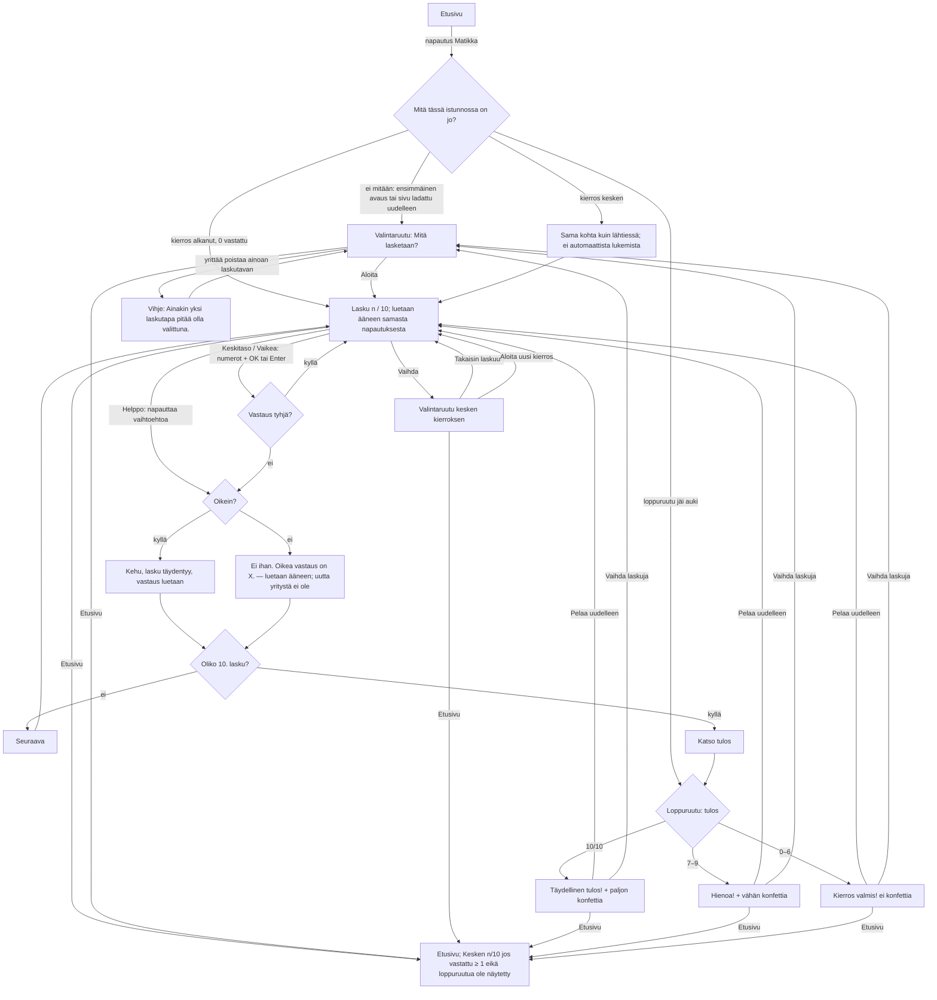

# SEI-2, SEI-5, SEI-6 — Matikka uudessa sovelluksessa

Designer, 2026-10-23. Kuvat jokaisesta tilasta kolmella laitteella:
`docs/design/sei-2.html`. Tämä dokumentti on rakentamisen lähde; HTML-sivu
näyttää saman omistajalle.

Rajaus: Matikkaseikkailun koko nykyinen käyttö (SEI-2) SEI-1:n kehyksen
sisällä, väärän vastauksen palaute (SEI-5) ja loppuruutu (SEI-6). Ei mitään
D-osiosta (ei kuvalaskuja, ei tallennusta yli uudelleenlatauksen, ei
profiileja). Kehys (yläpalkki, Etusivu, Kuuntele, Ei ääntä -ilmoitus,
Kesken-merkki, painikkeiden tilat, värit, kirjasin) on hyväksytty
`docs/design/sei-1.md`:ssä eikä muutu; tässä viitataan siihen kohtina
"SEI-1 §x".

Lähde nykyiselle toiminnalle: `originals/matikkaseikkailu.html`, rivinumerot
viittaavat siihen ("vanha r. n").

---

## 1. Palvelutaso

**Käyttäjä.** 1.–2.-luokkalainen, joka lukee, osa vasta vähän aikaa. Hän
tunnistaa numerot ja laskumerkit varmemmin kuin sanat. Siksi jokaisella
ruudulla tärkein tieto on numeroina ja merkkeinä, teksti on lyhyttä, ja
jokainen palaute myös luetaan ääneen. Aikuinen valitsee ehkä tason
ensimmäisellä kerralla.

**Tehtävä.** "Haluan laskea laskuja omalla tasollani ja nähdä, miten meni."
Kierros on 10 laskua (vanha r. 302). Lapsi vastaa, näkee heti oliko oikein,
ja kierroksen lopuksi kuinka moni meni oikein.

**Missä matkalla.**
- *Ennen:* lapsi on etusivulla ja napauttaa Matikka-korttia (SEI-1 §3.1).
- *Aikana:* valitsee tason ja laskutavat (ensimmäisellä kerralla), laskee 10
  laskua. Voi käydä etusivulla ja palata; kierros jatkuu (omistaja Q10).
- *Jälkeen:* loppuruutu kertoo tuloksen. Lapsi pelaa uudelleen, vaihtaa
  tasoa tai palaa etusivulle. Tulosta ei tallenneta (ei vanhassakaan).

**Jos tätä ei tehdä:** Matikka on uudessa sovelluksessa vain paikkamerkki, eikä
vanhaa peliä voi jättää pois käytöstä (backlogin järjestysperuste 1).

**Mitä jo noudatetaan (nykyiset mallit):**

| Malli | Missä nyt | Tässä |
|---|---|---|
| Kehys: yläpalkki, Etusivu, tilapaikka, pelikortti, kysymysrivi + Kuuntele | SEI-1 §3.2, `app/src/shell.js` | Tähdet tilapaikkaan, lasku kysymysriville, kaikki muu pelin alueelle (`ctx.root`). |
| Kuuntele-painike, teksti `Kuuntele lasku` | SEI-1 §3.4, `registry.js` | Ei muutu. Pelin `listen()` päättää, mitä luetaan (kohta 3.7). |
| Pääpainike: tunnusvärinen pilleri, valkoinen teksti, 4 px tumma alavarjo | `.accent-btn` (`app.css`) | `Aloita`, `Seuraava`, `Katso tulos`, `Pelaa uudelleen`, numeronäppäimistön `OK`. |
| Toissijainen painike: valkoinen, 3 px muste-reunus, muste-varjo | `.ok-btn` (Selvä) | `Vaihda`, `Takaisin laskuun`, `Vaihda laskuja` loppuruudussa. |
| Painettu tila (laskee 4 px, varjo pois), fokusrengas keltainen + muste | SEI-1 §3.3 | Kaikki tämän pelin painikkeet. |
| Kesken-merkki `Kesken n/10`, kierros jatkuu samasta kohdasta | SEI-1 §3.1, §3.2; `reportProgress` | Matikka raportoi `done` = vastattujen määrä (kohta 5). |
| Ääni samasta napautuksesta, ei viivettä | SEI-1 §3.5, `registry.js` sääntö 3 | Jokainen luenta käynnistyy siinä napautuksessa, joka sen aiheuttaa (kohta 3.7). |
| `aria-pressed` valintapainikkeissa | Espanja r. 137 | Laskutapojen kytkimet. |
| Taso-nimet Helppo / Keskitaso / Vaikea | Sanaseikkailun tasot (backlog SEI-3) | Sama nimitys Matikassa (kohta 3.1, ero E2). |
| Kehut `Hienoa! 🌟` … `Mestari! 🧙` | vanha r. 299 | Säilyvät sellaisinaan. |
| Putkiteksti `🔥 N peräkkäin oikein!` | vanha r. 653 | Säilyy sanasta sanaan. |
| Loppuruudun kolme tulostasoa: 100 %, ≥ 70 %, muu | vanha r. 663–665 | Samat rajat; nyt myös otsikko, ääni ja kuva noudattavat niitä (SEI-6). |

---

## 2. Kulku

Polut, jotka eivät ole onnellisia:
- **OK tyhjällä vastauksella:** ei tee mitään (SEI-2 kriteeri 5). Ei viestiä,
  ei ääntä; vastausruudun `?` pysyy.
- **Viidennen numeron painallus:** ei tee mitään (enintään 4 numeroa, vanha
  r. 565).
- **Ainoan päällä olevan laskutavan poisto:** kytkin pysyy päällä, vihje
  tulee näkyviin (kohta 3.1).
- **Ääni puuttuu:** kehyksen ilmoitus (SEI-1 §3.4); peli on pelattavissa
  loppuun, koska mikään ei odota puhetta.
- **Sivu ladataan uudelleen kesken kierroksen:** valintaruutu oletuksilla
  (Helppo, + ja −). Kierros ja valinnat katoavat, kuten SEI-1 §2 sanoo.
- **Etusivu kesken konfetin:** konfetti poistetaan heti; palatessa
  loppuruutu ilman konfettia ja ilman ääntä.
- **Nopea kaksoisnapautus ruudun vaihtuessa:** kohta 3.8.

---

## 3. Näkymät

Pelillä on kolme ruutua samassa pelikortissa: **valintaruutu**, **laskuruutu**
ja **loppuruutu**. Yläpalkki ja Kuuntele ovat kehyksen ja näkyvät kaikissa.
Ruudun vaihto pelin sisällä ei lisää selaimen historiaan mitään (selaimen
takaisin vie aina etusivulle, SEI-1 §3.0).

### 3.0 Tilapaikka yläpalkissa: tähdet

Viisi tähteä vierekkäin, SVG, 28 px, väli 4 px (< 420 px: 20 px, väli 3 px).
Täysi tähti: täyttö `#ffd23f`, reunus `#ffd23f`. Tyhjä tähti: ei täyttöä,
2,5 px valkoinen reunus.

- Täysien määrä = `round(oikein / vastattu × 5)` (vanha r. 647–648;
  `Math.round`, eli 0,5 pyöristyy ylöspäin).
- **Ennen ensimmäistä vastausta kaikki viisi ovat tyhjiä** (vanha näytti
  viisi täyttä, ero E9).
- Valintaruudussa tähdet näyttävät käynnissä olevan kierroksen tilanteen; jos
  kierrosta ei ole, viisi tyhjää.
- Loppuruudussa tähdet näyttävät lopullisen määrän (sama kaava, vastattu = 10).
- Ruudunlukija: tilapaikka on `role="img"`, nimi `Tähdet: 3 / 5`. Päivittyy
  hiljaa (ei live-aluetta; tulos ilmoitetaan vastauksen yhteydessä, kohta 7).

### 3.1 Valintaruutu: "Mitä lasketaan?"

**Milloin näkyy:**
- Kun Matikka avataan eikä tässä istunnossa ole kierrosta (ensimmäinen avaus,
  uudelleenlatauksen jälkeen).
- Kun lapsi painaa `Vaihda` laskuruudussa tai `Vaihda laskuja` loppuruudussa.

**Sisältö ylhäältä alas:**

1. **Kysymysrivi** (kehyksen `ctx.question`): otsikko h2 `Mitä lasketaan?`,
   32 px lihava. Oikealla kehyksen `Kuuntele lasku`.
2. **Ryhmän otsikko** `Taso` (22 px lihava, muste).
3. **Kolme tasopainiketta** (valitaan yksi):

| Painike | Merkki (3 pistettä) | Nimi | Esimerkki | Vastaustapa | Vanha nimi | Laskut (vanha r. 367–403) |
|---|---|---|---|---|---|---|
| 1 | ●○○ | `Helppo` | `3 + 4` | `Valitse vastaus` | Eskari | + summa 0–10; − tulos 0–10; × tekijät 1–5 |
| 2 | ●●○ | `Keskitaso` | `12 + 7` | `Kirjoita vastaus` | 1. luokka | + summa ≤ 20; − luvusta 2–20; × 1–5 kertaa 1–10 |
| 3 | ●●● | `Vaikea` | `45 + 38` | `Kirjoita vastaus` | 2. luokka | + summa ≤ 100; − luvusta 10–100; × 2–10 kertaa 2–10 |

   Ulkoasu: valkoinen kortti, korkeus 140 px, pyöristys 22 px, 3 px reunus
   `#c9cbd6`, alavarjo 4 px `#c9cbd6`. Sisällä allekkain: pisteet (14 px
   ympyrät, täysi = tunnusväri, tyhjä = 2 px tunnusvärinen reunus) ja nimi
   samalla rivillä, nimi 28 px lihava; esimerkki 30 px lihava muste;
   vastaustapa 20 px `#5b5f73`.
   **Valittu:** 4 px tunnusvärinen reunus, tausta `#e3f7ea`, oikeassa
   yläkulmassa valkoinen valintamerkki tunnusvärisessä 28 px ympyrässä.
   Valinta ei siis näy pelkkänä värinä.

4. **Ryhmän otsikko** `Laskut`.
5. **Kolme kytkintä** (päällä mikä tahansa yhdistelmä, vähintään yksi):

| Kytkin | Merkki (36 px, ympyrässä) | Teksti | Oletus |
|---|---|---|---|
| Yhteenlasku | `+` | `Yhteenlasku` | päällä |
| Vähennyslasku | `−` | `Vähennyslasku` | päällä |
| Kertolasku | `×` | `Kertolasku` | pois |

   Kortti 100 px korkea, pyöristys 22 px; merkki 42 px keskellä ylhäällä,
   teksti 22 px lihava sen alla, valintaruutu 28 px vasemmassa yläkulmassa.
   (Merkki ja teksti allekkain, koska `Vähennyslasku` ei mahdu rinnakkain
   kolmannekseen 712 px:stä.) **Päällä:** tausta `#e3f7ea`, 3 px
   tunnusvärinen reunus, merkki tunnusvärillä, täytetty valintaruutu
   (tunnusvärinen neliö, valkoinen ✓). **Pois:** valkoinen tausta, 3 px
   `#c9cbd6` reunus, merkki musteella, tyhjä valintaruutu (2,5 px `#8a8fa3`
   reunus).

6. **Vihjerivi** (varattu 30 px korkeus, ettei asettelu hypi), tyhjä
   oletuksena. Ks. säännöt.
7. **Painikkeet:**
   - Ei kierrosta käynnissä: yksi pääpainike `Aloita`, 64 px korkea,
     vähintään 240 px leveä, keskellä.
   - Kierros käynnissä (avattu `Vaihda`-painikkeesta): vasemmalla
     toissijainen `Takaisin laskuun`, oikealla pääpainike
     `Aloita uusi kierros`. Molemmat 64 px.
   - Loppuruudusta avattuna: kuten "ei kierrosta" (`Aloita`), koska kierros on
     jo pelattu.

**Säännöt:**
- Tason tai kytkimen napautus muuttaa vain valintaruudun valintoja. **Uusi
  kierros alkaa vasta `Aloita`- tai `Aloita uusi kierros` -napautuksesta**
  (vanha aloitti uuden kierroksen heti, r. 434 ja 443; ero E1).
- `Vaikea`-napautus kytkee Kertolaskun päälle, jos se oli pois (vanha r.
  430–433). Lapsi voi kytkeä sen tämän jälkeen pois. Muiden tasojen valinta ei
  muuta kytkimiä.
- Ainoan päällä olevan kytkimen napautus: kytkin pysyy päällä, ja vihjeriville
  tulee `Ainakin yksi laskutapa pitää olla valittuna.` (20 px muste,
  `role="status"`). Vihje poistuu seuraavasta napautuksesta mihin tahansa
  tason tai kytkimen painikkeeseen. (Vanha ei tehnyt mitään, r. 440; ero E12.)
- `Takaisin laskuun` hylkää valintaruudun muutokset ja palaa täsmälleen samaan
  laskuun (sama syötetty vastaus, sama palaute). Ei lue ääneen.
- `Aloita` / `Aloita uusi kierros`: arvotaan 10 uutta laskua valinnoilla,
  pisteet, putki ja tähdet nollautuvat, `reportProgress({done: 0, total: 10,
  finished: false})`, ja lasku 1 luetaan ääneen samassa napautuksessa.
- Valinnat muistetaan istunnon ajan (seuraava `Vaihda` näyttää ne), ei yli
  uudelleenlatauksen (vanhakaan ei muistanut).
- Oletukset ensimmäisellä avauksella: `Helppo`, Yhteenlasku ja Vähennyslasku
  päällä, Kertolasku pois (vanha r. 310–311).

**Kuuntele valintaruudussa** lukee: `Mitä lasketaan? Valitse taso ja laskut.
Paina sitten Aloita.` (nopeus 0,85). Ei lueta automaattisesti avattaessa.

**Asettelu:**

| Leveys | Tasopainikkeet | Kytkimet | Painikkeet |
|---|---|---|---|
| ≥ 600 px | kolme rinnakkain, kukin 1/3, korkeus 140 px | kolme rinnakkain, 100 px | rinnakkain, keskitetty; toissijainen vasemmalla |
| < 600 px | allekkain, korkeus 88 px; pisteet ja nimi vasemmalla, vastaustapa nimen alla, esimerkki oikealla | allekkain, 64 px, valintaruutu vasemmalla, merkki ja teksti rinnakkain | allekkain koko leveydellä |

Korkeus: tietokoneella (548 px pelille) ruutu vie noin 520 px: kysymysrivi 56
+ 20 + otsikko 30 + 10 + tasot 140 + 16 + otsikko 30 + 10 + kytkimet 100 + 8 +
vihje 30 + 8 + painike 64. Ei vieritystä kolmessa kohdelaitteessa.

**Tilat:** normaali; vihje näkyvissä; kesken kierroksen (kaksi painiketta).
Tyhjä, lataus ja virhe eivät ole mahdollisia (kaikki on kiinteää, ei haeta
mitään); pelin käynnistysvirhe on kehyksen (SEI-1 §3.6).

### 3.2 Laskuruutu, yhteiset osat

**Kysymysrivi (`ctx.question`):** lasku, esim. `7 + 5 = ?`
- 56 px lihava, muste, `white-space: nowrap`. Laskumerkki tunnusvärillä
  (`+`, `−` U+2212, `×`), `=` harmaa `#5b5f73` (vanha r. 105–106, värit
  tummennettu).
- Vastauksen paikka on **ruutu laskun sisällä** (ero E6): 4 px reunus
  `#8a8fa3`, pyöristys 14 px, vähimmäisleveys 1,6 em, sisällä `?` harmaana
  ennen vastausta.
- **Mahtuminen:** jos lasku ei mahdu riville Kuuntele-painikkeen viereen,
  kirjasinkoko pienenee 4 px:n askelin, pienimmillään 36 px (< 420 px:
  28 px). Mitataan aina kun lasku tai syötetty vastaus muuttuu. Tavallisesti
  56 px mahtuu: pisin todennäköinen `100 − 64 = 36` on noin 420 px,
  käytettävissä noin 440 px (iPad pysty ja vaaka). Pahin `100 − 100 = 9999`
  (4 numeroa kirjoitettuna) pienenee 48 px:iin.
- Uuden laskun ilmestyminen: vanha "appear"-animaatio (r. 107) säilyy, 0,3 s;
  pois, jos laitteessa on "vähennä liikettä".

**Tietorivi** (pelialueen ylin):
- Vasemmalla `Pisteet: 3 / 4` (22 px lihava muste) = oikein / vastattu
  (vanha r. 645). Ennen ensimmäistä vastausta `Pisteet: 0 / 0`.
- Oikealla edistymispalkki: **10 lohkoa** (ero E10), kukin 14 px korkea, väli
  4 px, pyöristys 7 px. Täytetty lohko = vastattu lasku, tunnusväri;
  täyttämätön `#dfe3ea`. Täyttyy heti vastattaessa (vanha täytti Seuraava-
  napautuksessa, r. 646).

**Putkirivi** (varattu 34 px korkeus):
`🔥 3 peräkkäin oikein!` (vanha r. 653, sama teksti), 22 px lihava, väri
`#a14b00` (vanha `#f0a500` oli liian vaalea, ero E11). Näkyy, kun putki ≥ 3, ja
pysyy näkyvissä seuraavassa laskussa, kunnes tulee väärä vastaus (vanha
toiminta). Ei lueta ääneen.

**Palauteruutu** (varattu 2 riviä, noin 92 px, `role="status"` ei käytetä,
ks. kohta 7):
- Tyhjä ennen vastausta.
- Oikein: ✓-kuvake (28 px, tunnusväri) + satunnainen kehu listasta
  `Hienoa! 🌟`, `Oikein! ⭐`, `Mahtavaa! 🎉`, `Tosi hyvä! 🏆`,
  `Loistavaa! 🌈`, `Upea! 💪`, `Bravo! 🎊`, `Mestari! 🧙` (vanha r. 299),
  30 px lihava, väri `#17803d`. Vanha pieni "pomppu" (r. 180) säilyy.
- Väärin (**SEI-5**): ✗-kuvake (28 px, `#c62828`) + kaksi riviä:
  - `Ei ihan.` 30 px lihava `#c62828`
  - `Oikea vastaus on 12.` 26 px muste
  Ei mitään kehotusta yrittää uudelleen, koska uutta yritystä ei ole (ero E3,
  kohta 3.5).

**Seuraava-painike** (varattu paikka, näkyy vasta vastauksen jälkeen):
- Pääpainike `Seuraava` + nuoli oikealle (SVG), 64 px korkea, vähintään
  240 px leveä.
- 10. laskun jälkeen teksti on `Katso tulos` (ero E7).
- Kun painike tulee näkyviin, fokus siirtyy siihen (näppäimistöllä Enter
  jatkaa; iPadilla fokusrengasta ei näy).

**Alarivi:**
- Vasemmalla nykyiset valinnat harmaana 20 px: `Helppo · + −`
  (tasonimi, piste, päällä olevat merkit järjestyksessä + − ×).
- Oikealla toissijainen painike `Vaihda`, 56 px. Vie valintaruutuun
  (kesken kierroksen -muoto). Ei kysy mitään: mitään ei menetä, koska
  `Takaisin laskuun` palaa samaan kohtaan.

### 3.3 Laskuruutu, Helppo: neljä vaihtoehtoa

- Neljä vaihtoehtoa, tasan yksi oikea (vanha r. 408–421).
- Painikkeet **ovat kaikki samanvärisiä** (ero E5): valkoinen, 3 px reunus
  `#c9cbd6`, alavarjo 5 px `#c9cbd6`, numero 52 px lihava muste. Koko 150 ×
  110 px, pyöristys 22 px, väli 16 px. Vanhan neljän eri värin tilalla, jotta
  vihreä tarkoittaa vain "oikein" ja punainen vain "väärin".
- Asettelu 2 × 2.

**Tilat:**

| Tila | Valittu painike | Oikea painike | Muut kaksi |
|---|---|---|---|
| Odottaa | kaikki normaaleja, painettavissa | | |
| Painettu | laskee 5 px, varjo pois (vanha r. 136) | | |
| Oikein | tausta `#17803d`, valkoinen numero, oikeassa yläkulmassa ✓ valkoisessa ympyrässä; lyhyt pomppu | (sama) | 45 % läpinäkyvyys |
| Väärin | valkoinen, 4 px reunus `#c62828`, numero `#c62828` yliviivattuna, oikeassa yläkulmassa ✗ punaisessa ympyrässä; vanha "ravistus" 0,5 s (r. 181) | tausta `#17803d`, valkoinen numero, ✓ | 45 % läpinäkyvyys |

Vastauksen jälkeen kaikki neljä ovat pois käytöstä (vanha r. 512), kunnes
Seuraava. Tämä ei ole puheen odottamista vaan vastauksen lukitus.

### 3.4 Laskuruutu, Keskitaso ja Vaikea: numeronäppäimistö

- Näppäimet vanhassa järjestyksessä (r. 535–561): `1 2 3` / `4 5 6` /
  `7 8 9` / `Poista` `0` `OK`. Ruudukko 3 × 4, näppäin 96 × 72 px, väli
  12 px (yhteensä 312 × 324 px).
- Numeronäppäin: valkoinen, 3 px reunus `#c9cbd6`, alavarjo 4 px, numero
  34 px lihava muste.
- `Poista`: valkoinen, askelpalautinkuvake (SVG, 32 px muste); näkyvää tekstiä
  ei ole, nimi ruudunlukijalle `Poista`. (Vanha oli punainen; punainen on nyt
  vain väärälle vastaukselle, ero E17.)
- `OK`: pääpainikkeen tyyli (tunnusväri, valkoinen teksti `OK` 28 px + ✓).
- Kirjoitettu vastaus näkyy kysymysrivin vastausruudussa (kohta 3.2), 56 px
  muste. Tyhjänä `?` harmaana.

**Syöttösäännöt** (SEI-2 kriteeri 5):
- Numero lisätään loppuun, enintään 4 numeroa; viides ei tee mitään.
- Jos ruudussa on pelkkä `0` ja painetaan numeroa, `0` korvautuu sillä (ei
  näytetä `07`). `0` yksinään on kelvollinen vastaus (esim. `5 − 5`).
- `Poista` poistaa viimeisen numeron; tyhjänä ei tee mitään.
- `OK` tyhjällä ei tee mitään.
- Näppäimistö (tietokone): `0`–`9` (myös numeronäppäimistön), `Backspace` =
  Poista, `Enter` = OK; vastauksen jälkeen `Enter` = Seuraava / Katso tulos.
  Näppäimiä ei käsitellä, jos Ctrl, Cmd tai Alt on painettuna (ettei esim.
  Cmd+R muutu numeroksi). **`Enter`, kun fokus on painikkeessa, jätetään
  painikkeen omaksi painallukseksi** (muuten Seuraava painettaisiin kahdesti
  ja yksi lasku jäisi väliin).
- Vastauksen jälkeen numerot ja Backspace eivät enää muuta vastausta (vanha
  muutti näkyvää lukua, r. 692–707; ero E13).

**Tilat:**

| Tila | Vastausruutu | Näppäimistö |
|---|---|---|
| Tyhjä | `?` harmaa, reunus `#8a8fa3` | painettavissa |
| Kirjoittaa | `12` muste, reunus tunnusväri | painettavissa |
| Oikein | `12` `#17803d`, 4 px reunus `#17803d`, ✓ ruudun oikeassa yläkulmassa | kaikki 12 pois käytöstä, 45 % läpinäkyvyys |
| Väärin (**SEI-5**) | ruudussa oikea `12` `#17803d`, ✓; ruudun **oikealla puolella** lapsen vastaus pienessä punareunaisessa laatikossa: `13` yliviivattuna `#c62828`, ✗ (ero E4) | kuten yllä |

Vanha näytti väärän luvun punaisena 0,8 s ja vaihtoi sen sitten oikeaan
(r. 592–595). Nyt molemmat näkyvät samaan aikaan, joten lapsi näkee oman
vastauksensa ja oikean vierekkäin.

### 3.5 Väärä vastaus: päätös (SEI-5)

**Uutta yritystä ei ole.** Väärän vastauksen jälkeen oikea vastaus näytetään
heti (SEI-2 kriteeri 7 vaatii sen), ja palaute sanoo sen suoraan:
`Ei ihan.` / `Oikea vastaus on 12.` Teksti ja toiminta vastaavat toisiaan:
kumpikaan ei lupaa uutta yritystä.

Perustelu: toinen yritys samaan laskuun, kun oikea vastaus on jo näkyvissä,
olisi kopiointia; jos oikea piilotettaisiin toiseen yritykseen asti,
Helpolla neljästä vaihtoehdosta jäisi kolme ja toinen yritys olisi arvaus, ja
pisteiden laskutapa (oikein / vastattu) muuttuisi. Pidetään vanha laskutapa ja
korjataan teksti.

Vanha lista `Ei ihan, yritä uudelleen! 💪` … (r. 300) poistuu kokonaan.

### 3.6 Loppuruutu (SEI-6)

Näkyy `Katso tulos` -napautuksesta pelikortin sisällä; yläpalkki ja Etusivu
näkyvät (vanha oli tumma peite koko sivun päällä, r. 202; ero E8). Kysymysrivin
paikalla on otsikko, Kuuntele jää oikealle.

**Kolme versiota tuloksen mukaan** (rajat vanhasta r. 663–665):

| | 10 / 10 | 7–9 / 10 | 0–6 / 10 |
|---|---|---|---|
| Kuva (120 px ympyrä) | keltainen `#ffd23f` ympyrä, iso muste-reunainen tähti | tunnusvärinen ympyrä, valkoinen ✓ | vaaleansininen `#e8f1ff` ympyrä, muste-värinen ylös osoittava nuoli |
| Otsikko (h2 kysymysrivillä, 40 px lihava) | `Täydellinen tulos!` | `Hienoa!` | `Kierros valmis!` |
| Tulos (64 px lihava) | `10 / 10 oikein` | `8 / 10 oikein` | `2 / 10 oikein` |
| Tähdet (40 px) | 5 täyttä | `round(n / 2)`: 7 → 4, 8 → 4, 9 → 5 | 0 → 0, 1 → 1, 2 → 1, 3 → 2, 4 → 2, 5 → 3, 6 → 3 |
| Kolmas rivi (26 px) | `Olet matikkamestari!` | `Hyvin laskettu!` | `Harjoittelemalla oppii!` |
| Konfetti | 100 palaa, 3,5 s (vanha r. 669) | 40 palaa, 3 s | ei konfettia |
| Tulosalueen tausta (kuva, tulos, tähdet, kolmas rivi; pyöristys 24 px) | `#fff4d6` | `#e3f7ea` | valkoinen |
| Ääneen (nopeus 0,85) | `Täydellinen tulos! Sait 10 oikein. Olet matikkamestari!` | `Hienoa! Sait 8 oikein. Hyvin laskettu!` | `Kierros valmis. Sait 2 oikein. Harjoittelemalla oppii!` |

- **0 / 10:** näytöllä `0 / 10 oikein`, tähdet tyhjinä. Ääneen ilman lukua:
  `Kierros valmis. Harjoittelemalla oppii!`
- `Olet matikkamestari!` ja `Mahtavaa!` eivät esiinny missään muualla kuin
  10 / 10 -versiossa (SEI-6 kriteeri 1). (`Harjoittelemalla oppii!` on vanhan
  palautelistan lause, r. 300.)
- Painikkeiden alla harmaa rivi 20 px: `Helppo · + −` (mitä pelattiin).
- Järjestys ylhäältä: kysymysrivi (otsikko 40 px + Kuuntele), tulosalue,
  painikkeet, valintarivi. Korkeus noin 520 px; mahtuu tietokoneen 548 px:iin.
- **Painikkeet:** pääpainike `Pelaa uudelleen` (samat valinnat, uusi
  kierros, lasku 1 luetaan samasta napautuksesta; vanha r. 293) ja
  toissijainen `Vaihda laskuja` (valintaruutu). Rinnakkain ≥ 600 px, allekkain
  < 600 px.
- Ääni käynnistyy `Katso tulos` -napautuksessa (vanha 600 ms ajastin, r. 682,
  ei toimisi iPadilla). Kuuntele loppuruudussa lukee saman lauseen uudelleen.
- `reportProgress({done: 10, total: 10, finished: true})` loppuruudun
  ilmestyessä; Kesken-merkki poistuu.
- Konfetti putoaa koko pelialueen yli, ei estä napautuksia, ja poistetaan
  kokonaan, kun se on pudonnut tai kun lapsi poistuu. Jos laitteessa on
  "vähennä liikettä", konfettia ei näytetä lainkaan (kuva, otsikko ja
  tausta erottavat versiot silti).

Loppuruutu jää näkyviin, kunnes lapsi painaa jompaakumpaa painiketta. Jos hän
käy etusivulla ja palaa, sama loppuruutu on edessä (ilman konfettia ja
ääntä).

### 3.7 Mitä luetaan ääneen ja milloin

Kaikki luenta käynnistyy samassa napautuksessa (tai näppäinpainalluksessa),
joka sen aiheuttaa, ilman ajastinta (SEI-1 §3.5). Kieli suomi; `pitch` ei ole
käytössä (`speech.js` ei tue sitä; vanha 1,05, r. 348 — ei kuuluva ero).

| Tapahtuma | Teksti | Nopeus | Vanha |
|---|---|---|---|
| Lasku tulee näkyviin (`Aloita`, `Seuraava`, `Pelaa uudelleen`) ja korttinapautus kun kierros alkanut mutta 0 vastattu | `7 plus 5` / `9 miinus 3` / `4 kertaa 6` | 0,75 | r. 356–357, 500 ms viiveellä |
| Kuuntele, laskuruutu | sama kuin yllä, myös vastauksen jälkeen | 0,75 | r. 353–358 |
| Oikein | `12` | 0,9 | r. 631 |
| Väärin | `Ei ihan. Oikea vastaus on 12.` | 0,85 | ei luettu mitään (ero E3) |
| Valintaruutu, Kuuntele | `Mitä lasketaan? Valitse taso ja laskut. Paina sitten Aloita.` | 0,85 | ei ollut |
| `Katso tulos` ja Kuuntele loppuruudussa | taulukko 3.6 | 0,85 | r. 682 aina sama |
| Paluu kesken jääneeseen | ei mitään | | SEI-1 §3.5 |
| Valintaruutu avautuu | ei mitään | | |

`show({autoRead: true})`: lue lasku, jos laskuruutu on näkyvissä eikä siihen
ole vielä vastattu; muuten ei mitään.

### 3.8 Nopeat napautukset

- Vaihtoehtoa tai OK:ta napautetaan kahdesti: ensimmäinen vastaa, toinen osuu
  lukittuun painikkeeseen eikä tee mitään.
- Seuraava kahdesti: ensimmäinen vaihtaa laskun ja piilottaa Seuraavan;
  toinen osuu tyhjään kohtaan. Seuraava ei ole minkään vastauspainikkeen
  päällä missään asettelussa.
- **Kun ruutu vaihtuu pelin sisällä** (valintaruutu → lasku, lasku →
  loppuruutu, loppuruutu → lasku, lasku → valintaruutu), uuden ruudun
  painikkeet eivät reagoi 500 ms:n ajan. Ei näkyvää muutosta. Muuten
  `Katso tulos` -kaksoisnapautus osuisi `Pelaa uudelleen` -painikkeeseen ja
  tulos jäisi näkemättä. Kuuntele ja Etusivu (kehys) eivät kuulu tähän.

### 3.9 Asettelut

**Kapea ja pysty (< 900 px, esim. iPad pysty 724 × 958 pelille):** yksi
sarake: kysymysrivi; tietorivi; putkirivi; vastausalue (vaihtoehdot 2 × 2 tai
näppäimistö) keskitettynä; palauteruutu; Seuraava keskitettynä; alarivi
alimpana. Korkeus noin 820 px, ei vieritystä.

**Leveä (≥ 900 px, iPad vaaka 712 × 598, tietokone 712 × 548):** kysymysrivi
koko leveydellä; sen alla kaksi saraketta, oikealla 336 px:n vastausalue
(näppäimistö 312 × 324 tai vaihtoehdot 2 × 2 à 160 × 120), vasemmalla
tietorivi (pisteet palkin yläpuolella), putkirivi, palauteruutu, Seuraava ja
alimpana alarivi. Korkeus noin 440 px, mahtuu tietokoneen 548 px:iin.

**DOM-järjestys** (= Tab-järjestys) on molemmissa sama: tietorivi, putkirivi,
vastausalue, palauteruutu, Seuraava, alarivi. Leveässä asettelussa sijoitus
tehdään ruudukon alueilla, ei järjestystä muuttamalla.

**< 600 px:** vaihtoehdot 2 × 2, kukin (leveys − 16) / 2 × 96 px, numero
44 px; näppäimet 1/3 leveydestä × 64 px; pelialueen väli 12 px. < 420 px:
Kuuntele siirtyy laskun alle (SEI-1 §3.2), lasku 28–40 px.

---

## 4. Ilme

Kaikki värit, kirjasin ja painikkeiden tilat SEI-1 §4 ja §3.3:sta. Lisäykset:

| Nimi | Arvo | Käyttö | Kontrasti |
|---|---|---|---|
| Oikein | `#17803d` (= Matikan tunnusväri) | kehu, oikea vaihtoehto, oikea luku | valkoisella 5,0 : 1; valkoinen sillä 5,0 : 1 |
| Väärin | `#c62828` (= Espanjan tunnusväri) | `Ei ihan.`, väärän reunus ja luku | valkoisella 5,6 : 1; `#fdeceb`:llä 4,9 : 1 |
| Putki | `#a14b00` | `🔥 N peräkkäin oikein!` | valkoisella 6,0 : 1 |
| Neutraali reunus | `#c9cbd6` | vaihtoehdot, näppäimet, pois-kytkimet | ei tekstiä |
| Vastausruudun reunus | `#8a8fa3` | tyhjä vastausruutu | 3,3 : 1 (ei-tekstielementti) |
| Palkin tyhjä lohko | `#dfe3ea` | edistymispalkki | koriste; tieto on ruudunlukijalla tekstinä |
| Tähti | `#ffd23f` täysi, valkoinen reunus tyhjä | yläpalkki | täysi vihreällä 3,6 : 1; tyhjän reunus 5,0 : 1 |

Lukitut (vastauksen jälkeen 45 % läpinäkyvyys) painikkeet ovat pois käytöstä,
joten WCAG:n kontrastivaatimus ei koske niitä.

Liike: laskun ilmestyminen 0,3 s, kehun pomppu 0,5 s, väärän ravistus 0,5 s,
konfetti. Kaikki pois, jos "vähennä liikettä".

---

## 5. Data: mitä on, mitä ei

Kaikki on pelin muistissa; mitään ei haeta eikä tallenneta.

| Tarvitaan | Onko | Lähde / huomio |
|---|---|---|
| Laskut, tasot, rajat | Kyllä | Vanhan `generateProblem` (r. 361–406) sellaisenaan. Kaikki tulokset ≥ 0 (vähennys: `b ≤ a`), joten negatiivista vastausta ei voi tulla. Suurin vastaus 100 (Vaikea + ja ×), siis enintään 3 numeroa; 4 numeron raja on vanha. |
| Neljä vaihtoehtoa, tasan yksi oikea | Kyllä | Vanha `generateChoices` (r. 408–421). **Vaihtoehdot arvotaan kerran laskua kohden ja tallennetaan laskun tietoihin**, jotta ne ovat samat palattaessa. Huom. rakentajalle: täyttösilmukka `while (choices.size < 4) choices.add(answer + choices.size)` (r. 419) jää ikuiseen silmukkaan, jos `answer + size` on jo joukossa; korjattava niin, ettei se voi jäädä. |
| Pisteet, vastattu, putki, laskun numero | Kyllä | `score`, `answered`, `streak`, `qIndex` (r. 313–316). |
| Mitä lapsi vastasi tähän laskuun (palatessa näkyviin) | **Ei vanhassa** | Uusi tila laskua kohden: `{ vastattu: kyllä/ei, lapsen vastaus, oikein: kyllä/ei }`. Tarvitaan, jotta paluu näyttää saman palautteen (SEI-1 §3.2 "sama syötetty vastaus"). Muistissa, ei tallenneta. |
| Kirjoitettu keskeneräinen vastaus | Kyllä | `typedValue` (r. 317). Säilyy paluussa. |
| Valinnat (taso, laskutavat) | Kyllä | `difficulty`, `ops` (r. 310–311). Lisäksi valintaruudun luonnos, joka hylätään `Takaisin laskuun` -napautuksessa. |
| Missä ruudussa ollaan | **Ei vanhassa** | `valinta | lasku | loppu`. |
| Kesken-merkki | Kyllä | `reportProgress({done: answered, total: 10, finished})`. `done` kasvaa vastatessa (ei Seuraavassa). Uusi kierros: `done: 0`. Loppuruutu: `finished: true`. |
| Kehujen lista | Kyllä | r. 299. |
| Kierrosten tulokset, valinnat yli uudelleenlatauksen | Ei | Ei vanhassakaan. Tulee profiilien kanssa (SEI-11), ei nyt. |

---

## 6. Reunat

- **Lasku `0 + 0`** (Helppo, `a = 0`): vastaus `0`. Näppäimistöllä `0` +
  OK on kelvollinen. Vaihtoehdoissa `0` on yksi neljästä.
- **Kaikki kymmenen samaa laskutapaa** (vain × päällä): toimii; ei toistoa
  estetä (vanhakaan ei estänyt). Sama lasku voi tulla kahdesti kierroksessa.
- **Pisin lasku** `100 − 100 = 0` ja pisin syöte 4 numeroa: kirjasin pienenee
  (kohta 3.2). Ei koskaan vaakavieritystä.
- **Tähdet välissä:** 1 vastattu, väärin → 0 tähteä; seuraava oikein → 1/2 →
  3 tähteä (`round(2,5)` = 3). Tähdet heiluvat alussa; tämä on vanha kaava, ja
  kriteeri 9 vaatii sen.
- **Putki 10:** `🔥 10 peräkkäin oikein!` mahtuu riville (noin 330 px
  22 px:llä); < 420 px saa rivittyä kahdelle riville varatun korkeuden sisällä
  (varattu 34 px → kasvaa 60 px:iin < 420 px:ssä).
- **10. lasku vastattu, Katso tulos painamatta, lapsi menee etusivulle:**
  etusivulla `Kesken 10/10` (ehto SEI-1:ssä: vastattu ≥ 1 eikä loppuruutua
  näytetty). Palatessa näkyy 10. laskun palaute ja `Katso tulos`.
- **Kierros alkanut, 0 vastattu, etusivulle ja takaisin:** ei Kesken-merkkiä;
  korttinapautus lukee laskun 1 ääneen (kehys antaa `autoRead: true`).
- **Valintaruutu auki kesken kierroksen, etusivulle ja takaisin:**
  valintaruutu samoine luonnosvalintoineen; merkki `Kesken n/10` näkyy, koska
  kierros on yhä kesken.
- **Taso vaihdetaan Helposta Vaikeaan kesken kierroksen:** vasta
  `Aloita uusi kierros` vaihtaa; vanhan kierroksen pisteet nollautuvat.
- **Kaikki kolme laskutapaa pois:** ei mahdollinen.
- **Sivun uudelleenlataus:** valintaruutu oletuksilla.
- **Ei ääntä:** kaikki yllä toimii; vain luenta puuttuu. Palaute on aina
  myös tekstinä.

---

## 7. Saavutettavuus

**Näppäimistöpolku, valintaruutu:** Etusivu → (Selvä, jos ilmoitus) →
Kuuntele → Helppo → Keskitaso → Vaikea → Yhteenlasku → Vähennyslasku →
Kertolasku → (Takaisin laskuun) → Aloita / Aloita uusi kierros.
- Tasot: kolme `button`-elementtiä ryhmässä `role="radiogroup"`,
  nimi `Taso`; kukin `role="radio"`, `aria-checked`. Enter / välilyönti
  valitsee. (Nuolinäppäimiä ei vaadita; Tab kulkee kaikkien läpi.)
- Kytkimet: `button` + `aria-pressed`, ryhmän nimi `Laskut`.
- Vihje `Ainakin yksi laskutapa pitää olla valittuna.` on `role="status"`.

**Näppäimistöpolku, laskuruutu:** Etusivu → (Selvä) → Kuuntele →
vaihtoehdot (vasen ylä, oikea ylä, vasen ala, oikea ala) tai näppäimet
`1`…`9`, `Poista`, `0`, `OK` → Seuraava / Katso tulos (kun näkyy) → Vaihda.
Numerot, Backspace ja Enter toimivat kaikkialla laskuruudussa (kohta 3.4).

**Näppäimistöpolku, loppuruutu:** Etusivu → Kuuntele → Pelaa uudelleen →
Vaihda laskuja.

**Fokus:**
- Valintaruutu → lasku (Aloita, Takaisin laskuun) ja Seuraava → uusi lasku:
  fokus laskuun (kysymysrivin lasku, `tabindex="-1"`, ei Tab-järjestyksessä).
- Vastauksen jälkeen: fokus Seuraava / Katso tulos -painikkeeseen.
- Lasku → valintaruutu (Vaihda): fokus otsikkoon `Mitä lasketaan?`
  (`tabindex="-1"`).
- Katso tulos → loppuruutu: fokus otsikkoon (`Täydellinen tulos!` jne.).
- Paluu etusivulta: kehys siirtää fokuksen pelin nimeen (SEI-1 §7).

**Ruudunlukija** (pelin oma `role="status"` / `aria-live="polite"` -alue
`ctx.root`:n sisällä, näkymätön; kirjoitetaan kerran tapahtumaa kohden):

| Tapahtuma | Luetaan |
|---|---|
| Uusi lasku | `Lasku 5 / 10: 7 plus 5.` |
| Oikein | `Oikein! 7 plus 5 on 12. Pisteet 4 / 5.` + jos putki ≥ 3: `4 peräkkäin oikein.` |
| Väärin | `Ei ihan. Oikea vastaus on 12. Sinä vastasit 13. Pisteet 3 / 5.` |
| Loppuruutu | otsikko + `2 / 10 oikein.` + kolmas rivi |

| Elementti | Nimi |
|---|---|
| Lasku | `Lasku 5 / 10: 7 plus 5` (merkit sanoina: plus, miinus, kertaa) |
| Vastausruutu | `Vastauksesi: 12` / `Vastauksesi: tyhjä` |
| Vaihtoehto vastauksen jälkeen | `12, oikea vastaus` / `13, sinun vastauksesi, väärin` (✓ ja ✗ ovat `aria-hidden`; tieto on nimessä, ei värissä) |
| Poista | `Poista` |
| OK | `OK, tarkista vastaus` |
| Seuraava | `Seuraava lasku` |
| Vaihda | `Vaihda tasoa ja laskuja` |
| Alarivin valinnat | `Taso Helppo. Laskut: yhteenlasku, vähennyslasku.` |
| Edistymispalkki | `role="img"`, `4 laskua 10:stä tehty` |
| Tähdet | `Tähdet: 3 / 5` |
| Konfetti, kuvat, 🔥 | `aria-hidden` |

**Väri ei ole ainoa tieto:** oikea/väärä on myös ✓/✗-kuvakkeena,
yliviivauksena ja tekstinä; valittu taso on myös valintamerkkinä; kytkimen
tila on myös valintaruutuna; loppuruudun versiot eroavat myös otsikolta,
kuvalta ja tekstiltä.

**Koot:** pienin napautettava kohde on näppäin 96 × 72 px (< 600 px:
noin 90 × 64), väli ≥ 12 px. Kaikki ≥ 56 px korkeita.

---

## 8. Erot vanhaan peliin

Mikään vanhan pelin toiminto ei puutu. HTML-sivulla jokainen ero on merkitty
numerolla `E1`…`E19`.

| # | Ero | Miksi |
|---|---|---|
| E1 | Taso ja laskutavat valitaan omalla ruudullaan (`Mitä lasketaan?`), joka näkyy ensimmäisellä avauksella ja `Vaihda`-painikkeesta. Uusi kierros alkaa `Aloita`-napautuksesta, ei heti tasoa napauttaessa. Ensimmäiseen kierrokseen tulee yksi napautus lisää. | Vanhassa yksi vahingossa napautettu taso nollasi kierroksen; nyt kun kierros jatkuu etusivulla käynnin yli (Q10), sen ei pidä kadota yhdellä napautuksella. Lisäksi valinnat veisivät tilaa laskulta (tietokoneella 548 px). |
| E2 | Tasojen nimet `Helppo`, `Keskitaso`, `Vaikea` + esimerkkilasku, vanhat `Eskari`, `1. luokka`, `2. luokka`. Laskut ovat samat. | Pelaajat ovat 1.–2.-luokkalaisia (backlog: "Eskari"-nimi designerin päätettävä). Samat nimet kuin Sanoissa. |
| E3 | Väärä vastaus: `Ei ihan. Oikea vastaus on 12.`, myös ääneen. Ei "yritä uudelleen". | SEI-5. |
| E4 | Kirjoitettu väärä vastaus jää näkyviin yliviivattuna oikean viereen. | Vanha vaihtoi sen 0,8 s:ssa; lapsi ei ehtinyt nähdä omaa vastaustaan. |
| E5 | Vaihtoehdot ovat samanvärisiä (valkoinen); oikea vihreä ✓, väärä punainen ✗. | Vanhassa yksi vaihtoehto oli valmiiksi punainen ja valkoinen teksti vaaleilla väreillä huonosti luettava. |
| E6 | Kirjoitettu vastaus näkyy laskun sisällä ruudussa `7 + 5 = [12]`, ei erillisellä rivillä. | Lapsi näkee laskun ja vastauksensa yhdessä; säästää rivin. |
| E7 | 10. laskun jälkeen painike `Katso tulos`; loppuruutu ei tule itsestään 1,5 s:n päästä. | Lapsi ehtii nähdä viimeisen palautteen; iPad lukee tuloksen ääneen vain napautuksesta. |
| E8 | Loppuruutu on pelikortissa, yläpalkki näkyy; ei tummaa peitettä. Uusi painike `Vaihda laskuja`. | Kehys (SEI-1); valinnat eivät enää ole pelinäkymässä (E1). |
| E9 | Tähdet ovat tyhjiä ennen ensimmäistä vastausta. | Vanha näytti viisi täyttä tähteä ennen kuin mitään oli tehty. |
| E10 | Edistymispalkki on 10 lohkoa ja täyttyy vastatessa. | Lohkot voi laskea; sama luku kuin Kesken-merkissä. |
| E11 | Palautteen ja putkitekstin värit tummemmat. | Vanhat (punainen 3,7 : 1, oranssi 2,2 : 1) eivät täytä luettavuusrajaa. |
| E12 | Ainoaa laskutapaa yrittäessä poistaa tulee vihje. | Vanhassa napautus ei tehnyt mitään, eikä lapsi tiennyt miksi. |
| E13 | Vastauksen jälkeen näppäimistön numerot eivät muuta näkyvää lukua. | Vanha vika (r. 692–707). |
| E14 | Laskun yläpuolella ollut iso emoji (➕ ➖ ✖️ 🧮) on poistettu. | Laskumerkki näkyy laskussa; tila tarvitaan, jotta kaikki mahtuu ilman vieritystä. |
| E15 | Otsikko `🔢 Matikkaseikkailu 🔢` pomppuineen → yläpalkin `Matikka`. | Hyväksytty SEI-1:ssä (Q8, Q9). |
| E16 | `Mahtavaa! Olet matikkamestari!` vain tuloksella 10 / 10; muut tulokset saavat oman otsikon, kuvan, äänen ja konfettimäärän. | SEI-6. |
| E17 | `Poista`-näppäin ei ole punainen vaan valkoinen kuvakkeella. | Punainen on varattu väärälle vastaukselle. |
| E18 | Kesken jäänyt kierros jatkuu etusivulla käynnin jälkeen. | Hyväksytty SEI-1:ssä (Q10). |
| E19 | Kuuntele lukee myös valintaruudun ohjeen ja loppuruudun tuloksen. | Kehyksen Kuuntele on näkyvissä kaikissa ruuduissa; sillä on aina jotain luettavaa. |

---

## 9. Hyväksyntä: missä kriteerit katetaan

| Kriteeri | Kohta |
|---|---|
| SEI-2 / 1 Helppo: rajat, 4 vaihtoehtoa, tasan 1 oikea | 3.1 taulukko, 3.3, 5 |
| SEI-2 / 2 Keskitaso: rajat, kirjoitetaan | 3.1, 3.4 |
| SEI-2 / 3 Vaikea: × kytkeytyy, rajat | 3.1 säännöt |
| SEI-2 / 4 laskutavat, viimeistä ei voi poistaa | 3.1 (huom. E1: uusi kierros alkaa `Aloita`-napautuksesta) |
| SEI-2 / 5 numerot, poisto, OK, näppäimistö, tyhjä OK | 3.4 |
| SEI-2 / 6 oikein: kehu, lasku täydentyy, luetaan | 3.2, 3.3, 3.4, 3.7 |
| SEI-2 / 7 väärin: oikea näytetään | 3.3, 3.4, 3.5 |
| SEI-2 / 8 luetaan plus/miinus/kertaa, Kuuntele lasku | 3.7 |
| SEI-2 / 9 pisteet, palkki, tähdet, putki ≥ 3 | 3.0, 3.2 |
| SEI-2 / 10 Seuraava / Enter, loppuruutu, konfetti, Pelaa uudelleen | 3.2, 3.4, 3.6 (E7) |
| SEI-5 / 1–2 teksti ja toiminta yhtä | 3.5 |
| SEI-6 / 1 2/10 ei mestari | 3.6 |
| SEI-6 / 2 10/10 eroaa visuaalisesti ja tekstiltä | 3.6 |

## 10. Avoin kysymys omistajalle

1. **Tasojen nimet.** Tuntevatko lapset vanhan pelin nimet `Eskari`,
   `1. luokka`, `2. luokka` ja käyttävätkö niitä? Oletus, jos et tiedä:
   uudet nimet `Helppo`, `Keskitaso`, `Vaikea` (samat kuin Sanoissa); laskut
   pysyvät samoina.
