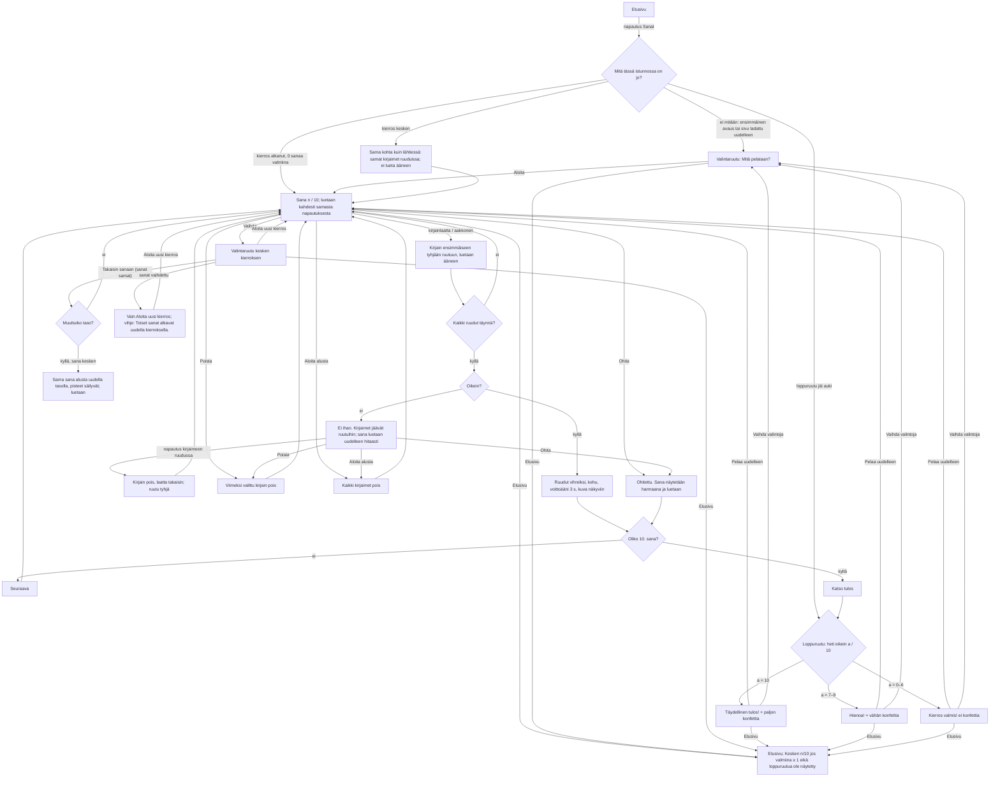

# SEI-3, SEI-7, SEI-8 — Sanat uudessa sovelluksessa

Designer, 2026-10-23. Kuvat jokaisesta tilasta kolmella laitteella:
`docs/design/sei-3.html`. Tämä dokumentti on rakentamisen lähde; HTML-sivu
näyttää saman omistajalle.

Rajaus: Sanaseikkailun koko nykyinen käyttö (SEI-3) SEI-1:n kehyksen sisällä,
väärän yrityksen korjaus, askelpalautin ja ohitus (SEI-7) sekä tulos, joka
kertoo myös virheet (SEI-8). Ei mitään D-osiosta: ei kirjainkohtaista
virhemerkintää (SEI-33), ei tavupaloja, ei uusia teemoja, ei pieniä kirjaimia,
ei tallennusta yli uudelleenlatauksen. Kehys (yläpalkki, Etusivu, Kuuntele,
Ei ääntä -ilmoitus, Kesken-merkki, painikkeiden tilat, värit, kirjasin) on
hyväksytty `docs/design/sei-1.md`:ssä eikä muutu ("SEI-1 §x"). Matikan
hyväksytyt ratkaisut (`docs/design/sei-2.md`, "SEI-2 §x") otetaan käyttöön
samoina, kun sama asia toistuu.

Lähde nykyiselle toiminnalle: `originals/sanaseikkailu.html`, rivinumerot
viittaavat siihen ("vanha r. n").

Omistajan päätökset, joita tämä noudattaa: tasot Helppo / Keskitaso / Vaikea
(Q21); vain nykyiset toiminnot ja korjaukset (Q5); pelaajat 1.–2.-luokkalaisia,
osa lukenut vasta vähän aikaa (Q1); kesken jäänyt kierros jatkuu (Q10); sana
luetaan kahdesti tauon kanssa laitteen parhaalla äänellä (SEI-45, Q16, Q22).

---

## 1. Palvelutaso

**Käyttäjä.** 1.–2.-luokkalainen. Osa lukee jo sujuvasti, osa vasta
äännellen. Peli on lukemisen ja kirjoittamisen harjoitus, joten lapsi ei voi
vielä luottaa tekstiin ohjeena: jokainen ohje on lyhyt, ja jokainen palaute
kuuluu myös ääneen. Aikuinen valitsee ehkä sanat ja tason ensimmäisellä
kerralla.

**Tehtävä.** "Kuulen (tai näen kuvana) sanan ja kokoan sen kirjaimista."
Kierros on 10 sanaa (vanha r. 396). Lapsi kokoaa sanan, kuulee jokaisen
kirjaimen, saa tietää onko sana oikein, korjaa tarvittaessa ja näkee lopuksi,
kuinka moni meni heti oikein.

**Missä matkalla.**
- *Ennen:* lapsi on etusivulla ja napauttaa Sanat-korttia (SEI-1 §3.1).
- *Aikana:* valitsee sanat, tason ja tavutuksen (ensimmäisellä kerralla),
  kokoaa 10 sanaa. Voi käydä etusivulla ja palata; kierros jatkuu (Q10).
- *Jälkeen:* loppuruutu kertoo, montako sanaa meni heti oikein, montako
  korjaamalla ja montako ohitettiin. Lapsi pelaa uudelleen, vaihtaa valintoja
  tai palaa etusivulle. Tulosta ei tallenneta (ei vanhassakaan).

**Jos tätä ei tehdä:** Sanat on uudessa sovelluksessa vain paikkamerkki, eikä
nykyistä julkaistua Sanaseikkailua (Apps Script) voi jättää pois käytöstä.
Lisäksi väärä yritys pyyhkii jatkossakin koko sanan, ja tulos on aina 10/10.

**Mitä jo noudatetaan (nykyiset mallit):**

| Malli | Missä nyt | Tässä |
|---|---|---|
| Kehys: yläpalkki, Etusivu, tilapaikka, pelikortti, kysymysrivi + Kuuntele | SEI-1 §3.2, `app/src/shell.js` | Tähdet tilapaikkaan, kuva ja vihje kysymysriville (`ctx.question`), muu pelialueelle (`ctx.root`). |
| Kuuntele-painike, teksti `Kuuntele sana` | SEI-1 §3.4, `registry.js` | Ei muutu. Pelin `listen()` päättää, mitä luetaan (kohta 3.8). |
| Kahdesti luettu sana tauon kanssa: `[{kissa, 0.78}, {kissa, 0.52, pauseMs: 700}]` | SEI-45, `registry.js` (Sanat-paikkamerkki), omistaja Q22 "parempi" | Täsmälleen sama jokaiselle sanalle. |
| Valintaruutu ennen kierrosta, `Aloita`; kesken kierroksen `Vaihda` → kaksi painiketta | SEI-2 §3.1, `matikka.js` | Sama rakenne: `Mitä pelataan?` (kohta 3.1). Ero Matikkaan: `Takaisin sanaan` ottaa tason ja tavutuksen muutoksen käyttöön (SEI-3 kriteeri 6 vaatii). |
| Tasokortit: pisteet ●○○, nimi, esimerkki, vastaustapa; valittu = reunus + tausta + valintamerkki | SEI-2 §3.1 (`.mk-level`) | Samat kortit, sisältönä sanapelin esimerkki. |
| Kytkinkortti: valintaruutu vasemmassa yläkulmassa, päällä = tausta + reunus + ✓ | SEI-2 §3.1 (`.mk-toggle`) | Tavutus. |
| Kirjainlaatta: valkoinen, tunnusvärinen kirjain, tunnusvärin tumma alavarjo | Etusivun Sanat-kortin `A B C` (`.tile`, SEI-1 §3.1) | Helpon ja Keskitason kirjainlaatat. |
| Neutraali näppäin: valkoinen, 3 px `#c9cbd6` reunus ja alavarjo, muste-teksti | Matikan numeronäppäin (`.mk-key`) | Vaikean aakkosnäppäimet ja `Poista`-näppäin (askelpalautinkuvake, sama SVG kuin Matikassa). |
| Pääpainike `.accent-btn` / toissijainen `.ok-btn` | SEI-1, SEI-2 | `Aloita`, `Seuraava`, `Katso tulos`, `Pelaa uudelleen` / `Takaisin sanaan`, `Aloita alusta`, `Ohita`, `Vaihda`, `Vaihda valintoja`. |
| Tietorivi `Pisteet: x / y` + 10-lohkoinen palkki | SEI-2 §3.2 | Sama ulkoasu, Sanojen laskutapa (kohta 3.2). |
| Palauteruutu ✓/✗ + 1–2 riviä, värit `#17803d` / `#c62828` | SEI-2 §3.2, §4 | Sama. |
| `Katso tulos` 10. jälkeen; loppuruutu pelikortissa kolmena versiona (10 / 7–9 / 0–6), konfetti 100 / 40 / 0 | SEI-2 §3.6 (SEI-6) | Sama rakenne, Sanojen luvut ja tekstit (kohta 3.7). |
| Tähdet yläpalkissa: SVG 28 px, tyhjät alussa | SEI-2 §3.0 | Sama, Sanojen kaava. |
| Kosketussuoja 500 ms ruudun vaihtuessa (`guarded`) | SEI-2 §3.8, `matikka.js` | Sama (kohta 3.9). |
| Oma näkymätön `aria-live`-alue `ctx.root`:ssa | SEI-2 §7 | Sama (kohta 7). |
| Kehut `Hienoa! 🌟` … `Bravo! 🎊` | vanha r. 393 | Säilyvät sellaisinaan. |
| Tavutusalgoritmi `syllabify` | vanha r. 409–446 | Säilyy sellaisenaan. |

---

## 2. Kulku

Polut, jotka eivät ole onnellisia:
- **Väärä sana** (KISTA, kun sana on KISSA): kirjaimet jäävät, lapsi
  napauttaa T:tä ruudussa, T palaa laattoihin, lapsi napauttaa S:ää, sana
  tarkistetaan uudelleen (SEI-7 kriteeri 1). Yrityksiä on rajattomasti, kuten
  vanhassa; `Ohita` on tie ulos.
- **Kirjain napautetaan, kun ruudut ovat täynnä** (väärän yrityksen jälkeen
  Vaikealla): mitään ei lisätä; ruuturivi ravistuu 0,5 s, palauteteksti pysyy.
- **`Poista` tai `Aloita alusta` tyhjillä ruuduilla:** ei tee mitään.
- **Ohita vahingossa:** sana näytetään ja lasketaan ohitetuksi; ei peruutusta
  (kohta 3.5).
- **Ääni puuttuu:** kehyksen ilmoitus (SEI-1 §3.4). Peli on pelattavissa
  loppuun; Helpolla kuva ja vihje kertovat sanan, Keskitasolla ja Vaikealla
  ilman ääntä sanaa ei voi tietää, joten `Ohita` on ainoa tie eteenpäin. Tämä
  on vanhan pelin raja eikä muutu (Keskitasolla ja Vaikealla sana on vain
  äänessä).
- **Voittoääni ei lataudu:** ei ilmoitusta (SEI-1 §3.6).
- **Sivu ladataan uudelleen:** valintaruutu oletuksilla (Normaali, Helppo,
  tavutus pois). Kierros katoaa (SEI-1 §2).
- **Etusivu kesken konfetin tai voittoäänen:** molemmat loppuvat heti.

---

## 3. Näkymät

Kolme ruutua samassa pelikortissa: **valintaruutu**, **sanaruutu** ja
**loppuruutu**. Ruudun vaihto ei lisää selaimen historiaan mitään (SEI-1 §3.0).

### 3.0 Tilapaikka yläpalkissa: tähdet

Täsmälleen SEI-2 §3.0:n ulkoasu (viisi SVG-tähteä, 28 px; < 420 px: 20 px).

- Täysien määrä = `round(heti oikein / valmiina × 5)`; `valmiina` = oikein
  saadut + ohitetut sanat. Ennen ensimmäistä valmista sanaa viisi tyhjää
  (vanha näytti viisi täyttä, ero E7).
- Valintaruudussa käynnissä olevan kierroksen tilanne; ilman kierrosta tyhjät.
- Loppuruudussa `round(heti oikein / 2)`.
- Ruudunlukija: `role="img"`, nimi `Tähdet: 3 / 5`.

### 3.1 Valintaruutu: "Mitä pelataan?"

**Milloin näkyy:** kun Sanat avataan eikä istunnossa ole kierrosta; `Vaihda`
sanaruudussa; `Vaihda valintoja` loppuruudussa.

**Sisältö ylhäältä alas:**

1. **Kysymysrivi:** h2 `Mitä pelataan?` (32 px lihava). Oikealla `Kuuntele sana`.
2. **Rivi, jossa kaksi ryhmää** (≥ 600 px rinnakkain; vasen 2/3, oikea 1/3):
   - Ryhmä `Sanat` (otsikko 22 px lihava), kaksi korttia, valitaan yksi:

     | Kortti | Kuvat (emoji, 30 px, `aria-hidden`) | Nimi (26 px lihava) | Sanalista |
     |---|---|---|---|
     | 1 | 🐱 🚗 🌳 | `Normaali` | 24 sanaa KISSA … TULI (vanha r. 341–366) |
     | 2 | 🪄 🦉 🧹 | `Harry Potter` | 20 sanaa JÄSTI … TAIKAJUOMA (vanha r. 368–389) |

   - Ryhmä `Tavutus`, yksi kytkinkortti: valintaruutu vasemmassa yläkulmassa,
     keskellä `KIS-SA` (30 px lihava, väliviiva `#8a8fa3`), alla tila-sana
     `pois` / `päällä` (20 px). Tila näkyy siis ruutuna, värinä ja sanana.
3. **Ryhmä `Taso`**, kolme korttia (SEI-2:n tasokortti):

   | Kortti | Merkki | Nimi | Esimerkki (rivi, 30 px) | Vastaustapa (20 px `#5b5f73`) |
   |---|---|---|---|---|
   | 1 | ●○○ | `Helppo` | 🐱 + minilaatat `S` `I` `K` | `Kuva + kirjaimet` |
   | 2 | ●●○ | `Keskitaso` | katkoviivaympyrä `?` + `S` `I` `K` | `Ääni + kirjaimet` |
   | 3 | ●●● | `Vaikea` | katkoviivaympyrä `?` + `A B C` | `Ääni + aakkoset` |

   Minilaatta 30 × 30 px, kirjain 20 px, sama tyyli kuin kirjainlaatta (3.3).
4. **Vihjerivi**, varattu 30 px, 20 px muste, `role="status"`. Säännöt alla.
5. **Painikkeet** (64 px):
   - Ei kierrosta (myös loppuruudusta tultaessa): pääpainike `Aloita`.
   - Kierros kesken: toissijainen `Takaisin sanaan` vasemmalla, pääpainike
     `Aloita uusi kierros` oikealla. Jos valittu sanalista on eri kuin
     kierroksen, `Takaisin sanaan` ei näy (vain `Aloita uusi kierros`).

**Säännöt:**
- Korttien napautus muuttaa vain valintaruudun luonnosta. Mitään ei aloiteta
  ennen painiketta (vanhassa kortti aloitti heti, r. 530–555; ero E1).
- Oletukset ensimmäisellä avauksella: `Normaali`, `Helppo`, tavutus pois
  (vanha r. 399–401). Luonnos muistetaan istunnon ajan.
- **Vihjerivi kesken kierroksen**, ensimmäinen sopiva:
  1. Sanalista eri kuin kierroksen: `Toiset sanat alkavat uudella kierroksella.`
  2. Taso eri kuin kierroksen ja nykyinen sana kesken: `Sama sana alkaa alusta uudella tasolla.`
  3. Muuten tyhjä.
  Ilman kierrosta vihjerivi on aina tyhjä.
- `Aloita` / `Aloita uusi kierros`: arvotaan 10 sanaa valitusta listasta
  ilman toistoa, pisteet ja tähdet nollautuvat,
  `reportProgress({done: 0, total: 10, finished: false})`, sana 1 luetaan
  samassa napautuksessa (kohta 3.8).
- **`Takaisin sanaan`** (SEI-3 kriteeri 6; ero Matikkaan, jossa vastaava
  painike hylkää muutokset):
  - Ottaa käyttöön valitun tason ja tavutuksen. Sanalista on sama (muuten
    painike ei näy).
  - Jos taso muuttui ja nykyinen sana on kesken: sama sana alkaa alusta
    uudella tasolla (ruudut tyhjiksi, laatat sekoitetaan uudelleen), sanan
    yrityslaskuri säilyy, pisteet säilyvät, sana luetaan samassa
    napautuksessa.
  - Jos taso muuttui ja nykyinen sana on jo valmis (oikein tai ohitettu):
    näkyy sama valmis tila; uusi taso alkaa seuraavasta sanasta. Ei lueta.
  - Jos vain tavutus muuttui: sama sana, **ruuduissa olevat kirjaimet
    säilyvät** (vanha tyhjensi, r. 448–451; ero E2), väliviivat lisätään tai
    poistetaan; jos sana on kesken, se luetaan uudella tavalla samassa
    napautuksessa (valmista sanaa ei lueta).
  - Jos mikään ei muuttunut: palaa täsmälleen samaan tilaan, ei lueta.

**Kuuntele valintaruudussa** (0,85): ilman kierrosta `Mitä pelataan? Valitse
sanat ja taso. Paina sitten Aloita.`; kesken kierroksen `Mitä pelataan? Valitse
sanat ja taso. Paina sitten Takaisin sanaan.` Ei lueta automaattisesti.

**Asettelu ja korkeus:**

| Leveys | Sanat + Tavutus | Tasot | Painikkeet |
|---|---|---|---|
| ≥ 600 px | yksi rivi: kaksi sanakorttia + tavutuskortti, kukin 1/3, korkeus 100 px | kolme rinnakkain, 128 px | rinnakkain, keskitetty |
| < 600 px | allekkain: sanakortit 72 px (kuvat vasemmalla, nimi oikealla), tavutuskortti 64 px (ruutu, `KIS-SA`, tila rinnakkain) | allekkain, 88 px (merkki ja nimi + vastaustapa vasemmalla, esimerkki oikealla) | allekkain koko leveydellä |

Tietokone (548 px pelille): kysymysrivi 56 + 20 + otsikko 28 + 8 + kortit 100 +
14 + otsikko 28 + 8 + tasot 128 + 8 + vihje 30 + 8 + painike 64 = 500 px.

**Tilat:** normaali; vihje näkyvissä; kesken kierroksen (kaksi painiketta);
sanalista vaihdettu kesken kierroksen (yksi painike + vihje). Tyhjä, lataus ja
virhe eivät ole mahdollisia (kiinteä sisältö).

### 3.2 Sanaruutu, yhteiset osat

Järjestys ylhäältä (sama kaikilla leveyksillä; vain koot muuttuvat, kohta
3.10): kysymysrivi, tietorivi, kirjainruudut, palauterivi, kirjaimet
(laatat tai aakkoset), alarivi.

**Kysymysrivi (`ctx.question`):** kuva vasemmalla, teksti sen oikealla,
Kuuntele oikeassa reunassa.

| Taso | Kuva (80 × 80 px; pysty 96) | Teksti (24 px, enintään 2 riviä) |
|---|---|---|
| Helppo | sanan emoji 60 px valkoisessa painikkeessa (pyöristys 20 px, 3 px `#c9cbd6` reunus ja alavarjo) | sanan vihje lihavana, esim. `Sanoo miau!` (vanha r. 342–389) |
| Keskitaso | katkoviivaympyrä (3 px `#8a8fa3`), sisällä `?` 44 px lihava `#5b5f73` | `Kuuntele sana ja rakenna se kirjaimista!` (vanha r. 571) |
| Vaikea | sama ympyrä | `Kuuntele sana ja kirjoita se itse!` (vanha r. 572) |
| Keskitaso / Vaikea, kun sana on valmis (oikein tai ohitettu) | emoji ilmestyy ympyrän paikalle painikkeeksi (vanha "appear" 0,45 s, r. 122) | vihje korvaa ohjeen (ero E14) |

- Näkyvä kuva on painike: napautus lukee sanan kuten Kuuntele (vanha r. 566,
  vain Helpolla; nyt aina kun kuva näkyy, ero E14).
- Piilotettu kuva (`?`) ei ole painike.

**Tietorivi** (korkeus 28 px): vasemmalla `Pisteet: 3 / 4` (22 px lihava) = heti oikein /
valmiina (ero E7). Ennen ensimmäistä valmista sanaa `Pisteet: 0 / 0`. Oikealla
10 lohkon palkki (SEI-2 §3.2); lohko täyttyy, kun sana on valmis (oikein tai
ohitettu), ei Seuraava-napautuksessa (vanha r. 772; ero E10).

**Kirjainruudut** (yksi ruutu kirjainta kohden, keskitettynä):

| Tila | Ulkoasu | Napautettava |
|---|---|---|
| Tyhjä | 56 × 64 px, valkoinen, 3 px katkoviiva `#8a8fa3`, pyöristys 12 px | ei |
| Seuraava paikka (ensimmäinen tyhjä) | 4 px katkoviiva tunnusväri, tausta `#faf7ff` (ero E12) | ei |
| Täytetty | tausta `#efe8fb`, 3 px tunnusvärinen reunus, alavarjo 4 px `#553578`, kirjain 36 px lihava tunnusväri | **kyllä**: poistaa tämän kirjaimen (kohta 3.4) |
| Väärä yritys | kuten täytetty; koko rivi ravistuu 0,5 s (vanha r. 694) | kyllä |
| Oikein | tausta `#e3f7ea`, 3 px `#17803d`, kirjain `#17803d`, ei varjoa; lyhyt pomppu (vanha "vilkkuvat vihreinä", r. 689) | ei |
| Ohitettu | tausta `#f1f2f5`, 3 px `#c9cbd6`, kirjain `#5b5f73`, ei varjoa | ei |

- Väliä 6 px. **Tavutus päällä:** tavujen väliin väliviiva `-` (32 px lihava
  `#8a8fa3`, 14 px leveä), kuten vanha (r. 610–627). Väliviiva ei ole ruutu.
- Kirjain menee aina **ensimmäiseen tyhjään ruutuun** vasemmalta. Ilman
  poistoja se on sama kuin vanha "loppuun".
- Ruudut eivät koskaan näytä, mikä kirjain on väärin (se on SEI-33, ehdotus).

**Palauterivi** (varattu 64 px): vasemmalla kuvake ja teksti, oikealla
pääpainike vain kun sana on valmis.

| Tila | Kuvake (32 px) | Rivi 1 | Rivi 2 | Painike oikealla |
|---|---|---|---|---|
| Ennen tarkistusta | – | – | – | – |
| Oikein | ✓ `#17803d` | satunnainen kehu (vanha r. 393), 30 px lihava `#17803d`, pomppu 0,5 s | – | `Seuraava` → (10. sanassa `Katso tulos`) |
| Väärin | ✗ `#c62828` | `Ei ihan.` 28 px lihava `#c62828` | `Napauta kirjainta, jonka haluat vaihtaa.` 22 px muste | – |
| Ohitettu | ohitusnuoli » `#5b5f73` | `Ohitettu.` 28 px lihava muste | `Sana on KISSA.` 22 px muste (sana isoin kirjaimin) | `Seuraava` → / `Katso tulos` |

- Väärin-teksti jää näkyviin, kunnes sana tarkistetaan uudelleen, ohitetaan
  tai `Aloita alusta` painetaan.
- `Seuraava` / `Katso tulos`: pääpainike 64 px, vähintään 240 px, nuoli
  oikealla. Kun se tulee näkyviin, fokus siirtyy siihen.
- Vanha satunnainen virhelista (`Melkein! Kokeile vielä!` ym., r. 394) poistuu:
  "Melkein" väittää läheisyyttä, jota ei tarkisteta (ero E6).

**Alarivi:**
- Vasemmalla kaksi toissijaista painiketta (56 px), näkyvissä vain kun sana
  on kesken (valmiissa sanassa `visibility: hidden`, ettei rivi hypi):
  - `Aloita alusta` + kiertonuolikuvake (vanha r. 315, sama teksti): tyhjentää
    kaikki ruudut, laatat palaavat, palauteteksti poistuu. Tyhjillä
    ruuduilla ei tee mitään.
  - `Ohita` + ohitusnuoli (uusi, SEI-7 kriteeri 3; kohta 3.5).
  Väli painikkeiden välillä 16 px.
- Oikeassa reunassa toissijainen `Vaihda` (56 px) → valintaruutu kesken
  kierroksen -muodossa. Ei vahvistuskysymystä (mitään ei menetä).
- **Valintariviä ei ole sanaruudussa** (ero Matikkaan, ero E22). Taso näkyy
  ruudusta itsestään (kuva tai `?`, laatat tai aakkoset), tavutus väliviivoista
  ja sanalista sanoista; `Harry Potter · Keskitaso · Tavutus` ei mahtuisi
  alariville kolmen painikkeen viereen tietokoneen leveydellä. Ruudunlukija saa
  valinnat `Vaihda`-painikkeen nimestä (kohta 7). Loppuruudussa valintarivi
  näkyy (kohta 3.7).

### 3.3 Helppo ja Keskitaso: kirjainlaatat

- Laatat = sanan kirjaimet sekoitettuina (vanha r. 631–643). Sekoitus on
  tasajakoinen (Fisher–Yates, `rng`-parametri kuten `matikka-logic.js`), ja
  **jos sekoitus tuottaa sanan oikeassa järjestyksessä, sekoitetaan
  uudelleen** (enintään 20 kertaa; sanalle, jonka kaikki kirjaimet ovat samat,
  ei ole järjestystä, mutta listoilla ei sellaista ole). Vanha saattoi antaa
  sanan PUU valmiiksi oikeassa järjestyksessä joka kuudes kerta tai useammin
  (ero E13).
- Laatta 64 × 64 px (pysty 72), valkoinen, 3 px tunnusvärinen reunus,
  kirjain 36 px lihava tunnusväri, alavarjo 4 px `#553578`, väli 8 px.
  Kaikki samanvärisiä (vanhat kahdeksan väriä, r. 170–177, valkoisella
  tekstillä huonosti luettavia; ero E11).
- **Käytetty laatta** jää paikalleen tyhjänä katkoviivakehyksenä (3 px
  `#c9cbd6`, ei kirjainta, ei varjoa), `disabled`. Vanha näytti haalistuneen
  kirjaimen (r. 167; ero E11). Kirjain on nyt ruudussa ylempänä.
- **`Poista`-näppäin** laattarivin lopussa, 16 px välin jälkeen: valkoinen,
  3 px `#c9cbd6`, askelpalautinkuvake 34 px muste, sama koko kuin laatta.
  Poistaa viimeksi valitun kirjaimen; sen laatta palaa (SEI-7 kriteeri 2).
- Napautus laattaan: laatta tyhjenee, kirjain ensimmäiseen tyhjään ruutuun,
  kirjain luetaan (vanha r. 650). Kun viimeinen ruutu täyttyy, sana
  tarkistetaan samassa napautuksessa (vanha r. 651).

### 3.4 Vaikea: aakkoset

- 29 kirjainta vanhassa järjestyksessä `A`…`Z`, `Å`, `Ä`, `Ö` (vanha r. 391) +
  `Poista` viimeisenä = 30 näppäintä, 3 riviä × 10 (≥ 600 px).
- Näppäin 1/10 leveydestä (noin 64 px) × 56 px (pysty 64), väli 8 px;
  Matikan näppäimen ulkoasu, kirjain 28 px lihava muste. `Poista` kuten
  Helpolla.
- Napautus: kirjain ensimmäiseen tyhjään ruutuun ja luetaan; näppäin ei
  kulu (sama kirjain voidaan valita monta kertaa, esim. KISSA).
- Kun kaikki ruudut ovat täynnä (väärän yrityksen jälkeen), kirjainnäppäin ei
  lisää mitään; ruuturivi ravistuu 0,5 s.

**Kirjaimen poisto (SEI-7 kriteerit 1 ja 2), kaikilla tasoilla:**
- **Napautus täytettyyn ruutuun** poistaa sen kirjaimen; ruutu tyhjenee ja
  muuttuu "seuraava paikka" -ruuduksi, jos se on ensimmäinen tyhjä. Helpolla ja
  Keskitasolla juuri se laatta palaa (sama paikka laattarivissä). Muut kirjaimet
  pysyvät paikoillaan. Näin KISTA → napautus T → KIS_A → napautus S-laatta →
  KISSA → tarkistus (kriteeri 1).
- **`Poista`** poistaa viimeksi valitun kirjaimen (valintajärjestys, ei
  sijainti). Ilman ruutunapautuksia se on oikeanpuoleisin. Toistuvat
  painallukset poistavat valinnat käänteisessä järjestyksessä.
- Poisto ei puhu eikä keskeytä käynnissä olevaa puhetta.
- Poistot eivät ole yrityksiä; yritys on vain tarkistus täydellä sanalla.

### 3.5 Ohita (SEI-7 kriteeri 3)

- `Ohita` alarivillä aina kun sana on kesken, myös ennen ensimmäistä
  kirjainta ja väärien yritysten jälkeen.
- Napautus: sana merkitään **ohitetuksi** (ei oikeaksi, vaikka olisi ollut
  yrityksiä), ruutuihin tulee oikea sana ohitettu-tyylillä (harmaa), kaikki
  laatat palaavat kirjaimineen paikoilleen ja lukittuvat aakkosten tavoin
  (`disabled`, 45 % läpinäkyvyys), Keskitasolla ja
  Vaikealla kuva ja vihje tulevat näkyviin, palauterivi `Ohitettu.` / `Sana on
  KISSA.`, ja ääneen `Sana on kissa.` (0,8). Palkki ja Kesken-luku kasvavat
  heti. Voittoääntä ei soiteta.
- Seuraava sana tulee `Seuraava`-napautuksesta. Tämä on yksi napautus enemmän
  kuin kriteerin sanamuoto ("seuraava sana tulee"): lapsi näkee ja kuulee
  ohittamansa sanan, ja vahingossa painettu Ohita ei vie sanaa näkemättä
  (ero E5; omistajan kysymys, kohta 11).
- Ei vahvistuskysymystä eikä peruutusta.

### 3.6 Oikein ja väärin

**Oikein** (viimeinen kirjain tekee sanasta oikean):
- Ruudut oikein-tilaan, kehu palauteriville, `Seuraava` / `Katso tulos`.
- Keskitasolla ja Vaikealla kuva ja vihje näkyviin (vanha r. 739–745).
- Laatat / aakkoset lukittuvat; `Aloita alusta` ja `Ohita` piiloon.
- Voittoääni `vauhti.mp3` alusta, voimakkuus 0,8, pysäytetään 3 s:n jälkeen
  (vanha r. 718–729). Tiedosto toimitetaan sovelluksen mukana
  `app/assets/vauhti.mp3` (vanha haki Drivesta Apps Scriptin kautta, r.
  812–825; ero E16). `play()` kutsutaan samassa napautuksessa `say`-kutsun
  jälkeen.
- Sana lasketaan **heti oikein**, jos sillä ei ollut yhtään väärää
  tarkistusta; muuten **oikein uudella yrityksellä**.

**Väärin** (viimeinen kirjain, sana ei täsmää):
- Kirjaimet **jäävät** ruutuihin (vanha tyhjensi 0,9 s:n päästä, r. 697; ero
  E3), rivi ravistuu, palauterivi `Ei ihan.` / `Napauta kirjainta, jonka haluat
  vaihtaa.`, sanan yrityslaskuri +1.
- Ääneen samassa napautuksessa: viimeinen kirjain, `Ei ihan.` ja sana hitaasti
  (kohta 3.8). Vanha ei lukenut mitään (ero E6).
- Fokus (näppäimistöllä) ensimmäiseen täytettyyn ruutuun.

### 3.7 Loppuruutu (SEI-8)

Näkyy `Katso tulos` -napautuksesta pelikortissa (vanha: tumma peite 1,5 s
viiveellä, r. 747–748; ero E8, E9). Kysymysrivillä otsikko 40 px, Kuuntele
oikealla.

Merkinnät: **a** = heti oikein, **b** = oikein uudella yrityksellä, **c** =
ohitettu; a + b + c = 10.

| | a = 10 | a = 7–9 | a = 0–6 |
|---|---|---|---|
| Otsikko | `Täydellinen tulos!` | `Hienoa!` | `Kierros valmis!` |
| Kuva (120 px ympyrä; SEI-2 §3.6) | keltainen, tähti | violetti `#764ba2`, valkoinen ✓ | vaaleansininen, ylös osoittava nuoli |
| Iso tulos (64 px lihava) | `10 / 10` | `8 / 10` | `4 / 10` |
| Erittely (24 px, kuvake 32 px ympyrässä) | `✓ 10 sanaa heti oikein` | ks. alla | ks. alla |
| Tähdet (40 px) | 5 | `round(a / 2)` | `round(a / 2)` |
| Kolmas rivi (26 px) | `Olet tosi hyvä lukija!` (vanha r. 334) | `Hyvää työtä!` | `Harjoittelemalla oppii!` (vanha r. 394) |
| Tausta | `#fff4d6` | `#efe8fb` | valkoinen |
| Konfetti | 100 palaa, 3,5 s | 40 palaa, 3 s | ei |

**Erittely**, rivit tässä järjestyksessä; a-rivi aina, b- ja c-rivi vain kun
luku ≥ 1:
- ✓ (vihreä ympyrä) `{a} sanaa heti oikein`
- ↻ (violetti ympyrä) `{b} sanaa oikein uudella yrityksellä`
- » (harmaa ympyrä `#5b5f73`) `{c} sanaa ohitettu`

Luvulla 1 `sana`, muilla (myös 0) `sanaa`: `1 sana heti oikein`,
`0 sanaa heti oikein`.

**Ääneen** `Katso tulos` -napautuksesta ja Kuuntelesta (0,85). Luvut
numeroina, ei taivutettuina (puhe sanoisi "yksi sanan"):
- a = 10: `Täydellinen tulos! Kaikki 10 sanaa heti oikein. Olet tosi hyvä lukija!`
- muuten: otsikko (huutomerkki pisteeksi kun a ≤ 6), sitten
  `Heti oikein {a}.` (jätetään pois, jos a = 0), ` Uudella yrityksellä {b}.`
  (jos b ≥ 1), ` Ohitettu {c}.` (jos c ≥ 1), sitten kolmas rivi.
  Esim. `Hienoa! Heti oikein 8. Uudella yrityksellä 1. Ohitettu 1. Hyvää työtä!`

**Esimerkit SEI-8:n kriteereistä:**
- Kriteeri 1 (yksi sana kahden väärän jälkeen, muut heti): `9 / 10`, `9 sanaa
  heti oikein`, `1 sana oikein uudella yrityksellä`, `Hienoa!`.
- Kriteeri 2 (3 ohitettu, 7 heti): `7 / 10`, `7 sanaa heti oikein`, `3 sanaa
  ohitettu`.
- Kriteeri 3 (kaikki heti): `10 / 10`, `Täydellinen tulos!`, eri kuva, tausta,
  otsikko ja konfettimäärä kuin kriteerin 1 tuloksessa.

**Painikkeet:** pääpainike `Pelaa uudelleen` (samat valinnat, uusi kierros,
sana 1 luetaan; vanha r. 335) ja toissijainen `Vaihda valintoja`
(valintaruutu). Niiden alla valintarivi 20 px harmaa.

`reportProgress({done: 10, total: 10, finished: true})` loppuruudun
ilmestyessä. Konfetti kuten Matikka (ei estä napautuksia, poistuu, "vähennä
liikettä" → ei konfettia). Palatessa etusivulta sama loppuruutu ilman
konfettia ja ääntä.

**Asettelu:** ≥ 900 px tulosalue kahtena sarakkeena (vasemmalla kuva ja
tähdet, oikealla iso tulos, erittely ja kolmas rivi), jotta ruutu mahtuu
tietokoneen 548 px:iin: kysymysrivi 56 + 16 + tulosalue 280 + 16 + painikkeet
64 + 12 + valintarivi 24 = 468 px. < 900 px yksi sarake keskitettynä.
Painikkeet rinnakkain ≥ 600 px, allekkain < 600 px.

### 3.8 Mitä luetaan ääneen ja milloin

Kaikki luenta käynnistyy siinä napautuksessa, joka sen aiheuttaa (SEI-1
§3.5); osat välitetään yhtenä `ctx.speech.say([...])`-kutsuna. Teksti
pienillä kirjaimilla (vanha r. 489). Tauot ovat `pauseMs` myöhemmässä osassa.

**Sanan luenta** ("lue sana"):
- Tavutus pois: `[{sana, 0.78}, {sana, 0.52, pauseMs: 700}]` (SEI-45; vanha
  0,38 s tauko, r. 505–510).
- Tavutus päällä: `[{sana, 0.78}, {tavu1, 0.62, pauseMs: 700}, {tavu2, 0.62,
  pauseMs: 400}, …]` (vanha 0,4 s ja 0,22 s, r. 494–502, 517; tauot
  pidennetty samasta syystä kuin SEI-45:ssä, ero E15). Yksitavuinen sana (PUU,
  KUU): `[{puu, 0.78}, {puu, 0.62, pauseMs: 700}]`. Pisin, TAIKAJUOMA
  tavutettuna, noin 5 s, alle kehyksen 12 s:n rajan.

| Tapahtuma | Mitä | Vanha |
|---|---|---|
| Uusi sana näkyviin (`Aloita`, `Seuraava`, `Pelaa uudelleen`, `Aloita uusi kierros`) | lue sana | r. 592, 550 ms viiveellä |
| `Takaisin sanaan`, kun taso tai tavutus muuttui ja sana on kesken | lue sana | r. 554, 450 |
| Korttinapautus, kierros alkanut, 0 valmiina, sana kesken (`autoRead`) | lue sana | |
| Kuuntele sanaruudussa (myös valmiissa sanassa) ja näkyvän kuvan napautus | lue sana | r. 302, 566 |
| Kirjain valittu | `[{kirjain, 0.9}]` | r. 521–523 |
| Viimeinen kirjain, oikein | `[{kirjain, 0.9}]` + voittoääni | r. 650, 734 |
| Viimeinen kirjain, väärin | `[{kirjain, 0.9}, {'Ei ihan.', 0.85, pauseMs: 300}, {sana, 0.52, pauseMs: 700}]` | ei mitään (ero E6) |
| Ohita | `[{'Sana on ' + sana + '.', 0.8}]` | ei ollut |
| Poisto, `Aloita alusta` | ei mitään | |
| Valintaruudun Kuuntele | kohta 3.1 | ei ollut |
| `Katso tulos`, loppuruudun Kuuntele | kohta 3.7 | r. 802, aina sama |
| Paluu kesken jääneeseen, valintaruudun avaus | ei mitään | |

`pitch` ei ole käytössä (`speech.js` ei tue; vanha 1,05).

### 3.9 Nopeat napautukset

- **Ruudun vaihtuessa** (valinta → sana, sana → loppu, loppu → sana, sana →
  valinta) uuden ruudun painikkeet eivät reagoi 500 ms (Matikan `guarded`).
  Kuuntele ja Etusivu eivät kuulu tähän.
- `Seuraava` on palauterivillä ja `Ohita` alarivillä, eri kohdissa kaikissa
  asetteluissa: Seuraavan kaksoisnapautus ei osu Ohitaan.
- Laattojen ja aakkosten nopeat napautukset ovat sallittuja (sama kirjain
  kahdesti, esim. KISSA); niissä ei ole viivettä. Kaksoisnapautuszoomaus
  estetään (SEI-1 §3.3).
- Viimeisen kirjaimen kaksoisnapautus: toinen osuu käytettyyn laattaan
  (`disabled`) tai täyteen sanaan (ei lisää mitään).

### 3.10 Asettelut

Yksi sarake kaikilla leveyksillä, sama järjestys. Koot:

| | iPad pysty (724 × 958) | iPad vaaka (712 × 598) ja tietokone (712 × 548) | < 600 px | < 420 px |
|---|---|---|---|---|
| Kuva | 96 px, emoji 72 | 80 px, emoji 60 | 72 px, emoji 54 | 64 px; Kuuntele kysymyksen alle (SEI-1 §3.2) |
| Ruutu | 60 × 72, kirjain 40 | 56 × 64, kirjain 36 | 44 × 56, kirjain 30, rivittyy | sama |
| Laatta | 72 × 72 | 64 × 64 | (leveys − 32) / 5, korkeus 56, rivittyy 5 riviin | sama |
| Aakkoset | 10 saraketta, korkeus 64 | 10 saraketta, korkeus 56 | 5 saraketta, korkeus 52 (6 riviä) | sama |
| Väli osien välillä | 16 | 12 | 12 | 12 |
| Alarivi | yksi rivi | yksi rivi | `Aloita alusta`, `Ohita`, `Vaihda` allekkain koko leveydellä (puolikkaaseen `Aloita alusta` ei mahdu 22 px:llä) | sama |
| Palauterivi | yksi rivi | yksi rivi | teksti, sen alla `Seuraava` koko leveydellä | sama |

**Korkeus, pahin tapaus** (Vaikea, TAIKASAUVA tavutettuna, tietokone 548 px):
kysymysrivi 80 + 16 + tietorivi 28 (korkeus kiinnitetty) + 12 + ruudut 64 + 12
+ palauterivi 64 + 12 + aakkoset 184 + 12 + alarivi 56 = 540 px. Mahtuu, 8 px
varaa. **Jos se ei mahdu** (kirjasimen rivikorkeus vaihtelee laitteittain),
ensimmäisenä pienennetään aakkosnäppäimen korkeus 56 → 52 px (säästää 12 px);
vasta sitten pelialue saa vierittyä. Kun Ei ääntä -ilmoitus on näkyvissä,
pelialue vierittyy pystysuunnassa (SEI-1 §3.2 sallii).

**Leveys, pahin tapaus** (10 kirjainta + 3 väliviivaa): 10 × 56 + 3 × 14 + 12
väliä × 6 = 674 px ≤ 712. Pysty: 10 × 60 + 42 + 72 = 714 ≤ 724.

**< 600 px:** ruudut rivittyvät; **tavutus päällä rivitys tapahtuu vain
tavurajalla** (tavu on yksi rivittymätön ryhmä), muuten mistä tahansa.
320 px:n leveydellä (sisältö 264 px) mahtuu 5 ruutua riville.

---

## 4. Ilme

Värit, kirjasin ja painikkeiden tilat SEI-1 §4 ja SEI-2 §4. Lisäykset:

| Nimi | Arvo | Käyttö | Kontrasti |
|---|---|---|---|
| Tunnusväri | `#764ba2`, tumma `#553578`, vaalea `#efe8fb` | laatat, täytetyt ruudut, yläpalkki | `#764ba2` valkoisella 6,4 : 1; vaalealla 5,4 : 1 |
| Seuraava paikka | 4 px katkoviiva `#764ba2`, tausta `#faf7ff` | ensimmäinen tyhjä ruutu | ei tekstiä; reunus 6,2 : 1 |
| Oikein | `#17803d` vaalealla `#e3f7ea` | oikein-ruudut | 4,5 : 1 (36 px lihava = suuri teksti, raja 3 : 1) |
| Ohitettu | `#5b5f73` taustalla `#f1f2f5` | ohitetun sanan kirjaimet | 5,8 : 1 |
| Väärin | `#c62828` | `Ei ihan.`, ✗ | valkoisella 5,6 : 1 (vanha `#f44336` 3,7 : 1; ero E24) |
| Kehu | `#17803d` | kehuteksti | 5,0 : 1 (vanha `#4CAF50` 2,8 : 1; ero E24) |

Liike: kuvan ilmestyminen 0,45 s, kehun ja oikein-ruutujen pomppu 0,5 s,
ravistus 0,5 s, konfetti. Kaikki pois, jos "vähennä liikettä"; tila näkyy
silti väreistä, kuvakkeista ja tekstistä.

---

## 5. Data: mitä on, mitä ei

Kaikki on pelin muistissa; mitään ei haeta verkosta eikä tallenneta.

| Tarvitaan | Onko | Lähde / huomio |
|---|---|---|
| Sanalistat, emojit, vihjeet | Kyllä | Vanha r. 341–389 sellaisenaan (24 + 20). Molemmissa ≥ 10 sanaa, joten 10 sanan kierros on aina mahdollinen ilman toistoa. Pisimmät 10 kirjainta (TAIKASAUVA, VIISTOKUJA, LOHIKÄÄRME, TAIKAJUOMA), lyhyimmät 3 (PUU, KUU). |
| Aakkoset | Kyllä | Vanha r. 391. Å ei esiinny yhdessäkään sanassa; se säilyy, koska se on vanhassa. |
| Tavutus | Kyllä | `syllabify` r. 409–446 sellaisenaan; testataan ainakin KISSA → KIS-SA, AUTO → AU-TO, TAIKASAUVA → TAI-KA-SAU-VA, LOHIKÄÄRME → LO-HI-KÄÄR-ME, PUU → PUU, KAMMIO → KAM-MI-O. |
| Voittoääni | Kyllä | `originals/vauhti.mp3` kopioidaan `app/assets/vauhti.mp3` (registryn sääntö 5). `scripts/serve.mjs` palvelee `.mp3`:n jo `audio/mpeg`-tyyppinä. |
| Kierros: lista, taso, tavutus, 10 sanaa, sanan numero | Kyllä | `theme`, `difficulty`, `tavutus`, `deck`, `qIndex` (r. 399–403). |
| Sanan sisällä: mikä kirjain missä ruudussa, mistä laatasta, valintajärjestys | **Osittain** | Vanha piti vain merkkijonon `builtWord` (r. 406), joten keskeltä poisto ja `Poista` eivät olleet mahdollisia. Uusi tila sanaa kohden: `ruudut[i] = {kirjain, laatta-id | null}`, `valinnat = [ruutuindeksi, …]` (pino `Poista`-painiketta varten), laattojen järjestys. |
| Sanan yritykset ja lopputulos | **Ei vanhassa** | Uusi: `vääriä: 0…`, `tulos: kesken | heti | uudella | ohitettu`. Kierroksen a, b, c lasketaan näistä. Vanha `score` / `answered` kasvoivat vain oikeasta (r. 733–734), siksi aina 10/10. |
| Kesken-merkki | Kyllä | `reportProgress({done: a + b + c, total: 10, finished})`; kasvaa kun sana on valmis (oikein tai ohitettu), ei Seuraavassa ja ei väärästä yrityksestä. |
| Valintaruudun luonnos | **Ei vanhassa** | Uusi: `{theme, difficulty, tavutus}` luonnoksena; otetaan käyttöön painikkeesta. |
| Missä ruudussa ollaan | **Ei vanhassa** | `valinta | sana | loppu`. |
| Emojien näkyminen | Ei tiedossa | 🫕 (PATA) ja 🪄 (TAIKASAUVA) ovat Unicode 13 -emojeita (iPadOS 14.2+). Vanhemmassa laitteessa ne voivat näkyä tyhjänä laatikkona; vihje näkyy silti. Ei tarkistettu. |
| Soiko voittoääni ja puhe yhtä aikaa iPadilla | Ei tiedossa | Vanha soitti molemmat yhtä aikaa. iPadin Safarissa äänitiedoston aloitus voi keskeyttää tai vaimentaa puheen. Ei tarkistettu; tarkistetaan iPadilla kehyksen muiden iPad-kohtien kanssa. |
| Tulokset yli uudelleenlatauksen | Ei | Ei vanhassakaan; profiilien kanssa (SEI-11), ei nyt. |

---

## 6. Reunat

- **3-kirjaiminen sana (PUU):** 3 ruutua, 3 laattaa (P, U, U). Sekoitus ei
  koskaan anna PUU-järjestystä (kohta 3.3). Tavutus: yksi tavu, ei väliviivaa.
- **10-kirjaiminen sana tavutettuna:** mahtuu (kohta 3.10). < 600 px rivittyy
  tavurajalta, esim. `TAI-KA-` / `SAU-VA`.
- **Samat kirjaimet** (KISSA: S, S; TAIKASAUVA: A × 4): laatat ovat erillisiä;
  ruutunapautus palauttaa juuri sen laatan, josta kirjain tuli. Tarkistus
  vertaa merkkijonoja, joten kumpi S tahansa käy.
- **Pisin vihje** `Taikuutta osaava nainen` (23 merkkiä): noin 280 px 24 px:llä;
  mahtuu yhdelle riville tietokoneella, rivittyy kahdelle < 600 px.
- **Kaikki ohitettu:** `0 / 10`, `0 sanaa heti oikein`, `10 sanaa ohitettu`,
  `Kierros valmis!`, tähdet tyhjät. Ääneen `Kierros valmis. Ohitettu 10.
  Harjoittelemalla oppii!`
- **Kaikki korjattu:** `0 / 10`, `0 sanaa heti oikein`, `10 sanaa oikein
  uudella yrityksellä`.
- **Sama sana 20 väärää yritystä:** ei rajaa, ei näytetä yrityslukua; lasketaan
  "uudella yrityksellä".
- **Taso vaihdetaan väärän yrityksen jälkeen:** sana alkaa alusta uudella
  tasolla, mutta yrityslaskuri säilyy, joten sana ei voi enää olla "heti
  oikein". Tason vaihto ei ole keino ohittaa virhettä.
- **Taso vaihdetaan, kun sana on jo valmis:** kohta 3.1 (seuraavasta sanasta).
- **Ohita 10. sanassa:** palauterivi `Ohitettu.` + `Katso tulos`.
- **10. sana valmis, Katso tulos painamatta, etusivulle:** `Kesken 10/10`;
  palatessa sama palaute ja `Katso tulos` (sama kuin Matikka).
- **Kierros alkanut, 0 valmiina, mutta kirjaimia ruuduissa, etusivulle:** ei
  Kesken-merkkiä (valmiina 0); korttinapautus lukee sanan, ja ruuduissa olevat
  kirjaimet säilyvät.
- **Ei ääntä, Keskitaso tai Vaikea:** sanaa ei voi tietää; Ohita toimii.
  Kehyksen ilmoitus kertoo aikuiselle syyn.
- **Kaikki kirjaimet poistettu `Poista`-painikkeella väärän yrityksen jälkeen:**
  palauteteksti `Ei ihan.` jää näkyviin, kunnes sana tarkistetaan uudelleen
  tai `Aloita alusta` painetaan. `Aloita alusta` poistaa sen heti.
- **Negatiivisia tai tyhjiä lukuja ei ole:** a, b, c ≥ 0 ja summa aina 10
  loppuruudussa; kesken kierroksen valmiina 0–10.

---

## 7. Saavutettavuus

**Näppäimistöpolku, valintaruutu:** Etusivu → (Selvä) → Kuuntele → Normaali →
Harry Potter → Tavutus → Helppo → Keskitaso → Vaikea → (Takaisin sanaan) →
Aloita / Aloita uusi kierros.
- Sanat ja Taso: kumpikin `role="radiogroup"` (nimet `Sanat`, `Taso`),
  kortit `role="radio"` + `aria-checked`.
- Tavutus: `button` + `aria-pressed`, nimi `Tavutus`.
- Vihjerivi `role="status"`.

**Näppäimistöpolku, sanaruutu:** Etusivu → (Selvä) → Kuuntele → kuva (kun
painike) → täytetyt ruudut vasemmalta → (Seuraava / Katso tulos, kun näkyy) →
laatat / aakkoset → Poista → Aloita alusta → Ohita → Vaihda. Enter ja
välilyönti painavat painiketta (selaimen oma). Kirjainnäppäimiä ei käsitellä
(vanhakaan ei käsitellyt; ks. kohta 9).

**Fokus:**
- Uusi sana (Aloita, Seuraava, Pelaa uudelleen, Takaisin sanaan): sanaruudun
  kuvaan, tai piilotetulla kuvalla kysymystekstiin (`tabindex="-1"`).
- Laatta valittu näppäimistöllä: seuraava vapaa laatta oikealle, muuten
  ensimmäinen vapaa; jos ei vapaita, ensimmäiseen täytettyyn ruutuun.
  Aakkosnäppäin pitää fokuksen.
- Ruudun kirjain poistettu: Helpolla ja Keskitasolla palautuneeseen laattaan,
  Vaikealla näppäimeen `A`.
- Väärä yritys: ensimmäiseen täytettyyn ruutuun.
- Oikein / Ohita: `Seuraava`- tai `Katso tulos` -painikkeeseen.
- Valintaruutu ja loppuruutu: otsikkoon (`tabindex="-1"`).

**Ruudunlukija** (pelin oma `aria-live="polite"`, kerran tapahtumaa kohden):

| Tapahtuma | Luetaan |
|---|---|
| Uusi sana | `Sana 3 / 10. 5 kirjainta.` + Helpolla `Vihje: Sanoo miau!` |
| Kirjain valittu | `K. 1 / 5.` |
| Kirjain poistettu | `T poistettu. 4 / 5.` |
| Väärin | `Ei ihan. Sinun sanasi K I S T A. Napauta kirjainta, jonka haluat vaihtaa.` |
| Oikein | `Oikein! KISSA. Pisteet 4 / 5.` |
| Ohitettu | `Ohitettu. Sana on KISSA. Pisteet 3 / 5.` |
| Loppuruutu | otsikko + `8 / 10 heti oikein. 1 uudella yrityksellä. 1 ohitettu.` + kolmas rivi |

| Elementti | Nimi |
|---|---|
| Kuva (painike) | `Kuva. Kuuntele sana.` (emoji `aria-hidden`; nimi ei kerro sanaa) |
| Piilotettu kuva | `aria-hidden` |
| Ruuturyhmä | `role="group"`, `Sanasi, 5 kirjainta` |
| Täytetty ruutu | `Kirjain 4: T. Poista.` |
| Tyhjä ruutu | ei fokusoitava; ryhmän nimi kertoo pituuden |
| Ruutu valmiissa sanassa | `Kirjain 4: S, oikein` / `Kirjain 4: S, ohitettu` |
| Laatta | `K`; käytetty: `disabled`, `K, käytetty` |
| Poista | `Poista viimeisin kirjain` |
| Aloita alusta | `Aloita sana alusta` |
| Ohita | `Ohita sana` |
| Seuraava | `Seuraava sana` |
| Vaihda | `Vaihda sanoja, tasoa ja tavutusta. Nyt Normaali, Helppo, tavutus pois.` |
| Loppuruudun valintarivi | `Sanat Normaali. Taso Helppo. Tavutus päällä.` |
| Palkki | `role="img"`, `4 sanaa 10:stä tehty` |
| Tähdet | `Tähdet: 3 / 5` |
| Väliviiva | `aria-hidden` |
| Konfetti, emojit, ✓ ✗ ↻ » | `aria-hidden` |

**Väri ei ole ainoa tieto:** seuraava paikka on myös katkoviivan paksuus;
täytetty ruutu on myös kirjain ja varjo; oikein = ✓ + kehuteksti; väärin = ✗
+ teksti; ohitettu = » + `Ohitettu.`; valittu kortti = valintamerkki; tavutus =
ruutu + sana `päällä`; loppuruudun versiot = otsikko, kuva ja teksti.

**Koot:** pienin kohde < 600 px: ruutu 44 × 56 ja laatta noin 46 × 56; muuten
≥ 56 px. Väli ≥ 6 px ruuduissa (ruudut ovat poistokohteita, 6 px riittää 44 pt
-alarajan rinnalla), ≥ 8 px laatoissa ja näppäimissä.

---

## 8. Erot vanhaan peliin

Mikään vanhan pelin toiminto ei puutu (taulukko HTML-sivun kohdassa 11).

| # | Ero | Miksi |
|---|---|---|
| E1 | Sanat, taso ja tavutus valitaan omalla ruudullaan (`Mitä pelataan?`), joka tulee ensimmäisellä avauksella ja `Vaihda`-painikkeesta. Uusi kierros alkaa `Aloita`-napautuksesta. Tason vaihto kesken: `Takaisin sanaan` → sama sana alusta, pisteet säilyvät. Sanalistan vaihto vaatii `Aloita uusi kierros`. | Sama kuin Matikassa (hyväksytty E1): kierros säilyy etusivukäynnin yli, joten sen ei pidä kadota yhdellä napautuksella; tila tarvitaan sanalle. |
| E2 | Tavutuksen kytkeminen ei tyhjennä ruutuihin valittuja kirjaimia. | Vanha tyhjensi sanan (r. 448–451). |
| E3 | Väärän yrityksen jälkeen kirjaimet jäävät ruutuihin; ruudun kirjainta napauttamalla sen voi poistaa ja vaihtaa. | SEI-7 kriteeri 1. Vanha tyhjensi koko sanan 0,9 s:n päästä. |
| E4 | `Poista`-näppäin (askelpalautin) kaikilla tasoilla. | SEI-7 kriteeri 2. Vanhassa ei ollut askelpalautinta millään tasolla, vain `Aloita alusta`. |
| E5 | `Ohita`: sana näytetään harmaana ja luetaan, sitten `Seuraava`. Lasketaan ohitetuksi. | SEI-7 kriteeri 3. Lapsi näkee ohittamansa sanan. |
| E6 | Väärä yritys: `Ei ihan.` / `Napauta kirjainta, jonka haluat vaihtaa.`, myös ääneen sanan kanssa. Vanha satunnainen lista poistuu. | Vanha "Melkein!" väitti läheisyyttä; ohjeen pitää kertoa, mitä nyt tehdä; aloittelija tarvitsee äänen. |
| E7 | `Pisteet` = heti oikein / valmiina; tähdet samasta, tyhjät alussa. | SEI-8. Vanha laski vain oikeat, joten tulos oli aina 10/10; tähdet olivat täynnä ennen pelaamista. |
| E8 | Loppuruutu pelikortissa kolmena versiona; erittely heti oikein / uudella yrityksellä / ohitettu; `Olet tosi hyvä lukija!` vain 10/10:llä; uusi painike `Vaihda valintoja`. | SEI-8; Matikan SEI-6 -malli. |
| E9 | 10. sanan jälkeen `Katso tulos`; loppuruutu ei tule itsestään. | Viimeinen palaute ehditään nähdä; iPad lukee tuloksen vain napautuksesta. |
| E10 | Palkki 10 lohkona, täyttyy kun sana on valmis. | Sama luku kuin Kesken-merkissä. |
| E11 | Laatat yhtä väriä (valkoinen, violetti kirjain); käytetty laatta jää tyhjäksi kehykseksi. | Vanhat värit valkoisella tekstillä olivat huonosti luettavia (esim. `#4ECDC4` 1,9 : 1); vihreä ja punainen on varattu oikealle ja väärälle. |
| E12 | Seuraava täytettävä ruutu on korostettu. | Kun keskeltä voi poistaa, lapsen pitää nähdä, mihin kirjain menee. |
| E13 | Laatat eivät koskaan ole valmiiksi oikeassa järjestyksessä. | Vanha sekoitus antoi lyhyen sanan joskus valmiina. |
| E14 | Piilotettu kuva on katkoviivaympyrä `?`; valmiissa sanassa kuva ja vihje tulevat näkyviin myös ohitettaessa; näkyvä kuva lukee sanan kaikilla tasoilla. | Yhtenäinen: näkyvä kuva toimii aina samoin. |
| E15 | Sana luetaan kahdesti 0,7 s:n tauolla (tavutettuna tavut 0,7 s:n ja 0,4 s:n tauoin), heti napautuksesta. | SEI-45 (omistaja Q22); iPad sallii äänen vain napautuksesta. |
| E16 | Voittoääni tulee sovelluksen mukana, ei Google Drivesta. | Apps Script ei ole käytössä uudessa sovelluksessa. Ei näy lapselle. |
| E17 | Otsikko `🌟 Sanaseikkailu 🌟` pomppuineen → yläpalkin `Sanat`. | Hyväksytty SEI-1:ssä (Q8, Q9). |
| E18 | Kesken jäänyt kierros jatkuu etusivulla käynnin jälkeen, samoine kirjaimineen. | Q10. |
| E19 | Kuuntele lukee myös valintaruudun ohjeen ja loppuruudun tuloksen. | Kuuntele näkyy kaikissa ruuduissa (Matikan E19). |
| E20 | Kuuntele ei lukitu puheen ajaksi. | SEI-1 §3.4 (vanha lukitsi, r. 491–492). |
| E21 | Teema- ja tasopainikkeiden 📚 ⚡ 🟢 🟡 🔴 → kortit kuvaesimerkein ja pistein ●○○. | Värit eivät kerro tasoa lukemattomalle; esimerkki kertoo. |
| E22 | Valinnat eivät näy sanaruudussa painikkeina sanan yläpuolella; ne vaihdetaan `Vaihda`-painikkeesta. Taso näkyy ruudusta itsestään. | Tila sanalle (tietokone 548 px). |
| E23 | `Seuraava` on palautteen vieressä, ei kortin alalaidassa. | Silmä on ruuduissa; Seuraava ei osu Ohitaan. |
| E24 | Kehun ja virheen värit tummemmat. | Vanhat (`#4CAF50` 2,8 : 1, `#f44336` 3,7 : 1) eivät täytä luettavuusrajaa. |

---

## 9. Ei mukana (tietoisesti)

- Kirjainten kirjoittaminen tietokoneen näppäimistöllä Vaikealla. Vanhassa ei
  ollut; omistaja rajasi uudet toiminnot pois (Q5). Matikassa numeronäppäimet
  toimivat, joten ero näkyy tietokoneella. Seuraavan version ehdokas.
- Mikä kirjain on väärin (SEI-33, ehdotus).
- Yritysten enimmäismäärä tai vihje virheen jälkeen.

---

## 10. Hyväksyntä: missä kriteerit katetaan

| Kriteeri | Kohta |
|---|---|
| SEI-3 / 1 Normaali 24 sanaa kuvineen | 3.1, 5 |
| SEI-3 / 2 Harry Potter 20 sanaa, uusi kierros | 3.1 (E1) |
| SEI-3 / 3 Helppo: kuva, vihje, laatat, kuvan napautus lukee | 3.2, 3.3 |
| SEI-3 / 4 Keskitaso: kuva piilossa, ohje, kuva paljastuu | 3.2, 3.6 |
| SEI-3 / 5 Vaikea: ei laattoja, A–Z + ÅÄÖ | 3.4 |
| SEI-3 / 6 tason vaihto: sama sana alusta, pisteet säilyvät; teeman vaihto: uusi kierros | 3.1 Takaisin sanaan |
| SEI-3 / 7 tavutus KIS-SA, AU-TO, tavut luetaan | 3.2, 3.8, 5 |
| SEI-3 / 8 sana kahdesti, toinen hitaammin; kirjaimet luetaan | 3.8 |
| SEI-3 / 9 oikein: vihreä, kehu, voittoääni ≤ 3 s | 3.6 |
| SEI-3 / 10 väärin: viesti, uusi yritys; Aloita alusta | 3.6 (E3), 3.2 alarivi |
| SEI-3 / 11 pisteet, palkki, tähdet, loppuruutu, konfetti, Pelaa uudelleen | 3.0, 3.2, 3.7 |
| SEI-7 / 1 KISTA → K, I, S, A jäävät | 3.4, 3.6 |
| SEI-7 / 2 askelpalautin kaikilla tasoilla, laatta palaa | 3.3, 3.4 |
| SEI-7 / 3 Ohita, merkitään ohitetuksi, näkyy loppuruudussa | 3.5, 3.7 (huom. E5: Seuraava välissä) |
| SEI-8 / 1 kaksi väärää + oikein ≠ heti oikein, erittely | 3.6, 3.7 |
| SEI-8 / 2 3 ohitettua kerrotaan | 3.7 |
| SEI-8 / 3 kaikki heti → 10/10, eroaa | 3.7 |

## 11. Avoin kysymys omistajalle

1. **Ohita.** Kun lapsi ohittaa sanan, näytetäänkö ja luetaanko sana ensin
   (lapsi painaa sitten `Seuraava`), vai tuleeko seuraava sana heti, sanaa
   näyttämättä? Oletus, jos et tiedä: sana näytetään ensin.
