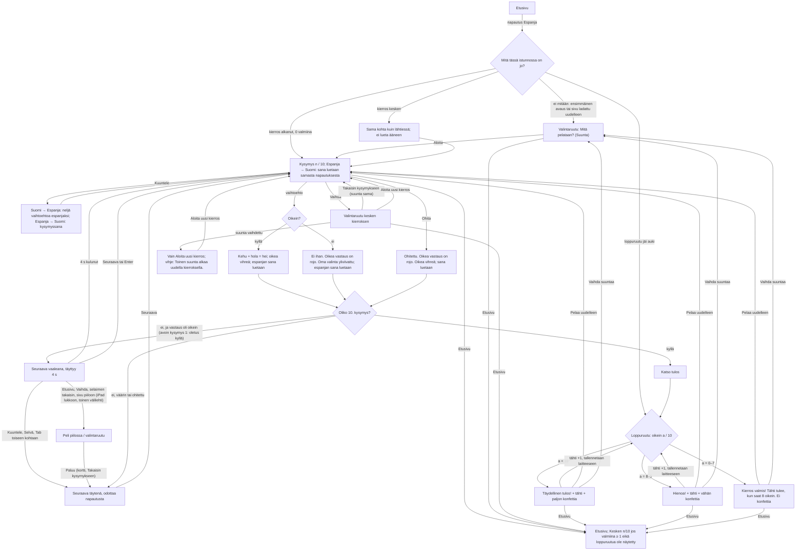

# SEI-4, SEI-9, SEI-10 — Espanja uudessa sovelluksessa

Designer, 2026-10-26. Kuvat jokaisesta tilasta tietokoneella ja iPadilla
(pysty ja vaaka): `docs/design/sei-4.html`. Tämä dokumentti on rakentamisen
lähde; HTML-sivu näyttää saman omistajalle.

Rajaus: Espanjavalmentajan koko nykyinen käyttö (SEI-4) SEI-1:n kehyksen
sisällä, sanalistan käännösten korjaus (SEI-9) sekä väärän vastauksen palaute
ja ohitus (SEI-10). Ei mitään D-osiosta: ei uusia aiheita (SEI-40; Q7:n
aihejärjestys koskee vasta sitä), ei kuvia, ei muistipeliä, ei kirjoittamista,
ei profiileja. Kehys (yläpalkki, Etusivu, Kuuntele, Ei ääntä -ilmoitus,
Kesken-merkki, painikkeiden tilat, värit, kirjasin) on hyväksytty
`docs/design/sei-1.md`:ssä ("SEI-1 §x"). Matikan (`docs/design/sei-2.md`,
"SEI-2 §x", Q20) ja Sanojen (`docs/design/sei-3.md`, "SEI-3 §x", Q26)
hyväksytyt ratkaisut otetaan käyttöön samoina, kun sama asia toistuu.

Lähde nykyiselle toiminnalle: `originals/espanjavalmentaja.html`, rivinumerot
viittaavat siihen ("vanha r. n").

Omistajan päätökset, joita tämä noudattaa: vain nykyiset toiminnot ja
korjaukset (Q5); pelaajat 1.–2.-luokkalaisia, osa lukenut vasta vähän aikaa,
espanjaa 1. luokalta (Q1, Q14); kesken jäänyt kierros jatkuu (Q10); koulun
sanalistaa ei ole, käännökset tarkistetaan sanakirjasta (Q7); laitteen paras
espanjan ääni, Mónica (Q16, Q22); ohitettu kohde näytetään ensin ja sitten
Seuraava (Q27, Sanoille); automaattinen siirtyminen oikean jälkeen Matikassa ja
Sanoissa (Q25, Q28), suunniteltu yhteisesti `docs/design/sei-46.md`:ssä
("SEI-46 §x"). **Espanjan automaattisesta siirtymisestä omistaja ei ole
päättänyt** (avoin kysymys 1, kohta 11); tämä dokumentti kuvaa sen oletuksella
"kyllä, samoin säännöin" ja kertoo jokaisessa kohdassa, mikä muuttuu, jos
vastaus on ei. Siirtyminen on **sama toteutus** kuin Matikassa ja Sanoissa
(kohta 3.5); Espanja ei määrittele omaa.

---

## 1. Palvelutaso

**Käyttäjä.** 1.–2.-luokkalainen, joka opiskelee espanjaa koulussa 1. luokalta.
Hän lukee suomea, osa vasta vähän aikaa; espanjan sanoja hän ei vielä osaa
lukea ääneen oikein. Siksi espanja kuuluu aina myös äänenä, ja kaikki suomen
teksti on lyhyttä. Kehys puhuu Espanjassa vain espanjaa (`ctx.speech.say`
puhuu pelin kielellä `es-ES`, `registry.js`), joten suomenkielistä ohjetta ei
lueta ääneen; tämä on sama kuin vanhassa.

**Tehtävä.** "Haluan harjoitella espanjan sanoja ja kuulla, miten ne
sanotaan." Kierros on 10 kysymystä, jokaisessa neljä vaihtoehtoa. Lapsi
vastaa, näkee ja kuulee oikean vastauksen ja kerää tähtiä kierroksista, joissa
on vähintään 8 oikein.

**Missä matkalla.**
- *Ennen:* lapsi on etusivulla ja napauttaa Espanja-korttia (SEI-1 §3.1).
  Mahdollisesti koulussa käsitelty tervehdyksiä tai värejä.
- *Aikana:* valitsee suunnan (ensimmäisellä kerralla), vastaa 10 kysymykseen.
  Voi käydä etusivulla ja palata; kierros jatkuu (Q10).
- *Jälkeen:* loppuruutu kertoo tuloksen ja sen, tuliko tähti. Tähdet
  säilyvät laitteessa seuraavaan kertaan (ainoa tallennettava tieto koko
  sovelluksessa). Lapsi pelaa uudelleen, vaihtaa suuntaa tai palaa etusivulle.

**Jos tätä ei tehdä:** Espanja on uudessa sovelluksessa vain paikkamerkki
(`placeholder.js`, sanoo "hola"), eikä vanhaa Espanjavalmentajaa voi jättää
pois. Lisäksi lapset oppivat jatkossa kaksi väärää käännöstä (SEI-9), eivätkä
saa väärästä vastauksesta muuta tietoa kuin värin (SEI-10).

**Mitä jo noudatetaan (nykyiset mallit):**

| Malli | Missä nyt | Tässä |
|---|---|---|
| Kehys: yläpalkki, Etusivu, tilapaikka, pelikortti, kysymysrivi + Kuuntele | SEI-1 §3.2, `shell.js` | Kerätyt tähdet tilapaikkaan, kysymyssana ja vihje kysymysriville (`ctx.question`), muu `ctx.root`:iin. |
| Kuuntele, teksti `Kuuntele` | SEI-1 §3.4, `registry.js` | Ei muutu. Pelin `listen()` päättää, mitä luetaan (kohta 3.8). |
| Tunnusväri `#c62828`, tumma `#8e0000`, vaalea `#fdeceb` | SEI-1 §4 | Yläpalkki, pääpainikkeet, valittu kortti, pelialueen tausta. |
| Valintaruutu `Mitä pelataan?`, `Aloita`; kesken kierroksen `Takaisin …` + `Aloita uusi kierros`; ryhmän vaihto vaatii uuden kierroksen + vihje | SEI-3 §3.1 (Sanat-teeman vaihto) | Suunta (kohta 3.1). |
| Valintakortti: pisteettömänä, nimi + esimerkki + vastaustapa, valittu = 4 px reunus + vaalea tausta + valintamerkki | SEI-2 §3.1 (`.mk-level`) | Suuntakortit. |
| Neljä vaihtoehtoa 2 × 2, kaikki valkoisia; oikea vihreä ✓, väärä punareunainen yliviivattu ✗, muut 45 %; lukitus vastauksen jälkeen | SEI-2 §3.3 | Sanavaihtoehdot (kohta 3.3). |
| Tietorivi `Pisteet: x / y` + 10-lohkoinen palkki | SEI-2 §3.2, SEI-3 §3.2 | Sama ulkoasu (kohta 3.2). |
| Palauterivi: kuvake + 1–2 riviä vasemmalla, pääpainike `Seuraava` oikealla | SEI-3 §3.2 | Sama (kohta 3.4). |
| Odottava Seuraava: täyttyy 4 s oikean jälkeen, keskeytykset, vähennä liikettä neljänä askeleena, ruudunlukijan lause | SEI-46 §3–§8 (Matikka ja Sanat) | Sama toteutus, sama ulkoasu (kohta 3.5). |
| `Ei ihan.` / `Oikea vastaus on …`, ei uutta yritystä | SEI-2 §3.5 (SEI-5) | Sama teksti (kohta 3.5). |
| Ohita: kohde näytetään, sitten `Seuraava`; lasketaan ohitetuksi | SEI-3 §3.5, Q27 | Sama (kohta 3.6). |
| Kehut `Hienoa! 🌟` … `Mestari! 🧙` | SEI-2 §3.2 (Matikka r. 299) | Samat. |
| `Katso tulos` 10. jälkeen; loppuruutu pelikortissa kolmena versiona, kuva 120 px, konfetti 100 / 40 / 0 | SEI-2 §3.6, SEI-3 §3.7 | Sama rakenne; rajat Espanjan tähtisäännöstä (kohta 3.7). |
| Erittelyrivit ✓ / ↻ / » ympyräkuvakkein | SEI-3 §3.7 | ✓ oikein, ✗ väärin, » ohitettu. |
| Kosketussuoja 500 ms ruudun vaihtuessa (`guarded`) | SEI-2 §3.8 | Sama. |
| Pelin oma näkymätön `aria-live`-alue | SEI-2 §7 | Sama (kohta 8). |
| Tähtien tallennus `localStorage` | vanha r. 381–391 | Säilyy, avain pelin tunnuksella (registryn sääntö 6, kohta 5). |

---

## 2. Kulku

Polut, jotka eivät ole onnellisia:
- **Väärä vastaus:** uutta yritystä ei ole (sama kuin Matikka, SEI-5). Oikea
  näytetään heti, Seuraava odottaa.
- **Seuraava ilman vastausta (SEI-10 kriteeri 2):** Seuraava-painiketta ei ole
  ennen vastausta. Ainoa tie eteenpäin vastaamatta on `Ohita`, joka laskee
  kysymyksen ohitetuksi ja näyttää oikean vastauksen. Vanhan "Seuraava
  vastaamatta = ohita ilman merkintää" -polkua ei ole.
- **Ohita vahingossa:** oikea vastaus näytetään ja kysymys lasketaan
  ohitetuksi; ei peruutusta (sama kuin Sanat).
- **Ääni puuttuu:** kehyksen ilmoitus espanjan äänestä (SEI-1 §3.4). Peli on
  pelattavissa loppuun: jokainen sana on näkyvissä tekstinä.
- **Tähteä ei voi tallentaa** (selain estää tallennuksen, esim. yksityinen
  selaus): tähti näkyy istunnon ajan, lapselle ei ilmoitusta (kohta 6).
- **Sivu ladataan uudelleen:** valintaruutu oletuksella (Suomi → Espanja);
  kierros katoaa, tähdet säilyvät.
- **Etusivu, Vaihda tai sivu piiloon odotuksen aikana:** odotus loppuu
  pysyvästi tälle kysymykselle; palatessa sama kysymys ja Seuraava täytenä
  odottaa napautusta, ei ääntä (SEI-46 §3.3).
- **Seuraava ja ajastin samaan aikaan** (napautus 3,99 s kohdalla) tai
  kaksoisnapautus Seuraavaan: kysymys vaihtuu kerran (SEI-46 §2).
- **iPad estää ajastimesta käynnistetyn puheen** (Espanja → Suomi): uusi
  kysymyssana näkyy tekstinä mutta jää lukematta; Kuuntele pysyy
  `Kuuntele`-tilassa (SEI-46 §5.2).

---

## 3. Näkymät

Kolme ruutua samassa pelikortissa: **valintaruutu**, **kysymysruutu** ja
**loppuruutu**. Ruudun vaihto ei lisää selaimen historiaan mitään (SEI-1 §3.0).

### 3.0 Tilapaikka yläpalkissa: kerätyt tähdet

Espanjan tähdet eivät ole Matikan ja Sanojen 0–5 kierrostähtiä, vaan
**kerätyt tähdet**: yksi jokaisesta kierroksesta, jossa oli vähintään 8 oikein
(vanha r. 375–391, SEI-4 kriteerit 8–9). Ne näkyvät kaikissa kolmessa
ruudussa samoina.

| Kerätty `n` | ≥ 600 px leveä ikkuna | < 600 px |
|---|---|---|
| 0 | yksi tyhjä tähti (2,5 px valkoinen reunus) + `0` | sama |
| 1–10 | `n` täyttä tähteä vierekkäin | yksi täysi tähti + `× n` |
| yli 10 | yksi täysi tähti + `× n`, esim. `× 12` | sama |

- Tähti SVG 24 px, väli 3 px; täysi `#ffd23f` (SEI-2 §3.0). Luku 26 px
  lihava valkoinen, 6 px tähden oikealla. `×` on U+00D7, välilyönnin kanssa.
- Kymmenen tähteä = 267 px; mahtuu 40 %:n tilapaikkaan iPad pystyssä (328 px)
  ja leveämmissä. Alle 600 px:n tilapaikka on alle 240 px, siksi tiivis muoto.
- Kun loppuruutu antaa tähden, uusi tähti ilmestyy pompulla 0,5 s (ei
  "vähennä liikettä" -asetuksella).
- Ruudunlukija: `role="img"`, nimi `Tähtiä: 5` (`Tähtiä: 0`). Ei live-aluetta;
  saatu tähti ilmoitetaan loppuruudun ilmoituksessa (kohta 8).

### 3.1 Valintaruutu: "Mitä pelataan?"

**Milloin näkyy:** kun Espanja avataan eikä istunnossa ole kierrosta;
`Vaihda` kysymysruudussa; `Vaihda suuntaa` loppuruudussa.

**Sisältö ylhäältä alas:**

1. **Kysymysrivi:** h2 `Mitä pelataan?` (32 px lihava). Oikealla `Kuuntele`.
2. **Ryhmän otsikko** `Suunta` (22 px lihava).
3. **Kaksi suuntakorttia**, valitaan yksi (SEI-2:n tasokortti ilman pisteitä,
   korkeus 128 px):

   | Kortti | Nimi (28 px lihava) | Esimerkki (30 px lihava) | Vastaustapa (20 px `#5b5f73`) |
   |---|---|---|---|
   | 1 | `Suomi → Espanja` | `hei` → `hola` | `Valitse espanjaksi` |
   | 2 | `Espanja → Suomi` | `hola` → `hei` | `Valitse suomeksi` |

   Nimet ovat vanhan pelin painikkeiden tekstit sellaisinaan (r. 156–157).
   Esimerkissä espanjan sana on tunnusvärillä `#c62828` ja `lang="es"`, nuoli
   `#8a8fa3`. Valittu: 4 px tunnusvärinen reunus, tausta `#fdeceb`,
   valintamerkki oikeassa yläkulmassa.
4. **Sanarivi** (20 px `#5b5f73`, ei napautettava): `Sanat: tervehdykset ja
   värit (18 sanaa)`. Korvaa vanhan merkin `Aihe: tervehdykset & värit` (r. 154).
5. **Vihjerivi**, varattu 30 px, 20 px muste, `role="status"`.
6. **Painikkeet** (64 px):
   - Ei kierrosta (myös loppuruudusta tultaessa): pääpainike `Aloita`.
   - Kierros kesken, suunta sama kuin kierroksen: toissijainen
     `Takaisin kysymykseen` vasemmalla, pääpainike `Aloita uusi kierros`
     oikealla.
   - Kierros kesken, suunta vaihdettu: vain `Aloita uusi kierros`; vihjerivillä
     `Toinen suunta alkaa uudella kierroksella.`

**Säännöt:**
- Korttinapautus muuttaa vain luonnosta. Mitään ei aloiteta ennen painiketta
  (vanha suunnan vaihto aloitti heti uuden kierroksen, r. 394–405; ero E1).
- Oletus ensimmäisellä avauksella ja uudelleenlatauksen jälkeen:
  `Suomi → Espanja` (vanha r. 217). Luonnos muistetaan istunnon ajan, ei
  tallenneta.
- `Takaisin kysymykseen`: palaa täsmälleen samaan tilaan (sama kysymys, samat
  vaihtoehdot samassa järjestyksessä, sama palaute). Ei lue ääneen. Odotus ei
  jatku: jos kysymykseen oli vastattu oikein, Seuraava on täysi ja odottaa
  napautusta (odotus loppui jo `Vaihda`-napautuksessa, kohta 3.5).
- `Aloita` / `Aloita uusi kierros`: arvotaan uusi kierros (kohta 5), pisteet
  nollautuvat, kerätyt tähdet eivät muutu,
  `reportProgress({done: 0, total: 10, finished: false})`, kysymys 1
  näytetään ja Espanja → Suomi -suunnassa luetaan samassa napautuksessa.

**Kuuntele valintaruudussa** lukee valitun kortin esimerkin espanjan sanan:
`hola` (0,9). Ei lueta automaattisesti. (Suomenkielistä ohjetta ei voi lukea,
kohta 1.)

**Asettelu:** ≥ 600 px kortit rinnakkain (kumpikin 1/2), < 600 px allekkain
88 px korkeina (nimi + vastaustapa vasemmalla, esimerkki oikealla).
Painikkeet rinnakkain ≥ 600 px, allekkain koko leveydellä < 600 px.
Tietokone: kysymysrivi 56 + 20 + otsikko 28 + 8 + kortit 128 + 12 + sanarivi
28 + 8 + vihje 30 + 8 + painike 64 = 390 px (tilaa 548).

**Tilat:** normaali; kesken kierroksen (kaksi painiketta); suunta vaihdettu
kesken kierroksen (yksi painike + vihje). Tyhjä, lataus ja virhe eivät ole
mahdollisia (kiinteä sisältö).

### 3.2 Kysymysruutu, yhteiset osat

Järjestys ylhäältä (kaikilla leveyksillä sama): kysymysrivi, tietorivi,
vaihtoehdot, palauterivi, alarivi.

**Kysymysrivi (`ctx.question`)**, Kuuntele oikealla:
- **Kysymyssana**, 48 px lihava muste (< 600 px: 34 px), esim. `punainen`
  tai `buenas noches`. Espanja → Suomi -suunnassa `lang="es"`. Saa rivittyä
  välilyönnin kohdalta kahdelle riville; sanaa ei katkaista.
- Sen alla **vihjerivi**, 22 px `#5b5f73`:
  - Suomi → Espanja: `Aihe: väri. Valitse espanjaksi.` /
    `Aihe: tervehdys. Valitse espanjaksi.`
  - Espanja → Suomi: `Aihe: väri. Valitse suomeksi.` /
    `Aihe: tervehdys. Valitse suomeksi.`
  Aihe on sanan oma aihe (vanha r. 299–301, sama sisältö; SEI-4 kriteeri 3).
- Uuden kysymyksen ilmestyminen 0,3 s (Matikan "appear"); pois "vähennä
  liikettä" -asetuksella.

**Tietorivi** (28 px): vasemmalla `Pisteet: 3 / 4` (22 px lihava) = oikein /
valmiina (vastatut + ohitetut); ennen ensimmäistä `Pisteet: 0 / 0`. Oikealla
10 lohkon palkki (SEI-2 §3.2), lohko täyttyy, kun kysymys on vastattu tai
ohitettu (ero E4).

**Alarivi:**
- Vasemmalla toissijainen `Ohita` + ohitusnuoli » (56 px), näkyvissä vain kun
  kysymykseen ei ole vastattu (muuten `visibility: hidden`, ettei rivi hypi).
- Oikealla toissijainen `Vaihda` (56 px) → valintaruutu kesken kierroksen
  -muodossa. Ei vahvistuskysymystä.
- Ei valintariviä (suunta näkyy vihjeestä `Valitse espanjaksi` /
  `Valitse suomeksi`).

### 3.3 Vaihtoehdot

- Neljä vaihtoehtoa, tasan yksi oikea, kolme väärää **samasta aiheesta** kuin
  kysymys (vanha r. 287–290; SEI-4 kriteeri 1). Vaihtoehdot ja niiden
  järjestys arvotaan kerran kysymystä kohden ja pysyvät samoina palattaessa.
- Asettelu 2 × 2 kaikilla leveyksillä ≥ 420 px; < 420 px yksi sarake (neljä
  allekkain), koska `hyvää iltapäivää` ei mahdu puolikkaaseen 320 px:n
  leveydestä.
- Painike: valkoinen, 3 px `#c9cbd6`, alavarjo 5 px `#c9cbd6`, pyöristys
  22 px, teksti 30 px lihava muste, keskitetty, saa rivittyä kahdelle riville
  välilyönnin kohdalta. Espanjankieliset vaihtoehdot `lang="es"`. Kaikki
  samanvärisiä (vanhakin oli neutraali `#fafafa`, r. 117).

| | iPad pysty (724 × 958) | iPad vaaka (712 × 598) ja tietokone (712 × 548) | 420–599 px | < 420 px |
|---|---|---|---|---|
| Koko | (leveys − 16) / 2 × 104 px | (leveys − 16) / 2 × 88 px | (leveys − 12) / 2 × 88 px, teksti 24 px | koko leveys × 64 px, teksti 24 px |
| Väli | 16 px | 16 px | 12 px | 10 px |

**Tilat** (täsmälleen SEI-2 §3.3):

| Tila | Valittu | Oikea | Muut |
|---|---|---|---|
| Odottaa | kaikki painettavissa | | |
| Painettu | laskee 5 px, varjo pois | | |
| Oikein | tausta `#17803d`, valkoinen teksti, ✓ valkoisessa ympyrässä oikeassa yläkulmassa; pomppu 0,5 s | (sama) | 45 % läpinäkyvyys |
| Väärin | valkoinen, 4 px `#c62828` reunus, teksti `#c62828` yliviivattuna, ✗ punaisessa ympyrässä; ravistus 0,5 s | tausta `#17803d`, valkoinen, ✓ | 45 % |
| Ohitettu | – | tausta `#17803d`, valkoinen, ✓ | 45 % |

Vastauksen tai ohituksen jälkeen kaikki neljä ovat `disabled` (SEI-4 kriteeri
4), kunnes seuraava kysymys tulee.

### 3.4 Palauterivi

Varattu 84 px (kaksi tekstiriviä, 36 + 29 px, tai 64 px:n painike), ettei
asettelu hypi. Vasemmalla kuvake ja teksti, oikealla pääpainike vain kun
kysymys on valmis. Palauteriville ei tule erillistä siirtymäpalkkia; odotus
näkyy Seuraava-painikkeen sisällä (kohta 3.5).

| Tila | Kuvake 32 px | Rivi 1 | Rivi 2 (22 px muste) | Painike |
|---|---|---|---|---|
| Ennen vastausta | – | – | – | – |
| Oikein, kysymykset 1–9 | ✓ `#17803d` | satunnainen kehu (SEI-2 §3.2), 30 px lihava `#17803d`, pomppu | pari: `hola = hei` | odottava `Seuraava` →, täyttyy 4 s (kohta 3.5) |
| Oikein, 10. | sama | sama | sama | `Katso tulos` →, täysi, ei täyty |
| Väärin (SEI-10) | ✗ `#c62828` | `Ei ihan.` 28 px lihava `#c62828` | `Oikea vastaus on rojo.` | `Seuraava` / `Katso tulos` |
| Ohitettu | » `#5b5f73` | `Ohitettu.` 28 px lihava muste | `Oikea vastaus on rojo.` | `Seuraava` / `Katso tulos` |

- Rivi 2: pari kirjoitetaan aina espanja ensin: `hola = hei`, `buenas noches
  = hyvää yötä` (kumpikin suunta). Väärin- ja Ohitettu-rivillä sana on
  vastauksen kielellä: Suomi → Espanja `Oikea vastaus on rojo.`, Espanja →
  Suomi `Oikea vastaus on punainen.` Espanjan sana lihavoituna `lang="es"`.
- **Väärästä ei ole uutta yritystä,** eikä teksti lupaa sitä (SEI-5:n
  periaate).
- `Seuraava` / `Katso tulos`: pääpainike 64 px, vähintään 240 px, nuoli
  oikealla. Kun se tulee näkyviin, fokus siirtyy siihen. Väärän ja ohitetun
  jälkeen se on heti täysi (tavallinen pääpainike) eikä täyty.

### 3.5 Automaattinen siirtyminen oikean vastauksen jälkeen

**Oletuksella "kyllä" (avoin kysymys 1).** Espanja käyttää **täsmälleen
samaa** automaattista siirtymistä kuin Matikka ja Sanat: säännöt, ulkoasu,
ajoitus, keskeytykset, vähennä liikettä ja ruudunlukija ovat SEI-46 §3–§8:n
mukaiset, ja koodissa se on **yksi toteutus kaikille kolmelle pelille**
(arkkitehti päättää, missä se asuu). Tässä kohdassa on vain se, mikä
Espanjassa on toisin tai mitä Espanjan sisällöstä seuraa; ristiriidassa
SEI-46 voittaa.

**Milloin odotus alkaa** (SEI-46 §3.1): vastaus on **oikein**, kysymys on
1–9, ja odotus alkaa samassa vaihtoehdon napautuksessa (tai Enterissä, kun
fokus on vaihtoehdossa), joka teki vastauksesta oikean. Odotusta **ei**
ole:
- **väärän vastauksen jälkeen** (kuten Matikassa): `Seuraava` on heti täysi
  ja odottaa; uutta yritystä ei ole (kohta 3.4);
- **Ohitan jälkeen** (kuten Sanojen ohitettu sana, Q27): oikea vastaus
  näytetään ja luetaan, `Seuraava` on heti täysi ja odottaa (kohta 3.6);
- **10. kysymyksen jälkeen**: `Katso tulos` on täysi eikä koskaan täyty;
- eikä uudelleen samalle kysymykselle, kun se on kerran loppunut.

**Odottava Seuraava-painike** (SEI-46 §4). Sama `<button>` kuin `Seuraava`
samalla paikalla (palauterivin oikea reuna; < 600 px palautetekstin alla
koko leveydellä, kohta 3.10). Ei erillistä palkkia, ei uutta riviä, ei
lukua, ei sekunteja, ei ääntä. Kaksi päällekkäistä kerrosta, joiden teksti
`Seuraava` ja nuoli ovat samassa kohdassa:

| Kerros | Tausta | Teksti ja nuoli | Muuta |
|---|---|---|---|
| Pohja | `--al` `#fdeceb` | `--a` `#c62828` | 3 px `#c62828` reunus, 4 px alavarjo `--ad` `#8e0000` |
| Täyttö (`aria-hidden="true"`) | `--a` `#c62828` | valkoinen | leikataan vasemmalta oikealle, näkyvä osa 0 % → 100 % (`clip-path: inset(0 calc(100% - p) 0 0)`) |

- Täyttö etenee **lineaarisesti 0 % → 100 % 4,0 s:ssa** vastausnapautuksesta.
  Täytenä painike näyttää täsmälleen tavalliselta Seuraavalta.
- Tasan **4000 ms** kohdalla yksi ajastin tekee **saman kuin
  Seuraava-napautus** (sama funktio): uusi kysymys näkyviin, Espanja → Suomi
  -suunnassa kysymyssana luetaan (kohta 3.8), fokus kysymyssanaan (kohta 8).
  Pisteet, palkki ja Kesken eivät muutu tässä (ne muuttuivat vastattaessa).
- **Seuraava odotuksen aikana** (napautus, tai Enter / välilyönti kun fokus
  on siinä) vie heti eteenpäin; ajastin perutaan samassa napautuksessa, joten
  kysymys vaihtuu kerran.
- Tilat: *odottaa, täyttyy*; *painettu* (laskee 4 px, varjo pois, täyttö jää
  kohdalleen); *fokus* (keltainen + muste fokusrengas, vain näppäimistöllä);
  *odottaa napautusta* (täysi, tavallinen Seuraava).

**Mikä lopettaa odotuksen** (SEI-46 §3.3). Pysyvästi tälle kysymykselle:
ajastin perutaan, täyttö katoaa, `Seuraava` on täysi ja odottaa napautusta.
Mikään muu ei muutu.

| Tapahtuma | Espanjassa |
|---|---|
| `Kuuntele` | Luetaan kuten aina (kohta 3.8: Suomi → Espanja oikea espanjan sana, Espanja → Suomi kysymyssana). |
| `Selvä` (Ei ääntä -ilmoitus) | Kuten SEI-1 §3.4. |
| Fokus siirtyy näppäimistöllä (Tab, Shift+Tab) johonkin muuhun kuin Seuraavaan | – (pelin oma fokuksen siirto Seuraavaan vastattaessa ei lopeta). |
| Sivu piiloon (`visibilitychange` → `hidden`) | – |
| `Etusivu`, selaimen takaisin (`hide()`) | Kuten nyt. |
| `Vaihda` | Valintaruutu kuten nyt. |

**Ei lopeta:** napautus lukittuun vaihtoehtoon, kysymyssanaan tai tyhjään
kohtaan; vieritys; laitteen kääntäminen. Espanjassa ei ole kuvaa eikä
voittoääntä (Sanojen keskeytys "kuvan napautus" ja voittoäänen 3 s:n
pysäytys eivät koske Espanjaa).

**Paluu** etusivulta, valintaruudun `Takaisin kysymykseen` -painikkeesta tai
piilossa olleelle sivulle: sama kysymys, sama palaute, `Seuraava` täytenä
odottaa. Ei uutta odotusta, ei ääntä (SEI-1 §3.5).

**Vähennä liikettä** (SEI-46 §4.3): täyttö etenee **neljänä askeleena** ilman
liukumista: 25 % heti, 50 % kohdassa 1 s, 75 % kohdassa 2 s, 100 % kohdassa
3 s (CSS `steps(4, jump-start)` 4 s:n animaatiolla); uusi kysymys silti
kohdassa 4 s. Pohjakerroksessa kolme pystyviivaa kohdissa 25 %, 50 % ja 75 %
(3 px, `#c62828` 35 % peittävyydellä, koko korkeus, `aria-hidden="true"`).

**Ääni** (SEI-46 §5). Oikean vastauksen espanjan sana (0,9) alkaa
vastausnapautuksesta ja kestää alle 1,5 s; pisin `buenas noches` /
`buenas tardes` noin 1,2 s. 4 s ei siis katkaise sitä. Odotukseen ei lisätä
ääntä. Ajastimen tuoma kysymys:
- Espanja → Suomi: kysymyssana luetaan ajastimesta. Jos iPad estää
  ajastimesta käynnistetyn puheen, sana näkyy silti tekstinä; Kuuntele pysyy
  `Kuuntele`-tilassa eikä Ei ääntä -ilmoitusta näytetä tämän takia (SEI-46
  §5.2).
- Suomi → Espanja: uutta kysymystä ei lueta (kohta 3.8), joten ajastimen
  puhe-esto ei koske tätä suuntaa.

**Ruudunlukija** (SEI-46 §8): oikein-ilmoituksen loppuun samaan
kirjoitukseen `Seuraava kysymys tulee itsestään.` (kysymykset 1–9; kohta 8).
Painikkeen nimi `Seuraava kysymys` ei vaihdu odotuksen aikana.

**Kontrasti Espanjan väreillä** (raja 3 : 1, teksti 26 px lihava = suuri):
`#c62828` / `#fdeceb` teksti ja täyttö vs. pohja 5,4 : 1; valkoinen
täytöllä 5,6 : 1; reunus valkoisella kortilla 5,6 : 1.

**Punainen painike oikean jälkeen.** Espanjan tunnusväri on sama punainen
kuin "väärin" (kohta 4). Odottava painike on silti tunnusvärinen kuten
kaikki Espanjan pääpainikkeet ja tavallinen Seuraava; oikeasta kertovat
vihreä ✓-vaihtoehto, vihreä kehu ja ✓-kuvake. Ei omaa väriä Espanjalle,
koska yksi toteutus ottaa värin pelin `--a` / `--al` / `--ad`-muuttujista.

**Data.** Uusi muistitila kysymykselle `odotus: ei | käynnissä | loppunut`
ajastimen tunnisteen kanssa (SEI-46 §6), ei tallenneta. Kaikki muu tarvittava
on jo kohdan 5 tilassa (`tulos`, kysymyksen numero). Pelin puheen loppumisesta
ei tarvita tietoa (kiinteä 4 s; Kuuntele lopettaa odotuksen).

**Jos vastaus on "ei":** odottavaa painiketta ei ole; `Seuraava` on aina
täysi ja odottaa napautusta. Kaikki muu tässä dokumentissa pysyy.

### 3.6 Ohita (SEI-10 kriteerit 2 ja 3)

- `Ohita` alarivillä aina kun kysymykseen ei ole vastattu.
- Napautus: kysymys merkitään **ohitetuksi** (ei oikeaksi), oikea vaihtoehto
  vihreäksi ✓, muut 45 %, kaikki lukittuvat, palauterivi `Ohitettu.` /
  `Oikea vastaus on rojo.`, espanjan sana luetaan, palkki ja Kesken-luku
  kasvavat heti. `Pisteet`-luvun jakaja kasvaa, osoittaja ei.
- Seuraava kysymys tulee `Seuraava`-napautuksesta (ei itsestään): `Seuraava`
  on heti täysi eikä täyty. Sama kuin Sanojen ohitettu sana (Q27, SEI-46
  §3.1): lapsi näkee ohittamansa sanan oikean vastauksen.
- Ei vahvistuskysymystä eikä peruutusta.

### 3.7 Loppuruutu

Näkyy `Katso tulos` -napautuksesta pelikortissa (vanha: teksti vastausten
paikalla heti 10. jälkeen, r. 358–379; ero E6, E7). Kysymysrivillä otsikko
40 px, Kuuntele oikealla.

Merkinnät: **a** = oikein, **b** = väärin, **c** = ohitettu; a + b + c = 10.
Rajat tulevat vanhan pelin tähtisäännöstä (8/10 antaa tähden, r. 364):

| | a = 10 | a = 8–9 | a = 0–7 |
|---|---|---|---|
| Otsikko | `Täydellinen tulos!` | `Hienoa!` | `Kierros valmis!` |
| Kuva (120 px ympyrä) | keltainen `#ffd23f`, iso tähti | tunnusvärinen `#c62828`, valkoinen ✓ | vaaleansininen `#e8f1ff`, ylös osoittava nuoli |
| Iso tulos (64 px lihava) | `10 / 10 oikein` | `8 / 10 oikein` | `6 / 10 oikein` |
| Erittely (24 px) | `✓ 10 oikein` | ks. alla | ks. alla |
| Tähtirivi (22 px, tähti 48 px) | täysi tähti + `Sait tähden!` | täysi tähti + `Sait tähden!` | tyhjä tähti (reunus `#b7791f`) + `Tähti tulee, kun saat 8 oikein.` |
| Espanjan lause (26 px lihava, `lang="es"`) ja suomeksi (20 px `#5b5f73`) | `¡Perfecto!` `Täydellistä!` | `¡Muy bien!` `Tosi hyvä!` | `¡Sigue practicando!` `Jatka harjoittelua!` |
| Tausta | `#fff4d6` | `#fdeceb` | valkoinen |
| Konfetti | 100 palaa, 3,5 s | 40 palaa, 3 s | ei |

**Erittely**, rivit tässä järjestyksessä; a-rivi aina, b ja c vain kun ≥ 1:
- ✓ (vihreä ympyrä `#17803d`) `{a} oikein`
- ✗ (punainen ympyrä `#c62828`) `{b} väärin`
- » (harmaa ympyrä `#5b5f73`) `{c} ohitettu`

**Tähti** (SEI-4 kriteeri 8, SEI-10 kriteeri 3): kun a ≥ 8, kerättyjen määrä
kasvaa yhdellä **kun loppuruutu ilmestyy ensimmäisen kerran tältä
kierrokselta**, ja uusi määrä tallennetaan heti (kohta 5). Paluu etusivulta
samaan loppuruutuun ei anna toista tähteä. Jos lapsi ei koskaan paina
`Katso tulos` (esim. lataa sivun uudelleen), kierros ei päättynyt eikä tähteä
tule.

**Ääneen** `Katso tulos` -napautuksesta ja Kuuntelesta: vain espanjan lause
(`Perfecto`, `Muy bien`, `Sigue practicando`; 0,9, merkit ¡! poistettuina).
Tulosta ei voi lukea suomeksi (kohta 1).

**Painikkeet:** pääpainike `Pelaa uudelleen` (sama suunta, uusi kierros;
vanha `Uusi kierros ▶`, r. 370) ja toissijainen `Vaihda suuntaa`
(valintaruutu). Niiden alla harmaa rivi 20 px: `Suomi → Espanja`.

`reportProgress({done: 10, total: 10, finished: true})` loppuruudun
ilmestyessä. Konfetti kuten Matikka (ei estä napautuksia, poistuu, "vähennä
liikettä" → ei konfettia). Palatessa sama loppuruutu ilman konfettia ja
ääntä.

**Asettelu:** ≥ 900 px kaksi saraketta (vasemmalla kuva ja tähtirivi,
oikealla iso tulos, erittely ja espanjan lause), < 900 px yksi sarake
keskitettynä. Tietokone: kysymysrivi 56 + 16 + tulosalue 290 + 16 +
painikkeet 64 + 12 + rivi 24 = 478 px.

**SEI-10 kriteerin 3 esimerkki** (6 oikein, 4 ohitettu): `Kierros valmis!`,
`6 / 10 oikein`, `✓ 6 oikein`, `» 4 ohitettu`, tyhjä tähti ja `Tähti tulee,
kun saat 8 oikein.`, ei konfettia, tähtien määrä ei muutu.

### 3.8 Mitä luetaan ääneen ja milloin

Kaikki puhe espanjaksi (`es-ES`, Mónica tai laitteen paras, SEI-45). Teksti
välitetään yhtenä `ctx.speech.say([...])`-kutsuna samassa napautuksessa, joka
sen aiheuttaa. Merkit `¡ ! ¿ ?` poistetaan puheesta (vanha r. 331, 414).
Nopeus 0,9 (vanha r. 234).

| Tapahtuma | Mitä | Vanha |
|---|---|---|
| Uusi kysymys, Espanja → Suomi (`Aloita`, `Seuraava`, `Pelaa uudelleen`, `Aloita uusi kierros`, korttinapautus kun 0 valmiina ja kysymys auki) | kysymyssana | ei luettu (ero E10) |
| Uusi kysymys, Suomi → Espanja | ei mitään (suomea ei voi lukea; neljän sanan luku joka kysymyksessä olisi 5 s) | ei luettu |
| Uusi kysymys odotuksen päätyttyä (kohta 3.5), Espanja → Suomi | kysymyssana, ajastimesta (ei napautuksesta; iPadin esto: kohta 3.5) | – |
| Kuuntele, Suomi → Espanja, ennen vastausta | neljä vaihtoehtoa näkyvässä järjestyksessä (vasen ylä, oikea ylä, vasen ala, oikea ala): `[{o1}, {o2, pauseMs: 500}, {o3, pauseMs: 500}, {o4, pauseMs: 500}]` | r. 409–411, 600 ms välein ja edellinen katkaistiin (ero E10) |
| Kuuntele, Suomi → Espanja, vastattu tai ohitettu | oikea espanjan sana | |
| Kuuntele, Espanja → Suomi (aina) | kysymyssana | r. 412–414 |
| Vastaus oikein | oikea espanjan sana (Espanja → Suomi: kysymyssana; SEI-4 kriteeri 5) | vain Espanja → Suomi, r. 330–332 |
| Vastaus väärin | oikea espanjan sana | ei mitään (ero E2) |
| Ohita | oikea espanjan sana | ei mitään |
| Valintaruudun Kuuntele | `hola` | ei ollut |
| `Katso tulos`, loppuruudun Kuuntele | espanjan lause (kohta 3.7) | ei ollut |
| Paluu kesken jääneeseen, valintaruudun avaus | ei mitään | |

Pisin: neljä vaihtoehtoa (`buenos días`, `buenas tardes`, `buenas noches`,
`¿qué tal?`) noin 4 × 1,2 s + 3 × 0,5 s ≈ 6,5 s, alle kehyksen 12 s:n rajan.

`show({autoRead: true})`: luetaan kysymyssana, jos kysymysruutu on auki,
siihen ei ole vastattu ja suunta on Espanja → Suomi; muuten ei mitään.

### 3.9 Nopeat napautukset

- Ruudun vaihtuessa (valinta → kysymys, kysymys → loppu, loppu → kysymys,
  kysymys → valinta) uuden ruudun painikkeet eivät reagoi 500 ms
  (`guarded`, SEI-2 §3.8). Kuuntele ja Etusivu eivät kuulu tähän.
- Vaihtoehdon kaksoisnapautus: toinen osuu lukittuun painikkeeseen.
- `Seuraava` on palauterivillä, `Ohita` alarivillä: eri kohdissa kaikissa
  asetteluissa, joten Seuraavan kaksoisnapautus ei osu Ohitaan eikä
  vaihtoehtoon (vaihtoehdot ovat palauterivin yläpuolella).
- `Seuraava` täyttymishetkellä: kumpi tahansa ensin siirtää; toinen ei
  tee mitään (ajastin perutaan napautuksessa, napautus ei tee mitään, jos
  kysymys on jo vaihtunut — Seuraava on silloin piilossa).
- Ajastimen tuoma kysymys ei ole ruudun vaihto eikä aseta 500 ms:n suojaa
  (SEI-46 §9): uuden kysymyksen vaihtoehdot reagoivat heti, kuten Seuraavan
  jälkeen.

### 3.10 Asettelut ja korkeudet

Yksi sarake kaikilla leveyksillä. Kuuntele siirtyy kysymyssanan alle < 420 px
(SEI-1 §3.2).

| | iPad pysty | iPad vaaka / tietokone | < 600 px |
|---|---|---|---|
| Kysymyssana | 48 px | 48 px | 34 px |
| Osien väli | 16 px | 12 px | 12 px |
| Palauterivi | yksi rivi: teksti + Seuraava | sama | teksti, alla Seuraava koko leveydellä |
| Alarivi | yksi rivi | yksi rivi | `Ohita` ja `Vaihda` allekkain koko leveydellä |

**Korkeus, tietokone (548 px):** kysymysrivi 92 (sana 58 + vihje 28 + väli 6)
+ 12 + tietorivi 28 + 12 + vaihtoehdot 192 (2 × 88 + 16) + 12 + palauterivi 84
+ 12 + alarivi 56 = 500 px. Pisin kysymyssana `hyvää iltapäivää` on noin
430 px 48 px:llä ja tilaa on 546 px, joten tällä sanalistalla sana ei rivity
tietokoneella eikä iPadilla. Jos se joskus rivittyy (tuleva lista), korkeus on
558 px ja pelialue saa vierittyä pystysuunnassa (SEI-1 §3.2).

---

## 4. Ilme

Värit, kirjasin ja painikkeiden tilat SEI-1 §4, SEI-2 §4, SEI-3 §4. Huomio:

- **Tunnusväri ja "väärin" ovat sama punainen** `#c62828` (SEI-1 ja SEI-2
  valitsivat sen tietoisesti). Espanjassa punainen siis näkyy myös
  painikkeissa ja yläpalkissa. Siksi Espanjassa väärä ei koskaan näy pelkkänä
  punaisena: aina ✗-kuvake, yliviivaus ja teksti `Ei ihan.` Valittu
  suuntakortti on punareunainen, mutta siinä on valintamerkki ✓.
- Loppuruudun 8–9-kuva on tunnusvärinen ympyrä valkoisella ✓:llä (Matikan ja
  Sanojen malli); ✓ kertoo, ettei punainen tässä tarkoita virhettä.
- Tähti `#ffd23f` punaisella `#c62828`: 4,0 : 1 (ei-tekstielementti, raja
  3 : 1). Tyhjän tähden valkoinen reunus punaisella 5,6 : 1.
- Vihje ja suomennos `#5b5f73` valkoisella 6,4 : 1; `#fdeceb`:llä 5,8 : 1.

Liike: kysymyksen ilmestyminen 0,3 s, kehun pomppu 0,5 s, väärän ravistus
0,5 s, uuden tähden pomppu 0,5 s, odottavan Seuraavan täyttö, konfetti. Kaikki
pois "vähennä liikettä" -asetuksella; täyttö etenee neljänä askeleena
pystyviivoin (kohta 3.5).

---

## 5. Data: mitä on, mitä ei

| Tarvitaan | Onko | Lähde / huomio |
|---|---|---|
| 18 sanaparia, aihe kullekin | Kyllä | Vanha r. 193–214: 8 tervehdystä, 10 väriä. Aiheen nimi `tervehdys` / `väri` näytetään vihjerivillä sellaisenaan. Kolme suomennosta muuttuu (SEI-9, alla). |
| Kolme väärää samasta aiheesta | Kyllä | Pienin aihe 8 sanaa, joten 3 väärää on aina saatavilla. **Ehto rakentajalle:** aiheen sisällä jokainen suomen ja jokainen espanjan teksti on yksilöllinen (yksikkötesti), muuten kaksi samannäköistä vaihtoehtoa voi tulla. Uudella listalla ehto täyttyy (vanhalla `kiitos` olisi tullut kahdesti, jos `por favor` = `kiitos`). |
| Kierros: 10 sanaa 18:sta ilman toistoa | Kyllä | Vanha r. 275. Aiheet sekaisin, kuten vanhassa. Sekoitus tasajakoinen (Fisher–Yates, `rng`-parametri kuten `matikka-logic.js`); vanha `sort(() => Math.random() - .5)` (r. 226) oli vino. |
| Kysymyskohtainen tila | **Ei vanhassa** | Uusi: `{sana, vaihtoehdot[4] järjestyksessä, tulos: kesken | oikein | väärin | ohitettu, valittu}`. Vaihtoehdot arvotaan kierroksen alussa kaikille 10 kysymykselle, jotta paluu näyttää samat. |
| Pisteet ja valmiit | Osittain | Vanha `score` ja `idx` (r. 218–220); ohitettuja ei laskettu lainkaan. Uusi: a, b, c lasketaan kysymysten tuloksista. |
| Suunta | Kyllä | `direction` (r. 217). Lisäksi valintaruudun luonnos. |
| Missä ruudussa ollaan | **Ei vanhassa** | `valinta | kysymys | loppu`. |
| Automaattisen siirtymisen odotus | **Ei vielä** | Yhteinen SEI-46:n kanssa: `odotus: ei | käynnissä | loppunut` + ajastin, muistissa, ei tallenneta (kohta 3.5). |
| Tähti annettu tältä kierrokselta | **Ei vanhassa** | Uusi lippu kierrokselle, jotta paluu loppuruutuun ei anna toista. |
| Kerätyt tähdet laitteessa | Kyllä | Vanha `localStorage 'es_stars'` (r. 382–386). Uusi avain alkaa pelin tunnuksella (registryn sääntö 6), esim. `espanja.stars`; arkkitehti nimeää. Arvo kokonaisluku merkkijonona. Luku: puuttuva, ei-numero, negatiivinen tai desimaali → 0 (desimaali alaspäin). Luku tai tallennus heittää virheen → näytetään muistissa oleva luku, ei viestiä. |
| Vanhan pelin tähdet | **Ei saatavilla** | Vanha peli oli paikallinen tiedosto; selain pitää sen tallennuksen eri paikassa kuin `hakaotu.github.io`:n. Uusi alkaa nollasta (avoin kysymys 3). |
| Kesken-merkki | Kyllä | `reportProgress({done: a + b + c, total: 10, finished})`; kasvaa vastatessa ja ohittaessa, ei Seuraavassa. |
| Espanjan lauseet loppuruutuun | **Uutta sisältöä** | `¡Perfecto!`, `¡Muy bien!`, `¡Sigue practicando!`. Tarkistettu sanakirjasta (alla). |
| Puhe | Kyllä | Kehyksen `ctx.speech.say` vain `es-ES`; suomea ei voi puhua Espanjassa ilman sopimuksen muutosta (ei tässä). |
| Tähtien säilyminen iPadilla | Ei tiedossa | iPadin Safari voi tyhjentää sivuston tallennuksen, jos sivustoa ei käytetä viikkoihin (backlogin riski). Ei tarkistettu. |

### SEI-9: käännökset

Tarkistettu 2026-10-26 sanakirjasta fi.wiktionary.org (hakusanat alla), Q7:n
mukaisesti; espanjaa osaavaa tarkistajaa ei ole nimetty.

| Espanja | Vanha suomi | Uusi suomi | Sanakirja (fi.wiktionary) | Peruste |
|---|---|---|---|---|
| hola | hei | hei | "hei, moi, moro" | ennallaan |
| adiós | moi moi / hei hei | **näkemiin** | "näkemiin" | Sanakirjan vastine. Vinoviiva teki vaihtoehdosta kaksi vastausta yhdessä, ja `hei hei` olisi sekoittunut `hei`:hin samassa vaihtoehtojoukossa. |
| buenos días | hyvää huomenta | hyvää huomenta | "hyvää huomenta, hyvää päivää" | ennallaan |
| buenas tardes | hyvää iltaa | **hyvää iltapäivää** | "hyvää iltapäivää, hyvää iltaa" | Ensimmäinen merkitys; erottaa sen `buenas noches`:sta (backlog SEI-9 kriteeri 2). |
| buenas noches | hyvää yötä | hyvää yötä | "hyvää yötä" | ennallaan |
| gracias | kiitos | kiitos | "kiitos, kiitoksia" | ennallaan |
| por favor | ole hyvä | **ole kiltti** | "kiitos, saisinko (pyydettäessä)"; en.wiktionary *please* → fi: "ole hyvä (ja)", "kiitos", "ole kiltti" | Pelkkä `ole hyvä` tarkoittaa suomessa "tässä, olepa hyvä" eikä pyyntöä (SEI-9 kriteeri 3). `kiitos` on jo `gracias`. `ole kiltti` on pyyntö, lapsen oma sana. |
| ¿qué tal? | mitä kuuluu? | mitä kuuluu? | "mitä kuuluu" | ennallaan |
| rojo | punainen | punainen | "punainen" | ennallaan |
| amarillo | keltainen | keltainen | "keltainen" | ennallaan |
| azul | sininen | sininen | "sininen" | ennallaan |
| verde | vihreä | vihreä | "vihreä" | ennallaan |
| blanco | valkoinen | valkoinen | "valkoinen" | ennallaan |
| negro | musta | musta | "musta" | ennallaan |
| naranja | oranssi | oranssi | "oranssi" | ennallaan |
| morado | violetti | violetti | "violetti" | ennallaan |
| marrón | ruskea | ruskea | "kastanjanruskea, ruskea" | ennallaan |
| gris | harmaa | harmaa | "harmaa" | ennallaan |

Loppuruudun lauseet: `¡Perfecto!` = täydellinen ("täydellinen",
fi.wiktionary *perfecto*) → `Täydellistä!`; `¡Muy bien!` = *muy* (hyvin,
erittäin) + *bien* (hyvin) → `Tosi hyvä!`; `¡Sigue practicando!` = *seguir*
(jatkaa, käskymuoto *sigue*) + *practicar* (harjoitella) → `Jatka
harjoittelua!`. Kolme viimeistä sanakirjasta sanoittain, ei fraasina.

Isot alkukirjaimet: sanat näytetään kuten vanhassa, pienellä (`hola`,
`buenas noches`, `¿qué tal?`); kysymysmerkit `¿ ?` näkyvät tekstissä.

---

## 6. Reunat

- **Pisin vaihtoehto** `hyvää iltapäivää` (16 merkkiä, 30 px noin 270 px):
  mahtuu 348 px:n painikkeeseen; 420–599 px rivittyy kahdelle riville
  (`hyvää` / `iltapäivää`); < 420 px yhden sarakkeen painike 264 px, 24 px
  tekstinä noin 215 px, mahtuu.
- **Kaikki 10 samaa aihetta:** mahdollista (10 väriä); ei estetä, kuten
  vanhassa.
- **Kaikki tervehdykset kierroksella:** 8 + 2 väriä; toimii.
- **Kaikki ohitettu:** `0 / 10 oikein`, `✓ 0 oikein`, `» 10 ohitettu`,
  `Kierros valmis!`, ei tähteä. Pisteet kesken kierroksen `0 / 10`.
- **Kaikki väärin:** `0 / 10 oikein`, `✓ 0 oikein`, `✗ 10 väärin`.
- **Tasan 8:** tähti (`Hienoa!`). **Tasan 7:** ei tähteä (SEI-4 kriteeri 8).
- **Tähtiä 0:** tyhjä tähti + `0`. **10:** kymmenen tähteä. **11:** yksi
  tähti + `× 11`. **1 000:** `× 1000` (ei tuhaterotinta; mahtuu). Negatiivinen
  tai rikki tallennettu arvo → 0.
- **Kaksi lasta samalla laitteella:** tähdet ovat yhteiset, kunnes profiilit
  (SEI-11) tulevat. Ei ratkaista tässä.
- **Kaksi välilehteä yhtä aikaa:** viimeksi tallentanut voittaa; tähti voi
  kadota. Hyväksytty raja.
- **10. vastattu, Katso tulos painamatta, etusivulle:** `Kesken 10/10`;
  palatessa palaute ja `Katso tulos`. Tähti tulee vasta loppuruudusta.
- **Kierros alkanut, 0 valmiina, etusivulle ja takaisin:** ei Kesken-merkkiä;
  korttinapautus lukee kysymyssanan (Espanja → Suomi).
- **Suunta vaihdetaan kesken:** vain `Aloita uusi kierros`; vanhan kierroksen
  pisteet katoavat, tähdet eivät.
- **Ei espanjan ääntä:** kaikki toimii; Kuuntele on `Ei ääntä`, ilmoitus
  kertoo aikuiselle, miten ääni lisätään.
- **Kaikki 10 oikein ilman napautuksia välissä:** kysymykset 2–10 tulevat
  itsestään, 10. jälkeen `Katso tulos` (täysi). 9 × 4 s = 36 s odotusta.
- **Kaikki väärin tai kaikki ohitettu:** ei yhtään odotusta.
- **Kysymys 9 oikein:** odotus, sitten kysymys 10. **Kysymys 10 oikein:**
  `Katso tulos`, ei odotusta.
- **Kuuntele Suomi → Espanja -suunnassa ennen vastausta** (neljä vaihtoehtoa,
  noin 6,5 s) ja sen jälkeen oikea vastaus: luenta katkeaa oikean sanan alta
  kuten nyt; odotus alkaa vastauksesta normaalisti. Kuuntele **odotuksen
  aikana** lopettaa odotuksen.
- **Odotus käynnissä ja Ei ääntä -ilmoitus ilmestyy** (oikean sanan luenta
  epäonnistui): ilmoitus ei itse lopeta odotusta; `Selvä` lopettaa.
- **Laite käännetään odotuksen aikana:** asettelu vaihtuu (< 600 px painike
  koko leveydellä), täyttö jatkuu prosentteina, ajastin ei muutu.
- **Hidas laite, ajastin myöhässä:** painike on täynnä myöhästymisen ajan; ei
  toista siirtymää.
- **Negatiivisia lukuja ei ole:** a, b, c ≥ 0, summa 10 loppuruudussa;
  täyttö 0–100 %, aika 0–4000 ms.

---

## 7. Erot vanhaan peliin

Mikään vanhan pelin toiminto ei puutu (taulukko HTML-sivun kohdassa 12).

| # | Ero | Miksi |
|---|---|---|
| E1 | Suunta valitaan omalla ruudullaan (`Mitä pelataan?`); kierros alkaa `Aloita`-napautuksesta. Suunnan vaihto kesken: `Vaihda` → kortti → `Aloita uusi kierros`. | Sama kuin Matikka ja Sanat (hyväksytty). Kierros säilyy etusivulla käynnin yli (Q10), joten se ei saa kadota yhdellä vahinkonapautuksella. |
| E2 | Väärä: `Ei ihan.` / `Oikea vastaus on rojo.` ja espanjan sana ääneen. | SEI-10 kriteeri 1. Vanhassa vain väri. |
| E3 | Seuraava vasta vastauksen jälkeen; vastaamatta vain `Ohita`, joka näyttää oikean ja lasketaan ohitetuksi. | SEI-10 kriteeri 2; sama kuin Sanat (Q27). |
| E4 | `Pisteet` = oikein / valmiina; palkki 10 lohkona, täyttyy vastatessa. | Sama kuin Matikka ja Sanat. Vanha `x/10` näytti kesken kierroksen yhtä paljon kuin lopussa; nyt tulos on `x / 10` loppuruudussa. |
| E5 | Oikein: kehu ja pari `hola = hei`. | Vanhassa ei mitään tekstiä; pari vahvistaa oppimista. |
| E6 | Loppuruutu pelikortissa kolmena versiona, erittely oikein / väärin / ohitettu, `Pelaa uudelleen`, uusi `Vaihda suuntaa`. | SEI-10 kriteeri 3; Matikan ja Sanojen malli. |
| E7 | 10. jälkeen `Katso tulos`. | Sama kuin muissa: viimeinen palaute ehditään nähdä; ääni vaatii napautuksen iPadilla. |
| E8 | Tähdet yläpalkissa; yli 10 → yksi tähti + `× n` (vanha 10 tähteä + `×n`); 0 → tyhjä tähti + `0` (vanha tyhjä); saatu tähti näytetään loppuruudussa. | Vanha "10 tähteä ×12" näytti kertolaskulta. Lapsi näkee, että tähtiä voi kerätä. |
| E9 | Käännökset: `näkemiin`, `hyvää iltapäivää`, `ole kiltti`. | SEI-9. |
| E10 | Espanja → Suomi: kysymyssana luetaan uuden kysymyksen tullessa. Espanjan sana kuuluu jokaisen vastauksen ja ohituksen jälkeen. Kuuntele lukee vaihtoehdot tauoin eikä katkaise edellistä. | Vasta lukemaan oppiva ei tiedä espanjan ääntämistä tekstistä. Vanha 600 ms:n ajastus katkaisi pidemmät sanat. |
| E11 | Loppuruudussa espanjan lause suomennoksineen, myös ääneen. | Kuuntele on loppuruudussakin (SEI-1); suomea ei voi lukea. |
| E12 | Oikea ✓ ja väärä ✗ yliviivattuna, ei vain väri. | SEI-10 kriteeri 1; värisokea ja ruudunlukija. |
| E13 | Vihje `Aihe: väri. Valitse espanjaksi.` (vanha `Valitse espanjaksi (väri).`). | Sama tieto, luettavampi. |
| E14 | Otsikko `¡Hola! Espanjaa leikkien 🇪🇸🎈` → yläpalkin `Espanja`; alalaidan vinkki `Klikkaa 🔊 Kuuntele…` pois. | SEI-1 (Q8, Q9). Kuuntele on kysymyksen vieressä. |
| E15 | Merkki `Aihe: tervehdykset & värit` → valintaruudun rivi `Sanat: tervehdykset ja värit (18 sanaa)`. | Sama tieto, ei kysymysruudun tilaa. |
| E16 | Kesken jäänyt kierros jatkuu etusivulla käynnin jälkeen. | Q10. |
| E17 | Vaihtoehdot pysyvät samoina palatessa; sekoitus tasajakoinen. | Paluu samaan kohtaan (SEI-1). |
| E18 | Kuuntele ei lukitu. | SEI-1 §3.4. |
| E19 | Oikean vastauksen jälkeen (1.–9.) Seuraava on vaalea ja täyttyy 4 s:ssa; täytenä seuraava kysymys tulee itsestään (oletus, avoin kysymys 1). Väärän, ohitetun ja 10. jälkeen ei odotusta. | Q25 ja Q28 muille peleille; sama toteutus ja ulkoasu kuin SEI-46. |
| E20 | Vanhan pelin tähdet eivät siirry. | Ei teknisesti luettavissa (kohta 5); avoin kysymys 3. |

---

## 8. Saavutettavuus

**Näppäimistöpolku, valintaruutu:** Etusivu → (Selvä) → Kuuntele →
`Suomi → Espanja` → `Espanja → Suomi` → (`Takaisin kysymykseen`) → `Aloita` /
`Aloita uusi kierros`. Kortit `role="radiogroup"` (nimi `Suunta`), kukin
`role="radio"` + `aria-checked`. Vihjerivi `role="status"`.

**Näppäimistöpolku, kysymysruutu:** Etusivu → (Selvä) → Kuuntele →
vaihtoehdot (vasen ylä, oikea ylä, vasen ala, oikea ala) → `Seuraava` /
`Katso tulos` (kun näkyy) → `Ohita` (kun näkyy) → `Vaihda`. DOM-järjestys =
näkyvä järjestys. Enter ja välilyönti painavat painiketta (selaimen oma).
Numeronäppäimiä ei käsitellä (vanhakaan ei).

**Näppäimistöpolku, loppuruutu:** Etusivu → Kuuntele → `Pelaa uudelleen` →
`Vaihda suuntaa`.

**Fokus:**
- Uusi kysymys (Aloita, Seuraava, odotuksen päättyminen, Pelaa uudelleen,
  Takaisin kysymykseen): kysymyssanaan (`tabindex="-1"`). Ajastimen tuoma
  kysymys siirtää fokuksen kuten Seuraava (SEI-46 §8); fokus ei voi olla
  silloin Etusivussa tai Kuuntelessa, koska fokuksen siirto muualle tai
  Kuuntelen napautus olisi jo lopettanut odotuksen.
- Vastaus tai Ohita: `Seuraava` / `Katso tulos`. Tämä pelin oma siirto ei
  lopeta odotusta. Enter tai välilyönti odottavassa Seuraavassa vie heti
  eteenpäin; Tab tai Shift+Tab pois siitä lopettaa odotuksen (kohta 3.5).
- Valintaruutu ja loppuruutu: otsikkoon (`tabindex="-1"`).

**Ruudunlukija** (pelin oma `aria-live="polite"`, kerran tapahtumaa kohden;
espanjan sanat ``):

| Tapahtuma | Luetaan |
|---|---|
| Uusi kysymys | `Kysymys 3 / 10: punainen. Aihe väri. Valitse espanjaksi.` |
| Oikein, kysymykset 1–9 | `Oikein! rojo on punainen. Pisteet 4 / 5. Seuraava kysymys tulee itsestään.` (viimeinen lause samassa kirjoituksessa; avoin kysymys 1 "ei" → lause pois) |
| Oikein, kysymys 10 | `Oikein! rojo on punainen. Pisteet 8 / 10.` |
| Odotus loppuu (kohta 3.5) | ei mitään |
| Väärin | `Ei ihan. Oikea vastaus on rojo. Sinä valitsit azul. Pisteet 3 / 5.` |
| Ohitettu | `Ohitettu. Oikea vastaus on rojo. Pisteet 3 / 5.` |
| Loppuruutu | otsikko + `6 / 10 oikein. 4 ohitettu.` + `Sait tähden! Tähtiä nyt 5.` tai `Tähti tulee, kun saat 8 oikein.` |

| Elementti | Nimi (vanhan mallin `Vastaus …` säilyy, r. 308) |
|---|---|
| Vaihtoehto | `Vastaus rojo`; vastauksen jälkeen `Vastaus rojo, oikea vastaus` / `Vastaus azul, sinun vastauksesi, väärin` / muut ennallaan (`disabled`) |
| Vaihtoehtoryhmä | `role="group"`, `Vastausvaihtoehdot` (vanha r. 173) |
| Kysymyssana | `Kysymys 3 / 10: punainen` |
| Seuraava | `Seuraava kysymys`; sama nimi odotuksen aikana (ei vaihdu) |
| Ohita | `Ohita kysymys` |
| Vaihda | `Vaihda suuntaa. Nyt Suomi → Espanja.` |
| Palkki (10 lohkoa) | `role="img"`, `4 kysymystä 10:stä tehty` (vanha `Edistymispalkki`, r. 178) |
| Odottavan Seuraavan täyttökerros ja pystyviivat | `aria-hidden="true"` (tieto on live-ilmoituksessa) |
| Tähdet yläpalkissa | `Tähtiä: 5` |
| Loppuruudun valintarivi | `Suunta Suomi → Espanja.` |
| Konfetti, ✓ ✗ », nuolet | `aria-hidden` |

**Väri ei ole ainoa tieto:** oikea = ✓ + teksti; väärä = ✗ + yliviivaus +
`Ei ihan.`; ohitettu = » + `Ohitettu.`; valittu suunta = valintamerkki;
loppuruudun versiot = otsikko, kuva, tähtirivi ja teksti; tähti saatu / ei =
täysi / tyhjä + teksti.

**Koot:** pienin kohde vaihtoehto < 420 px: 264 × 64; muuten ≥ 88 px korkea.
Ohita, Vaihda 56 px; Seuraava 64 px. Väli ≥ 10 px.

---

## 9. Ei mukana (tietoisesti)

- Suomenkielinen puhe Espanjassa (ohjeet, tulos). Vaatisi kehyksen
  puhesopimuksen muutoksen (kieli osaa kohden); ei nykyistä toimintaa.
- Uudet aiheet (SEI-40), kuvat (SEI-41), kirjoittaminen (SEI-43).
- Vaihtoehdon korostus sen kohdalla, jota Kuuntele parhaillaan lukee
  (kehys ei kerro, mikä osa on menossa).
- Vanhojen tähtien siirto (kohta 5).

---

## 10. Hyväksyntä: missä kriteerit katetaan

| Kriteeri | Kohta |
|---|---|
| SEI-4 / 1 Suomi → Espanja, 4 vaihtoehtoa espanjaksi, väärät samasta aiheesta | 3.1, 3.3, 5 |
| SEI-4 / 2 Espanja → Suomi; suunnan vaihto aloittaa uuden kierroksen | 3.1 (E1: `Aloita uusi kierros`) |
| SEI-4 / 3 10 sanaa 18:sta ilman toistoa; vihjerivi kertoo aiheen | 3.2, 5 |
| SEI-4 / 4 oikea vihreä, väärä punainen, lukitus | 3.3 |
| SEI-4 / 5 Kuuntele: vaihtoehdot / kysymyssana; oikean jälkeen uudelleen | 3.8 |
| SEI-4 / 6 Ohita tai Seuraava → seuraava kysymys | 3.4, 3.6 (E3: Seuraava vastauksen tai Ohitan jälkeen) |
| SEI-4 / 7 pisteet, palkki, tulos, uusi kierros | 3.2 (E4: `x / valmiina`), 3.7 (`x / 10 oikein`, `Pelaa uudelleen`) |
| SEI-4 / 8 ≥ 8 → konfetti ja tähti, 7 ei; enintään 10 tähteä, sitten ×n | 3.0, 3.7 |
| SEI-4 / 9 tähdet säilyvät | 5 |
| SEI-4 / 10 ruudunlukija: uusi kysymys, nimetyt vastaukset | 8 |
| SEI-9 / 1–3 käännökset | 5 (taulukko); tarkistajan hyväksyntä: avoin kysymys 2 |
| SEI-10 / 1 teksti kertoo oikean vastauksen | 3.4 |
| SEI-10 / 2 vastaamatta eteenpäin = ohitettu, kerrotaan lopussa | 3.6, 3.7 |
| SEI-10 / 3 6 oikein + 4 ohitettu → 6/10, ohitukset erikseen, ei tähteä | 3.7 esimerkki |

---

## 11. Avoimet kysymykset omistajalle

1. **Siirtyykö Espanja oikean vastauksen jälkeen itsestään seuraavaan
   kysymykseen, kuten Matikka ja Sanat?** Silloin oikean vastauksen jälkeen
   Seuraava-nappi täyttyy neljässä sekunnissa, ja sitä painamalla pääsee
   heti. Väärän tai ohitetun jälkeen peli odottaa nappia, ja kymmenennen
   jälkeen tulee "Katso tulos". Oletus, jos et tiedä: kyllä, samat säännöt
   kuin Matikassa ja Sanoissa.

2. **Käyvätkö nämä kolme korjattua suomennosta?** Sanakirjan mukaan
   "adiós" on "näkemiin" (nyt "moi moi / hei hei"), "buenas tardes" on
   "hyvää iltapäivää" (nyt "hyvää iltaa") ja "por favor" on pyyntö, joten
   "ole kiltti" (nyt "ole hyvä", joka suomeksi tarkoittaa "tässä, olepa
   hyvä"). Muut 15 sanaa ovat sanakirjan mukaan oikein. Oletus, jos et tiedä:
   nämä kolme korjausta.

3. **Vanhassa espanjapelissä kerätyt tähdet eivät siirry uuteen
   sovellukseen**, koska vanha peli tallensi ne eri paikkaan. Tähdet alkavat
   uudessa nollasta. Haittaako se lapsia? Oletus, jos et tiedä: alkavat
   nollasta, eikä vanhoja tähtiä yritetä siirtää.
