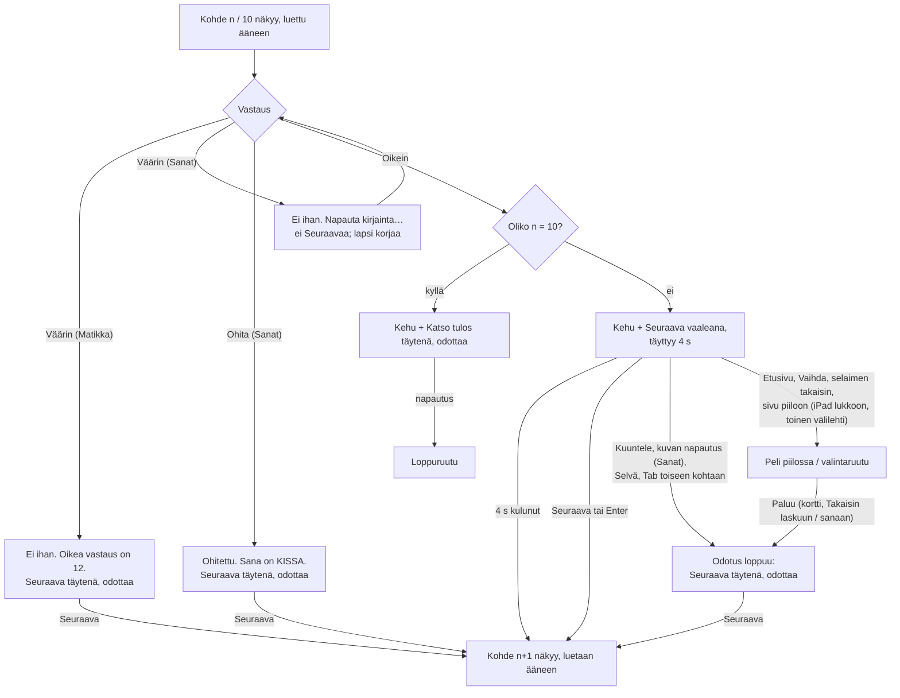

# SEI-46, SEI-47 — Automaattinen siirtyminen oikean vastauksen jälkeen (Matikka ja Sanat)

Designer, 2026-10-26. Kuvat jokaisesta tilasta molemmista peleistä
tietokoneella ja iPadilla: `docs/design/sei-46.html`. Tämä dokumentti on
rakentamisen lähde; HTML-sivu näyttää saman omistajalle.

**Tämä on muutos kahteen hyväksyttyyn suunnitelmaan**, ei uusi peli:
`docs/design/sei-2.md` (Matikka, Q20, "SEI-2 §x") ja `docs/design/sei-3.md`
(Sanat, Q26, "SEI-3 §x"). Kaikki, mitä tässä ei mainita, pysyy niissä
kuvatulla tavalla. Kumpaakaan tiedostoa ei muuteta; ristiriidassa tämä
dokumentti voittaa niiden kohtien osalta, jotka se nimeää (kohta 10).

Omistajan päätökset, joita tämä noudattaa (ei avata uudelleen):
- Q25 (Matikka) ja Q28 (Sanat "samoin säännöin"): siirtyminen **vain oikean
  vastauksen jälkeen**; **4 s** edistymispalkilla; **Seuraava ohittaa
  odotuksen**; **10. kohteen jälkeen `Katso tulos` säilyy** (ei hyppyä
  loppuruutuun).
- Q27 / SEI-3 E5: ohitettu sana näytetään ja luetaan, sitten Seuraava; **ei
  automaattista siirtymistä ohituksen jälkeen**.

Molemmat pelit toimivat **täsmälleen samoin**: sama painike, sama aika, samat
peruutussäännöt, sama ruudunlukijan lause (vain sana "lasku"/"sana" vaihtuu).
Ainoat erot johtuvat siitä, mitä peleissä jo on erilaista (Sanoissa kuva,
voittoääni ja ohitus; Matikassa näppäimistön Enter). SEI-47 kriteeri 14
vaatii tämän; poikkeamia ei ole.

---

## 1. Palvelutaso

**Käyttäjä.** Sama 1.–2.-luokkalainen kuin SEI-2 §1 ja SEI-3 §1. Osa lukee
vasta vähän; tieto ei siis voi olla tekstissä. Odotus näytetään kuvana
(painike täyttyy), ei lukuna eikä lauseena.

**Tehtävä.** "Kun vastasin oikein, haluan heti seuraavan." Omistaja
(2026-10-23, Mac, Matikka): jokainen oikea vastaus vaatii nyt Seuraava-
napautuksen. Väärän vastauksen jälkeen lapsi tarvitsee aikaa katsoa oikeaa
vastausta, joten siellä painike odottaa kuten ennen.

**Missä matkalla.** Kierroksen *aikana*, kohteiden 1–9 välissä. Ei koske
valintaruutua eikä loppuruutua. Kohteen 10 jälkeen lapsi painaa `Katso
tulos` kuten ennen (E7 / SEI-3 E9: iPad lukee tuloksen ääneen vain
napautuksesta).

**Jos tätä ei tehdä:** peli toimii kuten nyt; lapsi painaa Seuraava 9 kertaa
kierroksessa. Mikään ei mene rikki.

**Mitä noudatetaan (nykyiset mallit):**

| Malli | Missä nyt | Tässä |
|---|---|---|
| Pääpainike `Seuraava` + nuoli, 64 px, ≥ 240 px, tunnusväri | SEI-2 §3.2, SEI-3 §3.2 | Odotus näytetään **tämän painikkeen sisällä** (kohta 4). Ei uutta painiketta eikä uutta riviä. |
| Vaalea tunnusväritausta + tunnusvärinen reunus = "valittu / päällä" | SEI-2 §3.1 tasokortit, SEI-3 §3.1 kytkin (`--al` + `--a`) | Odottava painike alkaa vaaleana ja täyttyy tunnusvärillä. |
| Seuraava-napautus vaihtaa kohteen, lukee sen, siirtää fokuksen | SEI-2 §3.7, §7; SEI-3 §3.8, §7 | Ajastin tekee **täsmälleen saman** kuin napautus. |
| "Vähennä liikettä" poistaa animaatiot, tila näkyy silti | SEI-2 §4, SEI-3 §4 | Täyttö etenee neljänä askeleena ilman liukumista (kohta 4.3). |
| Pelin oma `aria-live`-alue, kerran tapahtumaa kohden | SEI-2 §7, SEI-3 §7 | Oikein-ilmoitukseen lisätään yksi lause. |
| Kesken jäänyt kierros palaa samaan kohtaan, ei lue ääneen | SEI-1 §3.5, SEI-2 §6 | Paluu odotuksen aikana: Seuraava odottaa napautusta. |

---

## 2. Kulku

Yksi kohde (lasku tai sana) vastaamisesta seuraavaan:

Polut, jotka eivät ole onnellisia:
- **Seuraava ja ajastin samaan aikaan** (napautus 3,99 s kohdalla): kohde
  vaihtuu kerran. Kumpi tahansa ehtii ensin, toinen ei tee mitään.
- **Kaksoisnapautus Seuraavaan odotuksen aikana:** ensimmäinen vaihtaa
  kohteen ja piilottaa Seuraavan; toinen osuu tyhjään (sama kuin SEI-2 §3.8,
  SEI-3 §3.9).
- **Ääni puuttuu kokonaan:** odotus toimii samoin; mikään ei odota puhetta.
- **iPad estää ajastimesta käynnistetyn puheen:** uusi kohde näkyy mutta jää
  lukematta; ks. kohta 5.2.

---

## 3. Säännöt

### 3.1 Milloin odotus alkaa

Odotus alkaa **vain** kun kaikki nämä pätevät:
1. Vastaus tai sana on **oikein**. Sanoissa myös oikein uudella
   yrityksellä (SEI-47 kriteeri 2).
2. Kohde on 1–9 (ei 10.).
3. Se alkaa **samassa napautuksessa**, joka teki vastauksesta oikean
   (Matikka: vaihtoehto, `OK` tai Enter; Sanat: viimeinen kirjain). Aika
   lasketaan tästä hetkestä.

Odotusta **ei** ole: väärän vastauksen jälkeen (Matikka), väärän tarkistuksen
jälkeen (Sanat; Seuraavaa ei silloin ole lainkaan), ohituksen jälkeen
(Sanat), 10. kohteen jälkeen, eikä koskaan uudelleen samalle kohteelle sen
jälkeen kun se on kerran loppunut (kohta 3.3).

### 3.2 Mitä odotuksen lopussa tapahtuu

Tasan **4000 ms** odotuksen alusta ajastin tekee **saman kuin
Seuraava-napautus**: sama funktio, sama tulos. Uusi kohde näkyviin, se
luetaan ääneen (SEI-2 §3.7, SEI-3 §3.8 "Uusi sana näkyviin"), fokus siirtyy
uuteen kohteeseen (SEI-2 §7, SEI-3 §7), ruudunlukija ilmoittaa sen. Pisteet,
palkki ja Kesken-luku eivät muutu tässä (ne muuttuivat jo vastattaessa).
Ainoa ero napautukseen: puhe käynnistyy ajastimesta (kohta 5.2).

Yksi ajastin on totuus. Painikkeen täyttö on saman pituinen animaatio, joka
alkaa samalla hetkellä; jos ajastin laukeaa hieman myöhässä (kuormitettu
laite), painike on täynnä sen hetken.

### 3.3 Mikä lopettaa odotuksen

Kaikki alla olevat lopettavat odotuksen **pysyvästi tälle kohteelle**:
ajastin perutaan, täyttö katoaa, ja Seuraava näkyy **täytenä, tavallisena
painikkeena** (sama kuin väärän vastauksen jälkeen). Seuraava kohde tulee
vasta napautuksesta. Mikään muu ei muutu.

| Tapahtuma | Mitä muuta tapahtuu | Miksi lopettaa |
|---|---|---|
| `Kuuntele lasku` / `Kuuntele sana` | Luetaan kuten aina (SEI-2 §3.7, SEI-3 §3.8). | Muuten seuraavan kohteen luenta katkaisisi kesken lauseen sen, mitä lapsi juuri pyysi kuulla (Sanoissa tavutettuna jopa 5 s). Peli ei saa tietoa puheen loppumisesta (kohta 6), joten ainoa tapa olla katkaisematta on lopettaa odotus. |
| Sanat: näkyvän kuvan napautus | Luetaan sana (SEI-3 §3.2). | Sama kuin Kuuntele. Lapsi, joka napauttaa paljastunutta kuvaa, haluaa katsoa sitä. |
| `Selvä` (Ei ääntä -ilmoitus, SEI-1 §3.4) | Ilmoitus piiloon, fokus Kuunteleen (nykyinen). | Aikuinen lukee ilmoitusta; kohde ei saa vaihtua sillä aikaa. |
| Fokus siirtyy näppäimistöllä (Tab, Shift+Tab) johonkin muuhun kuin Seuraavaan | – | Näppäimistön ja ruudunlukijan käyttäjä tutkii ruutua; fokus ei saa hypätä pois hänen altaan. |
| Sivu piiloon (`visibilitychange` → `hidden`: iPad lukkoon, sovelluksen vaihto, toinen välilehti) | – | Lapsi ei ole katsomassa; palatessa kohde ei saa olla vaihtunut näkemättä. |
| `Etusivu`, selaimen takaisin (`hide()`) | Kuten nyt. | SEI-46 kriteeri 6, SEI-47 kriteeri 7. |
| `Vaihda` | Valintaruutu kuten nyt. | Sama. |

**Ei lopeta:** napautus lukittuun vastauspainikkeeseen, käytettyyn laattaan,
valmiin sanan ruutuun tai tyhjään kohtaan; vieritys; laitteen kääntäminen tai
ikkunan koon muutos; Matikan numeronäppäimet ja Backspace (eivät tee
vastauksen jälkeen mitään, SEI-2 §3.4). Täyttö jatkuu niiden yli.

**Paluu** (SEI-47 avoin kysymys 2, SEI-46 kriteeri 6): kun lapsi palaa
etusivulta, valintaruudusta (`Takaisin laskuun`, `Takaisin sanaan`) tai
piilossa olleelle sivulle, sama kohde on valmiina ja **Seuraava odottaa
täytenä**. Ei uutta odotusta, ei jatkoa siitä mihin jäätiin, ei ääntä
(SEI-1 §3.5). Perustelu: palaava lapsi on ehkä unohtanut, mitä ruudulla oli;
itsestään vaihtuva kohde heti paluun jälkeen yllättäisi. Seuraava on yksi
napautus.

`Aloita uusi kierros`, `Pelaa uudelleen` ja sanalistan vaihto tulevat
valintaruudun kautta; odotus on loppunut jo `Vaihda`-napautuksessa.

### 3.4 Seuraava odotuksen aikana

`Seuraava` (napautus, tai Matikan kirjoitettavilla tasoilla Enter SEI-2
§3.4:n säännöin) toimii heti, täsmälleen kuten nykyinen Seuraava. Ajastin
perutaan samassa napautuksessa, joten kohde ei vaihdu kahdesti (SEI-46
kriteeri 5, SEI-47 kriteeri 6). Seuraava ei katkaise mitään muuta kuin
nykyinenkään (Sanojen voittoääni käyttäytyy kuten SEI-3:ssa Seuraavan
kohdalla).

---

## 4. Näkymät: odottava Seuraava-painike

Ainoa näkyvä muutos kummassakin pelissä. Kaikki muu oikein-tilassa (kehu,
vihreät ruudut / vihreä vastaus, lukitus, putkirivi, kuvan paljastus,
pisteet, palkki, tähdet) on SEI-2 §3.2–3.4:n ja SEI-3 §3.2, §3.6:n mukainen.

**Paikka:** sama kuin Seuraavan paikka nyt. Matikka: oma rivinsä
palauteruudun alla (SEI-2 §3.2, `nextw`). Sanat: palauterivin oikea reuna
kehun vieressä; < 600 px kehun alla koko leveydellä (SEI-3 §3.10). Korkeus
ei kasva missään asettelussa.

> Huom. pm:n kriteerit (SEI-46 / 1, SEI-47 / 1) sanovat "kehun alle
> ilmestyy edistymispalkki". Palkki on nyt **Seuraava-painikkeen sisällä**.
> Syy: Sanojen tietokoneasettelussa on 8 px vapaata korkeutta (SEI-3 §3.10),
> joten uusi rivi pakottaisi vierityksen; ja kun palkki on itse painike, lapsi
> näkee suoraan, että tämä nappi tapahtuu itsestään ja että sitä voi painaa.
> Kriteerin havaittava osa (palkki näkyy kehun yhteydessä, täyttyy tasaisesti
> 4 s, sitten seuraava tulee) täyttyy. Malli on tuttu videopalveluista
> ("Seuraava jakso" -painike, joka täyttyy).

### 4.1 Rakenne

Sama `<button>` kuin Seuraava (`.accent-btn`, 64 px korkea, ≥ 240 px leveä,
`Seuraava` + nuoli-SVG). Odotuksen aikana painikkeessa on kaksi
päällekkäistä kerrosta, joiden teksti ja nuoli ovat täsmälleen samassa
kohdassa:

| Kerros | Tausta | Teksti ja nuoli | Muuta |
|---|---|---|---|
| Pohja | tunnusvärin vaalea (`--al`: Matikka `#e3f7ea`, Sanat `#efe8fb`) | tunnusväri (`--a`: `#17803d` / `#764ba2`) | Painikkeella 3 px tunnusvärinen reunus ja tavallinen 4 px tumma alavarjo (`--ad`), joten se näyttää yhä painettavalta. |
| Täyttö (`aria-hidden="true"`) | tunnusväri (`--a`) | valkoinen | Leikataan vasemmalta oikealle: näkyvä osa 0 % → 100 % leveydestä (esim. `clip-path: inset(0 calc(100% - p) 0 0)`). |

Täytenä (100 %) painike näyttää täsmälleen tavalliselta Seuraavalta. Lapsi
näkee siis: vaalea painike täyttyy → kun se on täynnä, se "painaa itsensä".

### 4.2 Tilat

| Tila | Ulkoasu | Milloin |
|---|---|---|
| **Odottaa, täyttyy** | Vaalea pohja, tunnusvärinen täyttö etenee tasaisesti (lineaarinen) 0 % → 100 % 4,0 s:ssa. | Oikea vastaus, kohteet 1–9. |
| **Painettu odotuksen aikana** | Laskee 4 px, varjo pois (SEI-1 §3.3). Täyttö jää siihen kohtaan napautuksen ajaksi. | Seuraava-napautus. |
| **Fokus odotuksen aikana** | Keltainen + muste fokusrengas (SEI-1 §3.3), näkyy vain näppäimistöllä. | Fokus siirtyy painikkeeseen vastattaessa. |
| **Odottaa napautusta** (täysi) | Tavallinen Seuraava, kuten nyt. | Väärä (Matikka), ohitettu (Sanat), odotus loppunut (kohta 3.3), paluu. |
| `Katso tulos` | Tavallinen, kuten nyt; ei koskaan täyttöä. | Kohde 10, oikein tai väärin tai ohitettu. |

Painikkeessa ei ole lukua, sekunteja eikä lisätekstiä. Ei ääntä.

### 4.3 Vähennä liikettä (`prefers-reduced-motion: reduce`)

Täyttö ei liu'u. Se etenee **neljänä askeleena** ilman siirtymäanimaatiota:
25 % heti, 50 % kohdassa 1 s, 75 % kohdassa 2 s, 100 % kohdassa 3 s;
seuraava kohde kohdassa 4 s, kuten muutenkin (CSS `steps(4, jump-start)`
4 s:n animaatiolla). Pohjakerroksessa näkyy kolme pystyviivaa kohdissa 25 %,
50 % ja 75 % (3 px, tunnusväri 35 % peittävyydellä, koko korkeus), jotta
askeleet näyttävät laskurilta eivätkä nykiviltä. Siirtymän ajoitus ei muutu
(SEI-46 kriteeri 8, SEI-47 kriteeri 11). Täysi painike on näkyvissä
viimeisen sekunnin, eli lapsi ehtii nähdä "täynnä".

### 4.4 Mittasuhteet laitteittain

Sama kuin Seuraava nyt; ei uusia mittoja.

| | Matikka | Sanat |
|---|---|---|
| Tietokone ja iPad vaaka (≥ 900 px) | vasen sarake, palauteruudun alla, vasemmassa reunassa | palauterivin oikea reuna |
| iPad pysty (600–899 px) | keskitettynä palauteruudun alla | palauterivin oikea reuna |
| < 600 px | keskitettynä | kehun alla koko leveydellä (täyttö koko leveydellä) |

---

## 5. Ääni

### 5.1 Ajoitus

| Aika | Matikka | Sanat |
|---|---|---|
| 0 s (napautus) | `12` (0,9), noin 1 s; pisin `sata` / `kahdeksankymmentäkolme` alle 2 s | viimeinen kirjain (0,9), alle 1 s; voittoääni `vauhti.mp3` alkaa samasta napautuksesta |
| 3,0 s | – | voittoääni pysäytetään (SEI-3 §3.6, nykyinen sääntö) |
| 4,0 s | uusi lasku: `7 plus 5` (0,75) | uusi sana: sana kahdesti tauon kanssa / tavutettuna (SEI-3 §3.8) |

Molemmissa pelissä oikean vastauksen ääni loppuu viimeistään 3,0 s:n
kohdalla, joten 4 s ei katkaise sitä (SEI-46 kriteeri 2, SEI-47 kriteeri 4).
Sanojen marginaali on noin 1 s; se mitataan SEI-47 kriteerillä 13. **Jos
mittaus näyttää voittoäänen tai kirjaimen katkeavan**, se palautetaan
omistajalle havaintona (SEI-47 avoin kysymys 1); ratkaisu ei ole odottaa
puheen loppua, koska peli ei saa siitä tietoa (kohta 6).

Odotukseen ei lisätä uutta ääntä (ei "seuraava tulee", ei tikitystä).

### 5.2 Kun iPad estää ajastimesta käynnistetyn puheen

Tarkistamaton riski (backlog SEI-46, SEI-47; arkkitehtuurin avoin kysymys
iPadista). Jos uuden kohteen luenta ei käynnisty, koska se ei alkanut
napautuksesta:
- Kohde näkyy silti; peli ei jää jumiin (SEI-1 kriteeri 5).
- **Kuuntele pysyy `Kuuntele lasku` / `Kuuntele sana` -tilassa**, ei muutu
  `Ei ääntä` -tilaan, eikä Ei ääntä -ilmoitusta näytetä tämän takia. Syy:
  ääni toimii napautuksesta; ilmoitus kertoisi aikuiselle väärin, että
  laitteessa ei ole ääntä, ja Kuuntele näyttäisi rikkinäiseltä juuri silloin
  kun se on lapsen ainoa tapa kuulla sana. (Nykyään kehys näyttää
  ilmoituksen kerran myös muusta kuin napautuksesta tulleesta virheestä,
  SEI-1 §3.4; tämä on poikkeus juuri automaattiselle luennalle.)
- Matikassa lasku on näkyvissä tekstinä. Sanojen Keskitasolla ja Vaikealla
  sana on vain äänessä, joten lapsi napauttaa Kuuntele. Tähän ei lisätä
  visuaalista kehotusta ennen kuin iPad-tarkistus näyttää, että estoa
  todella tapahtuu.

---

## 6. Data ja koodi: mitä on, mitä ei

| Tarvitaan | Onko | Huomio |
|---|---|---|
| Oikein / väärin / ohitettu, kohteen numero | Kyllä | Matikka: `answered`, laskun tila (SEI-2 §5). Sanat: `tulos: heti | uudella | ohitettu` (SEI-3 §5). |
| Tieto siitä, milloin pelin puhe loppuu | **Ei** | `ctx.speech.say(parts)` ei palauta mitään eikä ota takaisinkutsua (`registry.js`, arkkitehtuuri "Game contract"). Tämä suunnitelma **ei tarvitse** sitä: aika on kiinteä 4 s, ja kaikki, mikä voisi puhua odotuksen aikana pidempään (Kuuntele, kuva), lopettaa odotuksen. |
| Voittoäänen pituus | Kyllä | Pysäytetään 3 s:n jälkeen (SEI-3 §3.6). |
| Odotuksen tila kohteelle | **Ei vielä** | Uusi muistitila pelin sisällä: `odotus: ei | käynnissä | loppunut` + ajastimen tunniste. `loppunut` on pysyvä tälle kohteelle. Ei tallenneta. |
| Ajastimen peruminen poistuttaessa | Kyllä, sääntö on | Pelisopimus: `hide()` pysäyttää ajastimet. Matikan nykyinen ainoa `setTimeout` on konfetti. |
| Sivu piiloon | Selaimen `visibilitychange` | Kuuntelija `document`-tasolla vain `show`- ja `hide`-kutsujen välillä (sopimuksen sääntö 2). |
| Vähennä liikettä | Kyllä | `prefers-reduced-motion`, jo käytössä (konfetti). |
| Automaattisen luennan erottaminen napautuksesta kehyksessä | **Osittain** | Kehys tietää jo, tuliko puhe napautuksesta (`fromTap`), mutta näyttää ilmoituksen kerran myös muuten. Kohta 5.2 vaatii, että automaattisen luennan epäonnistuminen ei muuta Kuuntelea eikä näytä ilmoitusta. Arkkitehti päättää tavan. |
| Sanat-peli | **Ei vielä** | Sanat on paikkamerkki; SEI-47 rakennetaan SEI-3:n päälle ja julkaistaan sen jälkeen. |

---

## 7. Reunat

- **Kohde 9 oikein:** odotus, sitten kohde 10. **Kohde 10 oikein:** `Katso
  tulos`, ei odotusta.
- **Kaikki 10 oikein ilman yhtään napautusta vastausten välissä:** kohteet
  2–10 tulevat itsestään, 10. jälkeen `Katso tulos` (SEI-46 kriteeri 10,
  SEI-47 kriteeri 13). Kierros kestää 9 × 4 s = 36 s pelkkää odotusta.
- **Kaikki 10 väärin (Matikka):** ei yhtään odotusta; käyttäytyy kuten
  SEI-2.
- **Sanat: sana oikein 20 väärän yrityksen jälkeen:** odotus kuten heti
  oikein (kriteeri 2). Pisteet "uudella yrityksellä" kuten SEI-3.
- **Sanat: kaikki ohitettu:** ei yhtään odotusta.
- **Sanat: taso tai tavutus vaihdetaan (`Vaihda` → `Takaisin sanaan`) kun
  sana on valmis:** sama valmis tila, Seuraava täytenä (SEI-3 §3.1:n
  "näkyy sama valmis tila").
- **Pisteet eivät riipu siirtymätavasta** (SEI-47 kriteeri 10): pisteet,
  palkki ja Kesken muuttuvat vastattaessa, eivät siirryttäessä, kuten jo nyt.
- **10. kohde valmis, etusivulle:** ei muutosta (`Kesken 10/10`, `Katso
  tulos` palatessa).
- **Seuraava-napautus 0,1 s:n kohdalla:** kohde vaihtuu heti; käynnissä oleva
  vastauksen luenta katkeaa uuden luennan alta, kuten nykyisellä Seuraavalla.
- **Pisin sana palauterivillä tietokoneella** (`Mestari! 🧙` + odottava
  Seuraava): painikkeen leveys ei muutu, joten mahtuu kuten nyt.
- **Hidas laite, ajastin myöhässä:** painike on täynnä myöhästymisen ajan;
  ei toista siirtymää.
- **Odotus käynnissä ja Ei ääntä -ilmoitus ilmestyy** (vastauksen luenta
  epäonnistui): ilmoitus ei itse lopeta odotusta; `Selvä` lopettaa.
- **Laite käännetään odotuksen aikana:** asettelu vaihtuu, täyttö jatkuu
  prosentteina, ajastin ei muutu.
- **Negatiivisia aikoja tai lukuja ei ole:** täyttö 0–100 %, aika 0–4000 ms.

---

## 8. Saavutettavuus

**Näppäimistöpolku** ei muutu (SEI-2 §7, SEI-3 §7). Vastattaessa fokus
siirtyy Seuraavaan kuten nyt; Enter tai välilyönti ohittaa odotuksen. Tab tai
Shift+Tab pois Seuraavasta lopettaa odotuksen (kohta 3.3), joten
näppäimistön käyttäjä ei menetä fokustaan ruudun vaihtuessa kesken
tutkimisen. Kun ajastin vaihtaa kohteen, fokus siirtyy uuteen kohteeseen
kuten Seuraavan jälkeen.

Huom. toteutukselle: pelin oma fokuksen siirto Seuraavaan vastattaessa ei
lopeta odotusta; vain fokuksen siirtyminen johonkin **muuhun** elementtiin
odotuksen aikana lopettaa.

**Ruudunlukija** (pelin oma `aria-live="polite"`):

| Tapahtuma | Luetaan (lisäys lihavoitu) |
|---|---|
| Matikka oikein, laskut 1–9 | `Oikein! 7 plus 5 on 12. Pisteet 4 / 5.` (+ `4 peräkkäin oikein.`) **`Seuraava lasku tulee itsestään.`** |
| Matikka oikein, lasku 10 | ennallaan (ei lisäystä) |
| Sanat oikein, sanat 1–9 | `Oikein! KISSA. Pisteet 4 / 5.` **`Seuraava sana tulee itsestään.`** |
| Sanat oikein, sana 10 | ennallaan |
| Uusi kohde (ajastimesta tai Seuraavasta) | ennallaan: `Lasku 6 / 10: 8 plus 5.` / `Sana 4 / 10. 5 kirjainta.` |
| Odotus loppuu (kohta 3.3) | ei mitään (Kuuntele puhuu itse; painikkeen nimi ei muutu) |

Lause kuuluu oikein-ilmoituksen loppuun **samaan kirjoitukseen**, jotta se
luetaan ennen siirtymää (SEI-46 kriteeri 9, SEI-47 kriteeri 12).

| Elementti | Nimi |
|---|---|
| Seuraava, odotus käynnissä tai ei | ennallaan `Seuraava lasku` / `Seuraava sana`. Nimi ei vaihdu odotuksen aikana (vaihtuva nimi luettaisiin uudelleen). |
| Täyttökerros | `aria-hidden="true"` (sen teksti on pohjan tekstin kopio) |
| Pystyviivat (vähennä liikettä) | `aria-hidden="true"` |

**Väri ei ole ainoa tieto:** odotus näkyy täytön **pituutena** (vaalea
osa → täytetty osa), ei pelkkänä värinä. Ero odottavan ja tavallisen
Seuraavan välillä on vaalea tausta ja tunnusvärinen teksti vs. täysi tausta
ja valkoinen teksti.

**Kontrasti:**

| Pari | Matikka | Sanat | Raja |
|---|---|---|---|
| Teksti `--a` vaalealla pohjalla `--al` (26 px lihava = suuri) | `#17803d` / `#e3f7ea` 4,4 : 1 | `#764ba2` / `#efe8fb` 5,4 : 1 | 3 : 1 |
| Valkoinen teksti täytöllä | 5,0 : 1 | 6,4 : 1 | 3 : 1 |
| Täyttö vs. pohja (grafiikka) | 4,4 : 1 | 5,4 : 1 | 3 : 1 |
| Reunus valkoisella kortilla | 5,0 : 1 | 6,4 : 1 | 3 : 1 |

**Aika ja hallinta (WCAG 2.2.1, 2.2.2):** odotus ei poista mitään, mitä
lapsi ei saisi takaisin (pisteet on jo kirjattu), ja sen voi aina ohittaa
(Seuraava) tai lopettaa (Kuuntele, Tab, poistuminen). Erillistä
"pysäytä"-painiketta ei lisätä: se olisi kolmas nappi palauteriville, jossa
ei ole tilaa, ja lapselle merkityksetön. (pm:n avoin kysymys SEI-46 / 5:
vastaus "ei erillistä pysäytystä; Kuuntele ja kuva pysäyttävät".)

**Koot:** ei muutu (64 px korkea, ≥ 240 px leveä).

---

## 9. Mitä tämä ei muuta

- Väärän vastauksen palaute, teksti ja ääni (SEI-2 §3.5, SEI-3 §3.6).
- Ohitus (SEI-3 §3.5, Q27).
- `Katso tulos` ja loppuruutu (SEI-2 §3.6, SEI-3 §3.7).
- Tap-guard 500 ms: koskee ruudun vaihtoa, ei kohteen vaihtoa; ajastimen
  siirtymä ei ole ruudun vaihto eikä aseta `screenChangedAt`-aikaa
  (SEI-2 §3.8). Siis uuden kohteen vastauspainikkeet reagoivat heti, kuten
  Seuraavan jälkeen.
- Kesken-merkki ja `reportProgress` (vastattaessa, ei siirryttäessä).

---

## 10. Muutokset hyväksyttyihin suunnitelmiin

HTML-sivulla merkitty `A1`…`A5`.

| # | Muutos | Kumpaa koskee | Korvaa |
|---|---|---|---|
| A1 | Oikean vastauksen jälkeen (kohteet 1–9) Seuraava on odottava painike, joka täyttyy 4 s ja vaihtaa kohteen itse. | molempia | SEI-2 §3.2 Seuraava-painike, SEI-3 §3.2 palauterivin oikein-rivi |
| A2 | Kuuntele, kuvan napautus (Sanat), Selvä, fokuksen siirto, sivun piiloon meno, Etusivu ja Vaihda lopettavat odotuksen; Seuraava odottaa sen jälkeen napautusta, myös palatessa. | molempia | uusi |
| A3 | Ruudunlukijan oikein-ilmoitukseen lisätään `Seuraava lasku/sana tulee itsestään.` (kohteet 1–9). | molempia | SEI-2 §7, SEI-3 §7 ruudunlukijataulukko |
| A4 | Automaattisen luennan epäonnistuminen ei muuta Kuuntelea `Ei ääntä` -tilaan eikä näytä ilmoitusta. | molempia (kehys) | SEI-1 §3.4 "kerran myös muusta kuin napautuksesta" tämän luennan osalta |
| A5 | Vähennä liikettä: täyttö neljänä askeleena, pystyviivat. | molempia | uusi |

---

## 11. Hyväksyntä: missä kriteerit katetaan

| Kriteeri | Kohta |
|---|---|
| SEI-46 / 1, SEI-47 / 1 palkki, 4 s, ei napautusta | 3.1, 3.2, 4 (huom. palkki painikkeessa, ei kehun alla) |
| SEI-46 / 2, SEI-47 / 4 ääni ei katkea | 5.1 |
| SEI-46 / 3, SEI-47 / 5 uusi kohde luetaan, palkki ja Seuraava piilossa | 3.2 |
| SEI-46 / 4, SEI-47 / 2–3 väärin ja ohitettu: ei palkkia | 3.1, 4.2 |
| SEI-46 / 5, SEI-47 / 6 Seuraava ohittaa, ei kahta | 3.4, 2 |
| SEI-46 / 6, SEI-47 / 7–8 poistuminen ja paluu | 3.3 |
| SEI-46 / 7, SEI-47 / 9 10. kohde: Katso tulos | 3.1, 4.2 |
| SEI-46 / 8, SEI-47 / 11 vähennä liikettä | 4.3 |
| SEI-46 / 9, SEI-47 / 12 ruudunlukija | 8 |
| SEI-46 / 10, SEI-47 / 13 täysi kierros, mittaus | 7 |
| SEI-47 / 10 pisteet eivät riipu siirtymästä | 7, 9 |
| SEI-47 / 14 pelit samat | johdanto, 10 (ei poikkeamia) |

## 12. Avoimet kysymykset omistajalle

Ei yhtään. Omistajan säännöt (Q25, Q28) ratkaisevat liiketoimintapuolen;
loput ovat suunnittelupäätöksiä, jotka näkyvät HTML-sivulla katselmointia
varten.
