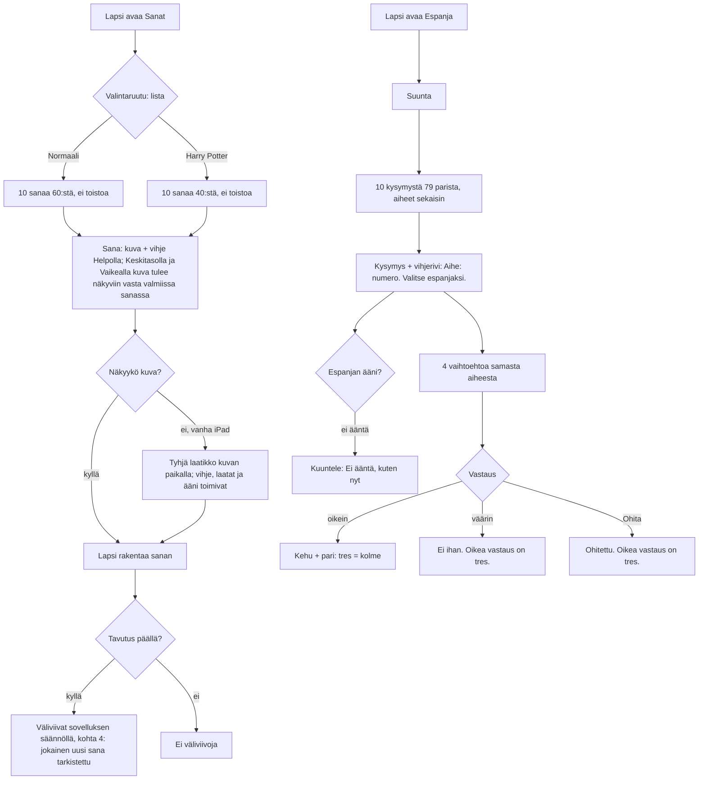

# SEI-50 – SEI-56 — Lisäsisältö: Sanat ja Espanja

Tehtävät: SEI-50 (Sanat, Normaali), SEI-51 (Sanat, Harry Potter), SEI-52
(Espanja, numero), SEI-53 (eläin), SEI-54 (ruoka), SEI-55 (viikonpäivä),
SEI-56 (perhe). Backlog osio E, omistajan vastaukset Q45–Q47.

Katselmointisivu omistajalle: `docs/design/sei-50.html`.

Tarkistaja (Q47): Claude, designer-rooli, 2026-10-27. Mitä tarkistettiin ja
mitä ei, kohta 9.

**Ruudulla ei muutu mikään rakenne, väri, painike tai teksti.** Muuttuvat vain
sanat, kuvat ja vihjeet (Sanat) ja sanaparit sekä viisi uutta aiheen nimeä
vihjerivillä (Espanja). Kaikki näkymät, tilat, äänet ja saavutettavuus ovat
`sei-3.md`:n (Sanat) ja `sei-4.md`:n (Espanja) mukaiset.

---

## 1. Palvelutaso

- **Käyttäjä:** 1.–2.-luokkalainen, joka pelaa Sanoja tai Espanjaa kotona
  iPadilla tai Macilla; aikuinen on lähellä mutta ei pelaa.
- **Tehtävä:** sama kuin ennen (kirjoita sana / valitse käännös). Ongelma on
  toisto: 24 / 20 sanan listasta ja 18 parista tulee samat sanat jo toisella
  kierroksella (omistajan pyyntö 2026-10-27, ei havaintoa lapsen käytöstä).
- **Matkalla:** sisältö näkyy vasta kierroksen sisällä. Valintaruudulla ei
  lue sanamääriä eikä aiheita, joten lapsi huomaa muutoksen vasta uusista
  sanoista.
- **Jos tätä ei tehdä:** lapsi oppii listan ulkoa ja Espanjassa tunnistaa
  vastauksen vaihtoehtojen joukosta muistin, ei kielen perusteella.
- **Mitä Espanjassa muuttuu kierroksen sisällä:** kierros arvotaan edelleen
  kaikista pareista (backlog E2, oletus). 18 → 79 paria tarkoittaa, että
  tervehdykset ja värit tulevat harvemmin (kohta 5.3).

## 2. Kulku

Kulku on sama kuin ennen; kaavio näyttää kohdat, joihin uusi sisältö osuu, ja
polut, jotka eivät ole onnellisia.

## 3. Näkymät: mitä ruudulla muuttuu

### 3.1 Sanat (ei muutoksia näkymiin)

- Kysymysrivin kuva (`emoji`) ja vihje (`hint`) tulevat uudesta taulukosta,
  kohta 4.1 ja 4.2. Kuvan koko, vihjeen fontti ja rivitys `sei-3.md` §3.2 ja
  §3.10.
- Pisin uusi Normaali-sana 7 kirjainta (HEVONEN, KIRAHVI, RAKETTI, PÄÄRYNÄ),
  sama kuin nyt (AURINKO). Pisin uusi HP-sana 10 (ROHKELIKKO, TÄHTITORNI,
  KASVIHUONE, PÄIVÄKIRJA), sama kuin nyt (TAIKASAUVA). Ei uutta asettelua.
- Pisin uusi vihje 28 merkkiä (`Yhdeksän ja kolme neljäsosaa`,
  `Täältä katsellaan yötaivasta`). Nyt pisin 23. 28 merkkiä 24 px:llä on noin
  340 px: mahtuu yhdelle riville tietokoneella ja iPadilla, rivittyy kahdelle
  < 600 px kuten `Taikuutta osaava nainen` jo nyt (`sei-3.md` §6).
- Ruudunlukija: Helpolla `Sana 1 / 10. 5 kirjainta. Vihje: Sanoo ammuu!`
  (nykyinen toteutus). Siksi vihje ei saa sisältää sanaa (kriteeri 4).

### 3.2 Espanja (yksi muutos: aiheen nimi vihjerivillä)

Vihjerivi on `Aihe: <aihe>. <suunta>.` (`sei-4.md` §3.2). Aiheen nimi on parin
oma `topic`-teksti sellaisenaan. Nykyiset ovat yksikössä (`tervehdys`,
`väri`), joten uudet ovat myös yksikössä:

| Tehtävä | `topic` (tarkka teksti) | Suomi → Espanja | Espanja → Suomi |
|---|---|---|---|
| SEI-52 | `numero` | `Aihe: numero. Valitse espanjaksi.` | `Aihe: numero. Valitse suomeksi.` |
| SEI-53 | `eläin` | `Aihe: eläin. Valitse espanjaksi.` | `Aihe: eläin. Valitse suomeksi.` |
| SEI-54 | `ruoka` | `Aihe: ruoka. Valitse espanjaksi.` | `Aihe: ruoka. Valitse suomeksi.` |
| SEI-55 | `viikonpäivä` | `Aihe: viikonpäivä. Valitse espanjaksi.` | `Aihe: viikonpäivä. Valitse suomeksi.` |
| SEI-56 | `perhe` | `Aihe: perhe. Valitse espanjaksi.` | `Aihe: perhe. Valitse suomeksi.` |

Ruudunlukijan kysymysilmoitus muuttuu samalla tavalla:
`Kysymys 4 / 10: keskiviikko. Aihe viikonpäivä. Valitse espanjaksi.`

- Pisin vihjerivi `Aihe: viikonpäivä. Valitse espanjaksi.` (38 merkkiä,
  22 px noin 400 px) mahtuu yhdelle riville ≥ 600 px (tilaa 546 px). Alle
  420 px se rivittyy kahdelle, kuten `Aihe: tervehdys. Valitse suomeksi.`
  jo nyt. Ei uutta tapausta.
- Pisin uusi vaihtoehto `kaksitoista` / `keskiviikko` (11 merkkiä) on
  lyhyempi kuin nykyinen `hyvää iltapäivää` (16). Pisin uusi espanja
  `zanahoria`, `miércoles` (9). Ei rivity missään leveydessä, joissa nykyinen
  ei rivity.
- Pisin uusi kysymyssana `kaksitoista` (11 merkkiä, yksi sana, ei voi
  rivittyä): < 420 px 34 px:llä noin 210 px; kortin sisäleveys 320 px:n
  laitteella noin 264 px. Mahtuu.
- Aksentit (`ratón`, `pájaro`, `león`, `plátano`, `miércoles`, `sábado`,
  `bebé`, `tía`) näkyvät kuten `adiós` ja `marrón` nyt; `lang="es"` on jo
  espanjankielisissä teksteissä.

### 3.3 Tilat

Tyhjä, lataus ja virhe eivät ole mahdollisia: sisältö on kiinteä ja pelin
muistissa (kuten `sei-3.md` §3.1, `sei-4.md` §5). Ainoa uusi osittainen tila
on kuva, joka ei piirry vanhalla laitteella (kohta 7).

---

## 4. Sanataulukot

Merkinnät: **Uusi** = lisätään; nykyiset sanat pysyvät ennallaan samoilla
kuvilla ja vihjeillä samassa järjestyksessä listan alussa (kriteeri 1). Uudet
lisätään listan loppuun tässä järjestyksessä.

Tavutus: "Sovellus" on se, minkä sovelluksen nykyinen tavutussääntö
(`syllabify`) antaa; jäljitetty käsin säännön läpi sana kerrallaan.
"Lähde" on fi.wiktionaryn tavutusrivi (haettu 2026-10-27), kun sellainen on.
Jokaisessa sanassa ne ovat samat.

Sanoja, joissa on kolmen konsonantin ryhmä (ANKKA, LAMPPU, KARKKI, TELTTA,
HANSKA, KOTITONTTU, TESTRAALI), ei otettu: sovelluksen sääntö tavuttaa ne
väärin (ANKKA → yksi tavu). Kohta 4.3.

### 4.1 Normaali (SEI-50): 24 nykyistä + 36 uutta = 60

| # | Sana | Kuva | Vihje (merkkiä) | Sovellus | Lähde: fi.wiktionary |
|---|---|---|---|---|---|
| 25 | LEHMÄ | 🐄 | Sanoo ammuu! (12) | LEH-MÄ | leh‧mä |
| 26 | HEVONEN | 🐴 | Sillä voi ratsastaa (19) | HE-VO-NEN | he‧vo‧nen |
| 27 | SIKA | 🐷 | Sanoo röh röh! (14) | SI-KA | si‧ka |
| 28 | LAMMAS | 🐑 | Sanoo mää! (10) | LAM-MAS | lam‧mas |
| 29 | KANI | 🐰 | Pitkät korvat, hyppii (21) | KA-NI | ka‧ni |
| 30 | KETTU | 🦊 | Oranssi metsän eläin (20) | KET-TU | ket‧tu |
| 31 | APINA | 🐒 | Kiipeilee puissa (16) | A-PI-NA | a‧pi‧na |
| 32 | LEIJONA | 🦁 | Eläinten kuningas (17) | LEI-JO-NA | lei‧jo‧na |
| 33 | KIRAHVI | 🦒 | Tosi pitkä kaula (16) | KI-RAH-VI | ki‧rah‧vi |
| 34 | ETANA | 🐌 | Kantaa kotiaan selässä (22) | E-TA-NA | e‧ta‧na |
| 35 | JUNA | 🚆 | Kulkee kiskoilla (16) | JU-NA | ju‧na |
| 36 | BUSSI | 🚌 | Moni pääsee kyytiin (19) | BUS-SI | bus‧si |
| 37 | LAIVA | 🚢 | Kulkee meren yli (16) | LAI-VA | lai‧va |
| 38 | PYÖRÄ | 🚲 | Kaksi rengasta ja polkimet (26) | PYÖ-RÄ | pyö‧rä (merkitys 2: polkupyörä) |
| 39 | RAKETTI | 🚀 | Lentää avaruuteen (17) | RA-KET-TI | ra‧ket‧ti |
| 40 | PILVI | ☁️ | Leijuu taivaalla (16) | PIL-VI | pil‧vi |
| 41 | SADE | 🌧️ | Vettä tulee taivaalta (21) | SA-DE | sa‧de |
| 42 | LUMI | ❄️ | Valkoista ja kylmää (19) | LU-MI | merkitys kyllä, tavutusriviä ei; perussääntö (KV-tavu) |
| 43 | SIENI | 🍄 | Sillä on lakki ja jalka (23) | SIE-NI | sie‧ni |
| 44 | LEHTI | 🍁 | Putoaa puusta syksyllä (22) | LEH-TI | leh‧ti |
| 45 | SALAMA | ⚡ | Välähtää ukkosella (18) | SA-LA-MA | sa‧la‧ma |
| 46 | LEIPÄ | 🍞 | Leikataan viipaleiksi (21) | LEI-PÄ | lei‧pä |
| 47 | JUUSTO | 🧀 | Keltainen ja reikäinen (22) | JUUS-TO | juus‧to |
| 48 | MAITO | 🥛 | Valkoinen juoma (15) | MAI-TO | mai‧to |
| 49 | PÄÄRYNÄ | 🍐 | Vihreä hedelmä (14) | PÄÄ-RY-NÄ | pää‧ry‧nä |
| 50 | KAKKU | 🎂 | Kynttilät päällä (16) | KAK-KU | kak‧ku |
| 51 | KEKSI | 🍪 | Rapea ja makea (14) | KEK-SI | kek‧si |
| 52 | KELLO | ⏰ | Tik tak! (8) | KEL-LO | merkitys kyllä, tavutusriviä ei; perussääntö (kaksoiskonsonantti) |
| 53 | KYNÄ | ✏️ | Sillä kirjoitetaan (18) | KY-NÄ | ky‧nä |
| 54 | REPPU | 🎒 | Koululaisen laukku (18) | REP-PU | rep‧pu |
| 55 | NALLE | 🧸 | Pehmeä lelu (11) | NAL-LE | nal‧le |
| 56 | RUMPU | 🥁 | Bum bum bum! (12) | RUM-PU | rum‧pu |
| 57 | KRUUNU | 👑 | Kuninkaan päässä (16) | KRUU-NU | kruu‧nu |
| 58 | KENKÄ | 👟 | Laitetaan jalkaan (17) | KEN-KÄ | ken‧kä |
| 59 | SUKKA | 🧦 | Lämmittää varpaita (18) | SUK-KA | suk‧ka |
| 60 | PAITA | 👕 | Puetaan päälle (14) | PAI-TA | pai‧ta |

Tarkistettu jokaisesta: yksi sana, vain A–Z/Ä/Ö, 4–7 kirjainta, ei esiinny
Harry Potter -listassa, kuva ei toistu Normaali-listan sisällä, vihje ei
sisällä sanaa eikä sen vartaloa, vihje ≤ 30 merkkiä. Kirjaimet B (BUSSI) ja D
(SADE) ovat Vaikean tason aakkosissa (A–Z, Å, Ä, Ö).

### 4.2 Harry Potter (SEI-51): 20 nykyistä + 20 uutta = 40

Lähde: suomenkielinen Wikipedia (haettu 2026-10-27), joka käyttää kirjojen
suomennoksen termejä. Lainaus on sivun oma muoto.

| # | Sana | Kuva | Vihje (merkkiä) | Sovellus | Lähde (fi.wikipedia-artikkeli: lainaus) | Kuvan sopivuus |
|---|---|---|---|---|---|---|
| 21 | ROHKELIKKO | 🦁 | Leijona on sen merkki (21) | ROH-KE-LIK-KO | Tylypahka: "Rohkelikko" | tuvan eläin |
| 22 | LUIHUINEN | 🐍 | Käärme on sen merkki (20) | LUI-HUI-NEN | Tylypahka: "Luihuinen" | tuvan eläin |
| 23 | PUUSKUPUH | 🦡 | Mäyrä on sen merkki (19) | PUUS-KU-PUH | Tylypahka: "Puuskupuh" | tuvan eläin |
| 24 | TUPA | 🏠 | Koulussa niitä on neljä (23) | TU-PA | Tylypahka: "tupa", "tuvat" | likimääräinen |
| 25 | TYLYAHO | 🏘️ | Taikurien oma kylä (18) | TY-LY-A-HO | Tylypahka: "Tylyaho" | hyvä |
| 26 | PIKAJUNA | 🚂 | Vie oppilaat kouluun (20) | PI-KA-JU-NA | Tylypahka: "Tylypahkan pikajuna" | hyvä |
| 27 | LAITURI | 🚉 | Yhdeksän ja kolme neljäsosaa (28) | LAI-TU-RI | Tylypahka: "laituri 9 ¾" | hyvä |
| 28 | TÄHTITORNI | 🔭 | Täältä katsellaan yötaivasta (28) | TÄH-TI-TOR-NI | Tylypahka: "tähtitorni" | hyvä |
| 29 | KASVIHUONE | 🪴 | Lasinen talo taimille (21) | KAS-VI-HUO-NE | Tylypahka: "kasvihuoneita" | likimääräinen |
| 30 | ETSIJÄ | 🔍 | Nappaa kultaisen pallon (23) | ET-SI-JÄ | Huispaus: "Etsijä" | likimääräinen |
| 31 | PITÄJÄ | 🥅 | Vartioi maalirenkaita (21) | PI-TÄ-JÄ | Huispaus: "Pitäjä" | hyvä |
| 32 | LYÖJÄ | 🏏 | Pelaaja, jolla on maila (23) | LYÖ-JÄ | Huispaus: "Lyöjä"; "puumailoillaan" | hyvä |
| 33 | KOTIKOLO | 🏡 | Punatukkaisen perheen talo (26) | KO-TI-KO-LO | Weasleyn perhe: "Kotikolo" (The Burrow) | hyvä |
| 34 | KALJUUNA | 💰 | Taikurien kultaraha (19) | KAL-JUU-NA | Weasleyn perhe: "tuhat kaljuunaa" | hyvä |
| 35 | ARPI | ⚡ | Salaman muotoinen otsassa (25) | AR-PI | Harry Potter ja viisasten kivi: "salamanmuotoisen arven" | hyvä |
| 36 | KENTAURI | 🏹 | Puoliksi hevonen (16) | KEN-TAU-RI | Harry Potter ja Feeniksin kilta: "kentaurit" | likimääräinen |
| 37 | SULKAKYNÄ | 🪶 | Kastetaan musteeseen (21) | SUL-KA-KY-NÄ | Harry Potter ja Feeniksin kilta: "sulkakynällä" | hyvä |
| 38 | FEENIKS | 🔥 | Tulinen lintu (13) | FEE-NIKS | Harry Potter ja salaisuuksien kammio: "feenikslintu Fawkes"; kirjan nimi "Feeniksin kilta" | likimääräinen |
| 39 | ALRUUNA | 🌱 | Kasvi, joka kiljuu (18) | AL-RUU-NA | Harry Potter ja salaisuuksien kammio: "alruunajuomalla" | likimääräinen |
| 40 | PÄIVÄKIRJA | 📔 | Salaisuudet sivuilla (20) | PÄI-VÄ-KIR-JA | Harry Potter ja salaisuuksien kammio: "Tom Valedron päiväkirja" | hyvä |

Tarkistettu jokaisesta: suomennoksen termi (ei englantia), ei henkilön nimi
(E4), yksi sana, ≤ 10 kirjainta, ei Normaali-listassa, kuva ei toistu HP-listan
sisällä, vihje ≤ 30 merkkiä, ei sisällä sanaa eikä sen vartaloa, ei paljasta
juonta, ei pelottava.

"Likimääräinen" kuva tarkoittaa: kuva sopii sanaan vihjeen kanssa, mutta ei
yksinään kerro sanaa (esim. 🔥 feeniksille, koska feeniks-emoji 🐦‍🔥 on vasta
Unicode 15.1:ssä ja piirtyy vanhemmissa laitteissa kahtena kuvana, jotka eivät
mahdu kuvaruutuun). Kriteeri 6 vaatii "sopii sanaan", ei yksiselitteisyyttä
(Normaalin kriteeri 5 vaatii; siksi Normaali-listassa ei ole likimääräisiä).

Neljä kuvaa toistuu listojen välillä: 🦁 LEIJONA / ROHKELIKKO, ⚡ SALAMA /
ARPI, 🔥 TULI / FEENIKS, 🏠 TALO / TUPA. Listat eivät koskaan sekoitu samaan
kierrokseen, joten lapsi ei näe kahta sanaa samalla kuvalla. Sääntö
rakentajalle: kuva on yksilöllinen listan sisällä, ei listojen välillä.

### 4.3 Sanat: pois jätetyt ja miksi

| Sana | Syy |
|---|---|
| ANKKA, LAMPPU, KARKKI, TELTTA, HANSKA | Kolmen konsonantin ryhmä; sovelluksen tavutus antaa väärän tuloksen (esim. ANKKA yhtenä tavuna). Kriteeri 6. |
| PERHONEN, MANSIKKA, PORKKANA, TRAKTORI, PINGVIINI | Yli 7 kirjainta (E4). |
| KUUSI | Myös numero; kuva ei olisi yksiselitteinen. |
| PIZZA | Suomen kirjakielen asu on "pitsa"; lapsi kirjoittaisi kumman tahansa. |
| SIILI, OVI | Kuva on jo HP-listassa (🦔 KUTKA, 🚪 KAMMIO); vältetty, vaikka sääntö sallisi. |
| KORPINKYNSI | 11 kirjainta, raja 10 (kriteeri 4). Kolme muuta tupaa on listassa. Kohta 11, Q-a. |
| KOTITONTTU, TESTRAALI | Tavutus väärin (NTT, STR); testraali myös pelottava. |
| ANKEROINEN, MÖRKÖ, KERBEROS, BASILISKI | Pelottava 7-vuotiaalle (kriteeri 5). |
| Iseeviot-peili, Lajitteluhattu, muistipallo | Kaksi sanaa tai yli 10 kirjainta. (Huom: peili ei ole "Iseeviskan kuvastin", jonka ensin oletin; Wikipedian muoto on "Iseeviot-peili".) |
| SIEPPI, KAATO, RYHMY | Termi on oikea (Huispaus-artikkeli), mutta sopivaa kuvaa ei ole; kriteeri 6: sana jätetään pois. |
| KERMAKALJA | Ainoa sopiva kuva on olutlasi 🍺. |
| MUOTOKUVA, KURPITSA, ENNUSTUS | Lähdettä suomennoksesta ei löytynyt; ei arvattu. |

### 4.4 Espanja: uudet aiheet (SEI-52 – SEI-56)

Lähde jokaiselle: fi.wiktionary.org, sana espanjaksi hakusanana, osio
"Espanja", haettu 2026-10-27. Lainaus on sivun suomennos. Espanjan
alueellinen muoto (Espanja vs. Latinalainen Amerikka) lisäksi
en.wiktionary.org:sta, kun sana on alueellinen. Kaikki ilman artikkelia,
yksikössä, pienellä alkukirjaimella (E5, kuten `rojo`).

Nykyiset 18 paria pysyvät ennallaan ja ensimmäisinä. Uudet lisätään tässä
järjestyksessä aihe kerrallaan; jokaisen aiheen voi julkaista erikseen.

**SEI-52 — `numero`, 12 paria**

| es | fi | Lähde: fi.wiktionary |
|---|---|---|
| uno | yksi | Numeraali: "yksi" |
| dos | kaksi | Numeraali: "kaksi" |
| tres | kolme | Numeraali: "kolme" |
| cuatro | neljä | Numeraali: "neljä" |
| cinco | viisi | Numeraali: "viisi" |
| seis | kuusi | Numeraali: "kuusi" |
| siete | seitsemän | Numeraali: "seitsemän" |
| ocho | kahdeksan | Numeraali: "kahdeksan" |
| nueve | yhdeksän | Numeraali: "yhdeksän" |
| diez | kymmenen | Numeraali: "kymmenen" |
| once | yksitoista | Numeraali: "yksitoista" |
| doce | kaksitoista | Numeraali: "kaksitoista" |

Luvut kirjoitetaan sanoina molemmilla kielillä, ei numeroina (backlogin
esimerkki "yksi–kymmenen, uno–diez").

**SEI-53 — `eläin`, 16 paria**

| es | fi | Lähde: fi.wiktionary | Huomio |
|---|---|---|---|
| perro | koira | "koira" | |
| gato | kissa | "kissa" | |
| caballo | hevonen | "hevonen" | |
| vaca | lehmä | "lehmä" | |
| cerdo | sika | "sika" | |
| oveja | lammas | "lammas" | |
| pájaro | lintu | "mikä tahansa lintu" | aksentti á; alueellisia slangimerkityksiä, ei Espanjan perusmerkitys |
| pez | kala | "kala (vedessä ja eläinlajina)" | elävä kala; ruokana *pescado*, jota ei otettu (kala olisi kahdessa aiheessa) |
| ratón | hiiri | "hiiri" | aksentti ó |
| conejo | kani | "kani", "kaniini" | |
| pato | ankka | "ankka" | |
| gallina | kana | "kana" | ruokana *pollo* jätettiin pois (kana kahdessa aiheessa) |
| león | leijona | "leijona" | aksentti ó |
| elefante | norsu | "norsu" | |
| mono | apina | substantiivi: "apina" | Espanjassa myös adjektiivi "söpö"; lapselle opetetaan "el mono" |
| oso | karhu | "karhu" | |

**SEI-54 — `ruoka`, 16 paria**

| es | fi | Lähde: fi.wiktionary | Huomio |
|---|---|---|---|
| pan | leipä | "leipä" | |
| leche | maito | "maito" | |
| agua | vesi | "vesi" | |
| zumo | mehu | "mehu" | Espanjan muoto (en.wiktionary: "Spain"); Lat. Am. *jugo* |
| manzana | omena | "omena" | |
| plátano | banaani | "banaani (kasvi ja hedelmä)" | aksentti á; Espanjan muoto |
| fresa | mansikka | "mansikka" | |
| pera | päärynä | "päärynä (hedelmä)" | |
| queso | juusto | "juusto" | |
| huevo | muna | "muna", "kananmuna" | monikolla on puhekielinen kaksoismerkitys; yksikkö on peruskoulusana |
| arroz | riisi | "riisi" | |
| sopa | keitto | "keitto", "soppa" | |
| helado | jäätelö | substantiivi: "jäätelö" | |
| galleta | keksi | "keksi" | |
| patata | peruna | "peruna" | Espanjan muoto (en.wiktionary: "Spain"); Lat. Am. *papa* |
| zanahoria | porkkana | "porkkana" | |

**`naranja` ei ole ruoka-aiheessa** (kriteeri 9): se on jo väri (oranssi). Jos
`naranja = appelsiini` lisättäisiin, sama espanjan sana olisi kahdessa
aiheessa, ja paririvi `naranja = oranssi` / `naranja = appelsiini` opettaisi
lapselle kaksi eri vastausta samaan sanaan.

**SEI-55 — `viikonpäivä`, 7 paria (täsmälleen, kriteeri 8)**

| es | fi | Lähde: fi.wiktionary |
|---|---|---|
| lunes | maanantai | "maanantai"; kirjoitetaan pienellä |
| martes | tiistai | "tiistai" |
| miércoles | keskiviikko | "keskiviikko"; aksentti é tarkistettu |
| jueves | torstai | "torstai" |
| viernes | perjantai | "perjantai" |
| sábado | lauantai | "lauantai"; aksentti á tarkistettu |
| domingo | sunnuntai | "sunnuntai" |

Pieni alkukirjain molemmilla kielillä (espanjassa ja suomessa viikonpäivät
kirjoitetaan pienellä; kriteeri 10).

**SEI-56 — `perhe`, 10 paria**

| es | fi | Lähde: fi.wiktionary |
|---|---|---|
| madre | äiti | "äiti" |
| padre | isä | "isä" |
| hermano | veli | "veli" |
| hermana | sisko | "sisko, sisar" |
| abuelo | isoisä | "isoisä" |
| abuela | isoäiti | "isoäiti", "mummi", "mummo" |
| hijo | poika | "poika (suhteessa vanhempiinsa)" |
| hija | tytär | "tytär" |
| bebé | vauva | "vauva"; aksentti é |
| tía | täti | "täti"; aksentti í |

Sukupuolipareista (kriteeri 9): hermano/hermana, abuelo/abuela, hijo/hija ja
madre/padre ovat kumpikin oma parinsa, koska suomessa on kaksi eri sanaa.
Pois jätetyt:
- **tío** = "setä, eno" (fi.wiktionary): suomessa kaksi sanaa, kumpikaan ei
  yksin ole oikein. Siksi `tía` on mukana ilman paria (`täti` kattaa
  molemmat puolet).
- **primo / prima**: molemmat "serkku"; kaksi samaa suomea samassa aiheessa
  (kriteeri 2).
- **mamá / papá**: sama suomi kuin madre/padre.
- **familia** = perhe: kysymys `perhe` vihjerivillä `Aihe: perhe.` näyttäisi
  oudolta.

**Isoäiti ja isoisä** ovat sanakirjan muodot; lapsi sanoo usein mummo, mummi,
vaari, ukki tai pappa, mutta ne vaihtelevat perheittäin. Isoäiti ja isoisä
ovat kaikille ymmärrettäviä.

### 4.5 Espanja: tarkistukset kaikille 79 parille

- Jokaisen aiheen sisällä jokainen suomi ja jokainen espanja on yksilöllinen
  (kriteeri 2). Tarkistettu taulukoista.
- Koko listassa jokainen espanja on yksilöllinen (kriteeri 9, myös nykyinen
  testi vaatii tämän). Ei törmäyksiä.
- Koko listassa jokainen suomi on yksilöllinen (nykyinen testi vaatii myös
  tämän). Tarkistettu: `kala`, `kana`, `kissa` jne. esiintyvät vain kerran.
- Jokainen espanja on 1 sana (raja 2).
- Pienin aihe on viikonpäivä (7 paria): kolme väärää vaihtoehtoa löytyy aina.

---

## 5. Määrät ja perustelut

### 5.1 Ehdotetut määrät

| Lista / aihe | Nyt | Uusia | Yhteensä | Peruste |
|---|---|---|---|---|
| Sanat, Normaali | 24 | 36 | **60** | Kuusi kierrosta ennen kuin sana voisi toistua, jos kierrokset eivät menisi päällekkäin. Kaikki 4–7 kirjainta, enimmäkseen kaksitavuisia. Rajana oli se, että kuvan on oltava yksiselitteinen ja tavutuksen oikea; 40 uutta olisi vaatinut likimääräisiä kuvia. |
| Sanat, Harry Potter | 20 | 20 | **40** | Vähimmäismäärä. Rajana on, että sana on löydettävä suomennoksesta lähteen kanssa, mahduttava 10 kirjaimeen, olla pelottamaton ja sillä on oltava kuva. Kohdassa 4.3 on 17 Potter-ehdokasta, jotka eivät läpäisseet. |
| Espanja, numero | – | 12 | 12 | 1–10 on koulun ydin; 11 ja 12 tarvitaan kellossa ja kuukausissa ja ovat vielä lyhyitä. 13–19 (trece–diecinueve) ovat oma sarjansa; jätetty, jottei numeroaihe ylitä muita. |
| Espanja, eläin | – | 16 | 16 | Kotieläimet, maatilan eläimet ja tutuimmat villieläimet. |
| Espanja, ruoka | – | 16 | 16 | Aamiainen, hedelmät, perusruoat ja juomat. |
| Espanja, viikonpäivä | – | 7 | 7 | Kriteerin mukaan täsmälleen 7. |
| Espanja, perhe | – | 10 | 10 | Kaikki tavalliset perhesanat, joilla on yksi suomenkielinen vastine (4.4). |
| **Espanja yhteensä** | 18 | 61 | **79** | |

### 5.2 Uusi sana tulee vastaan (kriteerit SEI-50/7, SEI-51/9)

Todennäköisyys, ettei 10 sanan kierroksessa ole yhtään uutta sanaa:
- Normaali: C(24, 10) / C(60, 10) = 1 961 256 / 75 394 027 566 ≈ 0,003 %.
- Harry Potter: C(20, 10) / C(40, 10) = 184 756 / 847 660 528 ≈ 0,02 %.

Viidessä kierroksessa uusi sana tulee siis vastaan käytännössä aina.
Kriteerin testi voi käyttää siemenarvottua satunnaislukugeneraattoria
(`newDeck(theme, rng)`).

### 5.3 Espanjan aiheiden osuus kierroksessa

Kierros on 10 paria 79:stä ilman toistoa, aiheet sekaisin (E2, oletus).
Odotettu määrä kierroksessa = 10 × aiheen koko / 79:

| tervehdys 8 | väri 10 | numero 12 | eläin 16 | ruoka 16 | viikonpäivä 7 | perhe 10 |
|---|---|---|---|---|---|---|
| 1,0 | 1,3 | 1,5 | 2,0 | 2,0 | 0,9 | 1,3 |

Kierroksia, joissa ei ole yhtään tervehdystä: C(71, 10) / C(79, 10) ≈ 32 %
(laskettu tulona (71/79)(70/78)…(62/70)). Nyt (18 paria): 1 / C(18, 10) =
1 / 43 758, eli käytännössä ei koskaan. Tämä on backlogin riski "vanhat aiheet
harvemmin"; se näytetään omistajalle katselmointisivulla (kohta 11, Q-b).

Jos aiheet julkaistaan yksi kerrallaan, osuudet muuttuvat joka julkaisulla;
kaikki muu toimii jokaisessa välivaiheessa, koska jokaisessa aiheessa on
vähintään 7 paria.

---

## 6. Data: mitä on, mitä ei

| Tarvitaan | Onko | Huomio |
|---|---|---|
| Sanalle `word`, `emoji`, `hint` | Kyllä | Sama rakenne kuin nyt; ei uusia kenttiä. |
| Parille `es`, `fi`, `topic` | Kyllä | Sama rakenne; `topic` on näytettävä teksti (kohta 3.2), joten se kirjoitetaan täsmälleen kuten taulukossa. |
| Lähde ja tarkistuspäivä sanakohtaisesti | **Ei koodissa** | Kirjataan tähän dokumenttiin ja tehtäviin, ei sovellukseen (kriteeri 8 vaatii kirjauksen tehtävään, ei dataan). |
| Emoji, jossa on muunnosmerkki U+FE0F | Kyllä | ☁️ (U+2601 U+FE0F), 🌧️ (U+1F327 U+FE0F), ❄️ (U+2744 U+FE0F), ✏️ (U+270F U+FE0F), 🏘️ (U+1F3D8 U+FE0F). Ilman U+FE0F:ää ne voivat piirtyä mustavalkoisena merkkinä. Kopioi tästä dokumentista sellaisenaan; nykyinen ☀️ ja ❤️ tehdään samoin. |
| Tavutus | Kyllä | Nykyinen `syllabify` riittää kaikille 56 uudelle sanalle (kohta 4). Ei muutosta sääntöön. |
| Aakkoset Vaikealla | Kyllä | Uusissa sanoissa B, D, F; kaikki ovat aakkosissa. |
| Testit, jotka lukitsevat nykyiset määrät | Kyllä, muuttuvat | `tests/unit/sanat-logic.test.mjs` lukitsee 24 ja 20 sekä viimeiset sanat (TULI, TAIKAJUOMA); `tests/unit/espanja-logic.test.mjs` lukitsee taulukon ja aiheiden koot (8, 10) sekä luettelee aiheet `['tervehdys', 'väri']` yksilöllisyystestissä. Arkkitehti päättää, miten ne laajennetaan; tämän dokumentin taulukot ovat odotettu sisältö. |

**Testattavat ehdot rakentajalle** (ehdotus arkkitehdille, ei määräys):
- Jokainen Normaali-sana 3–7 kirjainta, HP-sana ≤ 10, vain ALPHABETin
  kirjaimia; ei sanaa kahdesti listojen yli; emoji yksilöllinen listan sisällä.
- Jokaisen uuden sanan `syllabify` = kohdan 4.1/4.2 sarake "Sovellus".
- Mikään vihje ei sisällä sanaa (pienillä kirjaimilla vertaillen).
  Vartalotarkistus on käsin tehty tässä, koodi ei pysty siihen.
- Espanja: jokainen `es` ja jokainen `fi` yksilöllinen koko listassa;
  aiheiden koot 8, 10, 12, 16, 16, 7, 10.

---

## 7. Reunat

- **Kuva ei piirry** (vanha iPad, Unicode 13 -kuvat 🪴 ja 🪶 kuten nykyiset 🪄
  ja 🫕): kuvan paikalla näkyy tyhjä laatikko; vihje, laatat, ääni ja
  pisteet toimivat (`sei-3.md` §5). Uusista kuvista Unicode 11–13: 🧸 (11),
  🦡 (11), 🧦 (10), 🦒 (10), 🪴 (13), 🪶 (13); muut Unicode 9 tai vanhempia.
- **Kaikki 10 samasta Espanja-aiheesta:** mahdollista (eläin ja ruoka 16,
  numero 12). Ei estetä, kuten nyt.
- **7 viikonpäivää samalla kierroksella:** mahdollista; jokaisessa
  kysymyksessä 3 väärää muista 6:sta. Toimii.
- **Kysymys `kuusi`** (Suomi → Espanja): suomessa myös puu, mutta vihjerivi
  `Aihe: numero.` ratkaisee. Vaihtoehdot ovat kaikki numeroita.
- **`isä` ja `isoisä` samassa vaihtoehtojoukossa:** eri sanat; ei ongelma.
- **`poika`** (hijo) Suomi → Espanja: vaihtoehdoissa ei ole *niño*-sanaa,
  joten "poika" voi tarkoittaa vain *hijo*.
- **Nolla uutta sanaa kierroksessa:** mahdollista mutta hyvin harvinaista
  (5.2).
- **Lyhyin uusi sana** 4 kirjainta (SIKA, KANI, JUNA, SADE, LUMI, KYNÄ, TUPA,
  ARPI); lyhyin nykyinen 3 (PUU, KUU). Ei uutta tapausta.
- **Sana, jonka kaikki kirjaimet sekoitettuna voisivat olla sama sana:**
  nykyinen uudelleensekoitus (`sei-3.md` §3.3) kattaa myös KAKKU, KEKSI, SUKKA.
- **Negatiivisia tai tyhjiä lukuja ei ole:** sisältö on kiinteä.

---

## 8. Saavutettavuus

Ei uusia ohjaimia, polkuja eikä värejä; näppäimistöpolku, kohdistusjärjestys
ja kontrastit `sei-3.md` §7 ja `sei-4.md` §8 mukaan.

- Emoji on `aria-hidden` ja kuvapainikkeen nimi `Kuva. Kuuntele sana.` ei kerro
  sanaa (ennallaan). Ruudunlukija saa vihjeen tekstinä Helpolla.
- Espanjan uudet aiheet luetaan ruudunlukijalle kysymysilmoituksessa
  (`Aihe viikonpäivä.`), kuten nykyiset.
- Espanjankieliset vaihtoehdot ja kysymyssanat ovat `lang="es"` (ennallaan),
  joten ruudunlukija lausuu `miércoles` espanjaksi.
- Mikään uusi tieto ei ole vain värin tai sijainnin varassa.

---

## 9. Tarkistus (SEI-50/8, SEI-51/8, SEI-52/6 ja niihin viittaavat)

**Tarkistaja:** Claude (designer-rooli). **Päivä:** 2026-10-27.

**Mitä tarkistettiin:**
- Espanja (61 paria): jokaisen sanan merkitys ja kirjoitusasu (aksentit)
  fi.wiktionarysta sana kerrallaan; Espanjan alueelliset muodot zumo ja
  patata en.wiktionarysta. Lainaukset taulukoissa 4.4.
- Sanat, Normaali (36): merkitys ja tavutus fi.wiktionarysta sana kerrallaan
  (34 tavutusriviä; LUMI ja KELLO: merkitys löytyi, tavutusriviä ei,
  tavutus suomen perussäännöstä).
- Sanat, Harry Potter (20): suomennoksen termi suomenkielisestä
  Wikipediasta (artikkelit Tylypahka, Huispaus, Weasleyn perhe, Harry Potter
  ja viisasten kivi, Harry Potter ja salaisuuksien kammio, Harry Potter ja
  Feeniksin kilta). Tavutus suomen tavutussäännöllä.
- Sovelluksen tavutus: jokainen 56 uutta sanaa jäljitetty käsin nykyisen
  säännön läpi; tulos = lähteen tavutus jokaisessa.
- Vihjeet: pituus, ei sanaa eikä vartaloa, sopivuus 7-vuotiaalle.

**Mitä EI tarkistettu (ja kuka voi):**
- **Ääni** (SEI-52 – 56 kriteeri 5): en kuule es-ES-ääntä. Jokainen uusi
  espanjan sana pitää kuunnella Macin Chromessa Kuuntele-painikkeella ja
  kirjata väärältä kuulostavat. Tämä on rakentajan tai katselmoijan
  tarkistus, kun sanat ovat sovelluksessa.
- **Kuvien näkyminen Macin Chromessa** (kriteeri 5/6): en näe ruutua.
  Katselmointisivu `sei-50.html` näyttää jokaisen kuvan samalla emojifontilla
  kuin sovellus, joten kun sivu avataan Macin Chromessa, tyhjä laatikko näkyy
  siellä. Kirjaus tehdään tehtävään, kun sivu on katsottu.
- **Kirjojen tekstiä** en lukenut; HP-termit ovat Wikipedian kautta, joka
  käyttää suomennoksen nimiä. Tämä on lähde, ei kirja itse.

**Epävarmat (merkitty, ei poistettu):**
- FEENIKS: kirjojen muoto on "feenikslintu" (11 kirjainta) ja "Feeniksin
  kilta". Perusmuoto "feeniks" on johdettu taivutusmuodosta; sana on yleinen
  suomen sana. Jos halutaan vain kirjan tarkka muoto, FEENIKS pois.
- PÄIVÄKIRJA: kirjassa salaperäinen esine; vihje ei kerro sitä. Sana on
  tavallinen suomen sana, ei vain Potter-termi.
- ARPI: Harryn tunnettu tuntomerkki; ei henkilön nimi, mutta liittyy
  henkilöön.
- *mono* (apina) on Espanjassa myös arkikielen "söpö"; *pájaro*, *huevo* ja
  *tía* ovat yksikössä perussanoja, mutta niillä on alueellisia arkisia
  lisämerkityksiä. Kaikki ovat espanjan alkeisoppikirjojen tavallisia sanoja.

---

## 10. Hyväksyntä: missä kriteerit katetaan

| Kriteeri | Kohta |
|---|---|
| SEI-50/1 määrä ≥ 44, nykyiset ennallaan, määrä kirjattu | 4.1, 5.1 (60) |
| SEI-50/2, SEI-51/2 ei kaksoiskappaleita | 4.1, 4.2 tarkistusrivit |
| SEI-50/3 merkit ja pituus | 4.1 |
| SEI-50/4, SEI-51/5 vihjeet | 4.1, 4.2 |
| SEI-50/5, SEI-51/6 kuvat | 4.1, 4.2, 7, 9 (Mac-katselu kesken) |
| SEI-50/6, SEI-51/7 tavutus | 4.1, 4.2, 6 |
| SEI-50/7, SEI-51/9 uusi sana 5 kierroksessa | 5.2 |
| SEI-50/8, SEI-51/8 tarkistuksen kirjaus | 9 |
| SEI-51/1 määrä ≥ 40 | 4.2, 5.1 (40) |
| SEI-51/3 suomennoksen termi, lähde | 4.2 |
| SEI-51/4 ≤ 10 kirjainta | 4.2 |
| SEI-52 – 56/1 määrä | 4.4, 5.1 |
| SEI-52 – 56/2 ei kahta samaa | 4.5 |
| SEI-52 – 56/3 neljä vaihtoehtoa samasta aiheesta | 4.5 (pienin aihe 7); nykyinen `newRound` |
| SEI-52 – 56/4 aiheen nimi vihjerivillä | 3.2 |
| SEI-52 – 56/5 ääni | 9 (kuuntelu kesken) |
| SEI-52 – 56/6 käännös ja lähde | 4.4, 9 |
| SEI-52 – 56/7 tähti ja tulosruutu | ei muutu (`sei-4.md` §3.7) |
| SEI-53/8, 54/8, 55/9, 56/8 väärät samasta aiheesta | 4.5; nykyinen `newRound` |
| SEI-54/9 naranja | 4.4 |
| SEI-55/8, 10 seitsemän päivää, kirjoitusasu | 4.4 |
| SEI-56/9 suomi lapsen sana, sukupuoliparit | 4.4 |

---

## 11. Avoimet kysymykset omistajalle

Kumpikaan ei estä rakentamista; oletus on kirjattu, ja taulukot yllä noudattavat
oletusta.

- **Q-a (päätös):** Harry Potter -sanoissa ovat mukana tuvat Rohkelikko,
  Luihuinen ja Puuskupuh. Korpinkynsi on 11 kirjainta, ja raja on 10. Saako
  Korpinkynsi olla mukana, vaikka se on listan pisin sana?
  **Oletus:** ei; kolme tupaa. (Jos kyllä: kohdan 4.2 riville 41 KORPINKYNSI,
  🦅, `Kotka on sen merkki`, tavutus KOR-PIN-KYN-SI, joka on sovelluksen
  säännön mukainen; asettelu 11 ruudulle pitää silloin tarkistaa kapealla
  näytöllä.)
- **Q-b (päätös):** Espanjassa kierros arvotaan kaikista aiheista. Kun pareja
  on 79, noin joka kolmannessa kierroksessa ei ole yhtään tervehdystä (nyt
  aina on). Onko se hyvä?
  **Oletus:** kyllä, kaikki aiheet sekaisin kuten nyt. (Aiheen valinta lapselle
  olisi oma tehtävänsä, backlog E2.)
