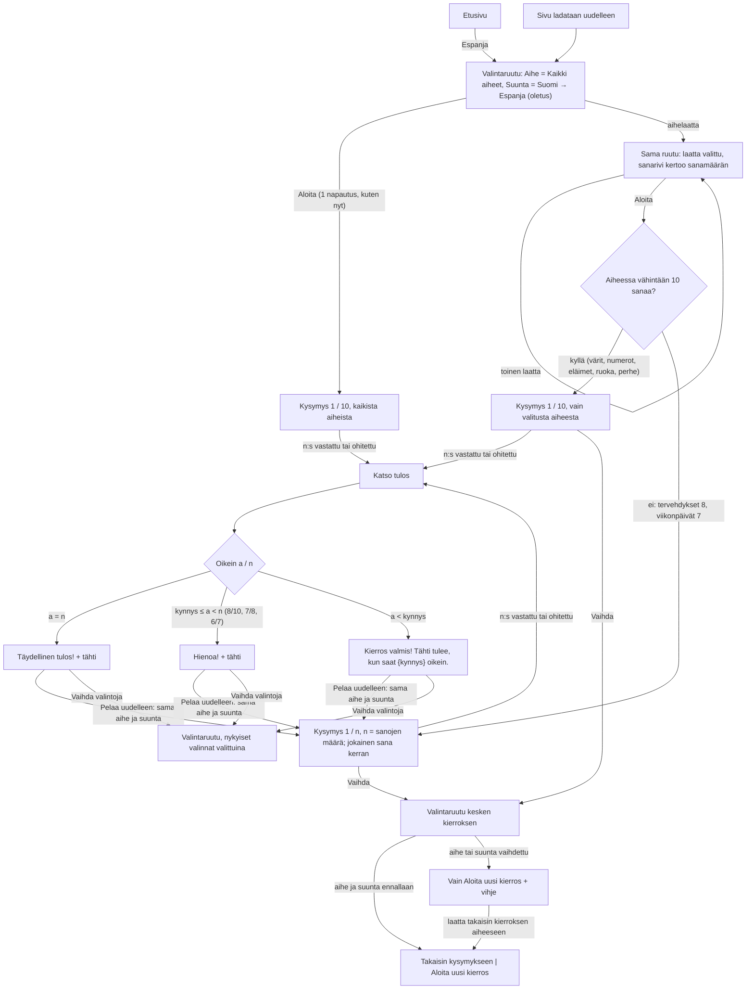

# SEI-57 — Espanja: aiheen valinta

Designer, 2026-10-27. Kuvat jokaisesta tilasta: `docs/design/sei-57.html`
(tietokone, iPad pysty ja vaaka, kapea ikkuna). Tämä dokumentti on
rakentamisen lähde; HTML-sivu näyttää saman omistajalle.

Omistajan päätös (Q55, 2026-10-27): vaihtoehto A, lapsi valitsee aiheen
ennen kierrosta; ensimmäisenä `Kaikki aiheet` = nykyinen toiminta. Ei tasoja
(E7 ei koske). E8: oletus (a), lyhyempi kierros, näytetään tässä; omistaja
voi muuttaa katselmoinnissa.

Kaikki, mitä tässä ei mainita, on ennallaan `docs/design/sei-4.md`:n
mukaan ("SEI-4 §x"). Sisältö: `docs/design/sei-50.md`,
`app/src/games/espanja-logic.js`.

---

## 1. Palvelutaso

**Käyttäjä.** 1.–2.-luokkalainen, joka opiskelee espanjaa koulussa. Lukee
suomea hitaasti; espanjaa ei osaa lukea ääneen.

**Tehtävä.** "Koulussa harjoiteltiin viikonpäiviä, haluan harjoitella vain
niitä." Tai, kuten nyt: "haluan pelata espanjaa", jolloin aiheella ei ole
väliä.

**Missä matkalla.**
- *Ennen:* etusivu → Espanja-kortti → valintaruutu `Mitä pelataan?`. Lapsella
  voi olla mielessä koulun aihe; aikuinen voi olla vieressä ja sanoa "valitse
  eläimet".
- *Aikana:* valitsee aiheen (tai ei koske siihen) ja suunnan, painaa `Aloita`.
- *Jälkeen:* loppuruutu; `Pelaa uudelleen` pitää aiheen ja suunnan, `Vaihda
  valintoja` palaa valintaruutuun.

**Jos tätä ei tehdä:** kierros arpoo 10 sanaa 79:stä seitsemästä aiheesta.
Koulussa juuri käsitelty aihe (esim. 7 viikonpäivää) tulee kierrokseen
keskimäärin alle kerran; harjoittelua ei voi rajata.

**Mallit, joita noudatetaan:**

| Malli | Missä nyt | Tässä |
|---|---|---|
| Valintaruutu `Mitä pelataan?`, ryhmän otsikko 22 px, kortit `role="radio"` ryhmässä `role="radiogroup"`, valittu = 4 px tunnusvärinen reunus + vaalea tausta + valintamerkki, mitään ei aloiteta ennen painiketta | SEI-4 §3.1 (suuntakortit), SEI-3 §3.1 | Aihelaatat samoin. |
| Sanalistan valinta kuvin: emoji (`aria-hidden`) + nimi kortissa | SEI-3 §3.1 `Sanat`-ryhmä (`.sn-theme`) | Aihelaatta on sama kortti pienempänä (kohta 3.1). |
| Ryhmän vaihto kesken kierroksen: vain `Aloita uusi kierros` + vihje `Toiset … alkavat uudella kierroksella.` | SEI-3 §3.1 (sanalista), SEI-4 §3.1 (suunta) | Aiheen vaihto samoin. |
| Loppuruudun `Vaihda valintoja` + harmaa valintarivi `A · B` | SEI-3 §3.7, SEI-2 §3.6 (`Helppo · + −`) | Korvaa Espanjan `Vaihda suuntaa` -painikkeen, koska valittavaa on nyt kaksi. |
| Valinnat muistetaan istunnon ajan, ei tallenneta | SEI-4 §3.1, SEI-3 §3.1 | Aihe samoin. |
| Kierroksen pituus, palkki, Kesken-merkki, tähti, odottava Seuraava | SEI-4 §3.2, §3.5, §3.7 | Sama, mutta 10:n tilalla kierroksen pituus **n** (kohta 4). |

---

## 2. Kulku

Polut, jotka eivät ole onnellisia:
- **Lapsi ei koske aiheeseen:** `Kaikki aiheet` on valmiiksi valittuna;
  kierros on täsmälleen nykyinen (10 kysymystä 79 sanasta, väärät
  vaihtoehdot kysymyksen omasta aiheesta, tähti 8/10:llä).
- **Lapsi valitsee aiheen vahingossa:** laatta muuttaa vain valintaa;
  mitään ei ala ennen `Aloita`-painiketta. Toinen napautus toiseen laattaan
  korjaa. Kesken kierroksen vahinkonapautus ei hävitä kierrosta, koska
  `Takaisin kysymykseen` palaa, kun laatta napautetaan takaisin.
- **Aihe vaihdetaan kesken kierroksen:** vain `Aloita uusi kierros`; vanhan
  kierroksen pisteet katoavat, tähdet eivät (sama kuin suunnan vaihto).
- **Sivu ladataan uudelleen:** `Kaikki aiheet` ja `Suomi → Espanja`;
  kierros katoaa, tähdet säilyvät.
- Tyhjä, lataus ja virhe eivät ole mahdollisia: sisältö on kiinteä
  sovelluksessa.

---

## 3. Näkymät

### 3.1 Valintaruutu: "Mitä pelataan?"

**Sisältö ylhäältä alas** (uutta: kohdat 2–3; muut SEI-4 §3.1):

1. Kysymysrivi: h2 `Mitä pelataan?`, oikealla `Kuuntele`. Ennallaan.
2. **Otsikkorivi:** vasemmalla ryhmän otsikko `Aihe` (22 px lihava), samalla
   rivillä oikealla **sanarivi** (20 px `#5b5f73`, ei napautettava, kohta
   3.2). < 600 px: sanarivi otsikon alla omalla rivillään, 18 px.
3. **Aihelaatat**, kahdeksan, valitaan yksi, tässä järjestyksessä:

   | # | Emoji (`aria-hidden`) | Nimi laatassa | Saavutettava nimi | Sanoja | Kierros |
   |---|---|---|---|---|---|
   | 1 | 🎲 | `Kaikki` | `Kaikki aiheet` | 79 | 10 |
   | 2 | 👋 | `Tervehdykset` | `Tervehdykset` | 8 | **8** |
   | 3 | 🎨 | `Värit` | `Värit` | 10 | 10 |
   | 4 | 🔢 | `Numerot` | `Numerot` | 12 | 10 |
   | 5 | 🐶 | `Eläimet` | `Eläimet` | 16 | 10 |
   | 6 | 🍎 | `Ruoka` | `Ruoka` | 16 | 10 |
   | 7 | 📅 | `Viikonpäivät` | `Viikonpäivät` | 7 | **7** |
   | 8 | 👪 | `Perhe` | `Perhe` | 10 | 10 |

   - Järjestys = aiheiden järjestys sanalistassa (`WORDS`) ja backlogin
     kriteeri 5.
   - `Kaikki` näkyy laatassa lyhyenä, koska `Kaikki aiheet` ei mahdu 169 px
     laattaan 20 px:llä; nopanheitto 🎲 kertoo "sekaisin". Ruudunlukija
     kuulee `Kaikki aiheet` (näkyvä teksti sisältyy nimeen, WCAG 2.5.3).
   - Kaikki emojit ovat Unicode 6.0:n perusmerkkejä ilman U+FE0F:ää;
     piirtyvät vanhoillakin iPadeilla. 🎲 U+1F3B2, 👋 U+1F44B, 🎨 U+1F3A8,
     🔢 U+1F522, 🐶 U+1F436, 🍎 U+1F34E, 📅 U+1F4C5, 👪 U+1F46A.
   - **Laatta** (SEI-3:n `.sn-theme` pienempänä): valkoinen, 3 px `#c9cbd6`
     reunus, alavarjo 4 px `#c9cbd6`, pyöristys 18 px. Emoji 26 px ylhäällä
     keskellä, nimi alla 20 px lihava muste `#1f2340`, keskitetty,
     `white-space: nowrap` ≥ 600 px.
   - **Valittu:** 4 px `#c62828` reunus, tausta `#fdeceb`, alavarjo
     `#8e0000`, valintamerkki 24 px (punainen ympyrä, valkoinen ✓) oikeassa
     yläkulmassa 6 px reunasta. Sama kuin suuntakortti, merkki 30 → 24 px
     laatan pienen koon takia.
   - **Painettu:** laskee 4 px, varjo pois (kuten suuntakortti).
   - Oletus ensimmäisellä avauksella ja uudelleenlatauksen jälkeen: laatta 1
     `Kaikki`.
4. Ryhmän otsikko `Suunta` ja kaksi suuntakorttia: **ennallaan** (128 px).
5. Vihjerivi (30 px, `role="status"`): säännöt alla.
6. Painikkeet: ennallaan (`Aloita`; kesken kierroksen `Takaisin
   kysymykseen` + `Aloita uusi kierros`).

**Vanha sanarivi** `Sanat: 7 aihetta (79 sanaa)` suuntakorttien alta
poistuu; sen tieto on nyt otsikkorivillä (kohta 3.2). Näin ruutu mahtuu
tietokoneen 548 px:iin.

**Säännöt:**
- Laatan napautus muuttaa vain luonnosta (kuten suuntakortti). Mitään ei
  lueta ääneen eikä aloiteta.
- `Aloita` / `Aloita uusi kierros`: kierros arvotaan valitusta aiheesta
  (kohta 4), sitten kuten SEI-4 §3.1.
- **Kesken kierroksen** (`Vaihda` kysymysruudussa): valittuina kierroksen
  aihe ja suunta. `Takaisin kysymykseen` näkyy vain, kun **sekä** aihe että
  suunta ovat samat kuin kierroksen. Vihjerivi, ensimmäinen sopiva:
  1. Aihe ja suunta vaihdettu: `Toinen aihe ja suunta alkavat uudella kierroksella.`
  2. Aihe vaihdettu: `Toinen aihe alkaa uudella kierroksella.`
  3. Suunta vaihdettu: `Toinen suunta alkaa uudella kierroksella.` (ennallaan)
  4. Muuten tyhjä. Ilman kierrosta aina tyhjä.
- `Vaihda valintoja` loppuruudusta: valittuina juuri pelatun kierroksen
  aihe ja suunta; vain `Aloita`.
- Valinta muistetaan istunnon ajan (etusivulla käynti ei muuta sitä), ei
  tallenneta laitteeseen. Uudelleenlataus → `Kaikki aiheet`. Sama kuin
  suunta ja Sanojen sanalista; tallennus olisi ensimmäinen asetus, joka
  säilyy latauksen yli, ja kaksi lasta samalla laitteella saisi toisen
  valinnan (profiilit SEI-11).

**Napautukset aloitusruudulta ensimmäiseen kysymykseen** (kriteeri 2):
ennen 1 (`Aloita`), jälkeen oletuksella 1 (`Aloita`). Aiheen kanssa 2.
Etusivulta: ennen 2, jälkeen 2.

**Kuuntele valintaruudussa:** ennallaan, lukee `hola`. Aiheen nimeä ei lueta:
peli puhuu vain espanjaa (SEI-4 §1), ja espanjankieliset aiheiden nimet
olisivat uutta, tarkistettavaa sisältöä. Ei tässä.

### 3.2 Sanarivi (otsikkorivillä `Aihe`-otsikon oikealla)

Teksti lasketaan sanalistasta, ei kirjoiteta käsin (kuten nykyinen
`WORD_LINE`):

| Valinta | Sanarivi |
|---|---|
| Kaikki aiheet | `Kaikki aiheet: 79 sanaa` |
| aihe, jossa ≥ 10 sanaa | `Eläimet: 16 sanaa` · `Värit: 10 sanaa` · `Numerot: 12 sanaa` · `Ruoka: 16 sanaa` · `Perhe: 10 sanaa` |
| aihe, jossa < 10 sanaa | `Tervehdykset: 8 sanaa, kierroksessa 8 kysymystä` · `Viikonpäivät: 7 sanaa, kierroksessa 7 kysymystä` |

Muoto: `{Nimi}: {s} sanaa` ja jos s < 10 lisäksi `, kierroksessa {s}
kysymystä`. `{Nimi}` = saavutettava nimi (taulukko 3.1). Pisin rivi
(`Viikonpäivät: 7 sanaa, kierroksessa 7 kysymystä`, 48 merkkiä, noin 480 px)
mahtuu `Aihe`-otsikon viereen 712 px:ssä. Lyhyempi kierros kerrotaan tässä
etukäteen, ettei 7. kysymyksen jälkeinen `Katso tulos` yllätä aikuista.

### 3.3 Kysymysruutu

Ennallaan SEI-4 §3.2–3.6, paitsi:
- **Palkissa n lohkoa** (10, 8 tai 7), sama kokonaisleveys; lohkot
  levenevät. Täyttyvät kuten ennen.
- `Katso tulos` n:nnen kysymyksen jälkeen; odottava Seuraava kysymyksissä
  1…n−1 (SEI-46-sääntö, n:n mukaan).
- Vihjerivi `Aihe: viikonpäivä. Valitse espanjaksi.` ennallaan, myös kun aihe
  on valittu (SEI-4 kriteeri 3; ei uutta tekstiä).
- Väärät vaihtoehdot: kuten nyt, kysymyksen omasta aiheesta. Yhden aiheen
  kierroksessa ne ovat siis aina valitusta aiheesta.
- `Vaihda`-painikkeen teksti ennallaan; nimi kohdassa 6.
- `reportProgress({done, total: n, finished})`: etusivun Kesken-merkki
  `Kesken 3/7`.

### 3.4 Loppuruutu

Rakenne, kuvat, konfetti ja espanjan lauseet SEI-4 §3.7. Rajat n:n mukaan
(kohta 4):

| | a = n | kynnys ≤ a < n | a < kynnys |
|---|---|---|---|
| Otsikko | `Täydellinen tulos!` | `Hienoa!` | `Kierros valmis!` |
| Iso tulos | `7 / 7 oikein` | `6 / 7 oikein` | `5 / 7 oikein` |
| Tähtirivi | `Sait tähden!` | `Sait tähden!` | `Tähti tulee, kun saat 6 oikein.` |
| Lause | `¡Perfecto!` `Täydellistä!` | `¡Muy bien!` `Tosi hyvä!` | `¡Sigue practicando!` `Jatka harjoittelua!` |
| Konfetti | 100 | 40 | ei |

Esimerkit yllä viikonpäivistä (n = 7, kynnys 6). Tervehdykset: `8 / 8`,
`7 / 8`, `Tähti tulee, kun saat 7 oikein.` Kaikki muut: ennallaan (10, 8).

**Painikkeet:** pääpainike `Pelaa uudelleen` (sama aihe ja suunta, uusi
arvonta) ja toissijainen **`Vaihda valintoja`** (oli `Vaihda suuntaa`;
Sanojen nimi). Niiden alla harmaa valintarivi 20 px:
`Viikonpäivät · Suomi → Espanja`, `Kaikki aiheet · Espanja → Suomi`.
Pisin `Tervehdykset · Espanja → Suomi` (31 merkkiä) mahtuu kapeaankin.

---

## 4. Kierroksen pituus ja tähtisääntö

- **n = pienempi luvuista 10 ja aiheen sanamäärä.** Kaikki aiheet ja
  aiheet, joissa ≥ 10 sanaa: 10. Tervehdykset 8, viikonpäivät 7.
- Kierroksessa jokainen sana enintään kerran (SEI-52 kr 3). n < 10 →
  jokainen aiheen sana kysytään kerran, satunnaisessa järjestyksessä.
- **Tähden kynnys = 8/10 skaalattuna ylöspäin pyöristäen** (vähintään 80 %
  oikein, kuten nyt): `kynnys = ⌈0,8 × n⌉`.

  | n | kynnys | sallittuja virheitä |
  |---|---|---|
  | 10 | 8 | 2 (ennallaan) |
  | 8 | 7 | 1 |
  | 7 | 6 | 1 |

  Huomio: lyhyessä kierroksessa sallitaan yksi virhe, ei kaksi. Vaihtoehto
  "aina kaksi virhettä" (6/8, 5/7) on avoin kysymys 1.
- Tähti on yksi ja sama Espanjan tähti aiheesta riippumatta (pm: eriytetyt
  tähdet eivät kuulu tähän).
- Ohitettu lasketaan kuten nyt (ei oikein). a + b + c = n.

---

## 5. Data: mitä on, mitä ei

| Tarvitaan | Onko | Huomio |
|---|---|---|
| Sanan aihe | Kyllä | `topic` jokaisella 79 parilla: `tervehdys` 8, `väri` 10, `numero` 12, `eläin` 16, `ruoka` 16, `viikonpäivä` 7, `perhe` 10 (tarkistettu `espanja-logic.js` 2026-10-27). |
| Laatan nimi ja emoji aiheelle | **Ei** | Uusi kiinteä taulukko, 7 riviä (kohta 3.1): `topic`-tunnus → nimi monikossa + emoji. `topic`-tekstiä ei muuteta (näkyy vihjerivillä). |
| Kierroksen pituus, kynnys | Johdettu | n ja kynnys lasketaan aiheen sanamäärästä; ei tallenneta. Koodissa `MAX_QUESTIONS` (10) on nyt kierroksen ylin pituus; jokainen "10" kysymysruudussa, palkissa, live-teksteissä, `endTexts`- ja `earnsStar`-säännöissä vaihtuu kierroksen pituuteen (arkkitehti päättää miten). |
| Valittu aihe | **Ei** | Uusi istuntotila: kierroksen aihe (`kaikki` tai `topic`-tunnus) + valintaruudun luonnos, kuten `direction`/`draft`. Ei `localStorage`-avainta. |
| Tähdet | Kyllä | `espanja.stars` ennallaan. |

**Testattavat ehdot rakentajalle** (ehdotus arkkitehdille):
- 200 siemenarvottua kierrosta kullekin aiheelle kumpaankin suuntaan:
  jokainen kysymys ja kaikki neljä vaihtoehtoa valitusta aiheesta, neljä
  eri vaihtoehtoa, tasan yksi oikea, ei samaa paria kahdesti, kierroksen
  pituus = min(10, aiheen sanamäärä).
- Kaikki aiheet: 200 kierrosta, pituus 10, sama sääntö kuin nyt.
- Jokaisessa `WORDS`:n aiheessa on vähintään 4 sanaa, ja jokaiselle on
  nimi ja emoji laattataulukossa (uusi aihe ilman nimeä kaatuu testiin, ei
  näy tyhjänä laattana).
- Kynnys: n = 10 → 8, 8 → 7, 7 → 6.

---

## 6. Reunat

- **Kaikki aiheet, kaikki ennallaan:** sama arvonta kuin nyt (79 sanasta 10).
- **Viikonpäivät (7):** kaikki seitsemän tulevat, jokainen kerran.
  Väärät vaihtoehdot jäljellä olevista kuudesta. `Pelaa uudelleen` = samat 7
  sanaa eri järjestyksessä ja eri väärin vaihtoehdoin.
- **Tervehdykset (8):** sama, 8 kysymystä. Tätä E8-kysymys ei maininnut
  erikseen; sama sääntö kuin viikonpäivillä.
- **Värit ja perhe (10):** 10 kysymystä = koko aihe, jokainen kerran.
- **0 oikein 7:stä:** `Kierros valmis!`, `0 / 7 oikein`, `✓ 0 oikein`,
  `✗ 7 väärin` tai `» 7 ohitettu`.
- **Tasan kynnys:** 6/7 tähti, 5/7 ei; 7/8 tähti, 6/8 ei.
- **Pienin mahdollinen aihe:** 4 sanaa riittää neljään vaihtoehtoon. Alle
  4 sanan aihe kaatuu testiin (kohta 5); tällaista ei ole.
- **Tulevat aiheet (SEI-40: keho, fraasit):** 9. laatta tekee ruudukosta
  kolmirivisen, ja tietokoneen valintaruutu (546 / 548 px) alkaa vierittyä.
  Uusi aihe vaatii designerin käynnin; ei ratkaista tässä.
- **Pisin laatan nimi** 12 merkkiä (`Tervehdykset`, `Viikonpäivät`), noin
  140 px 20 px:llä; laatan sisäleveys 151 px tietokoneella. < 600 px nimi
  18 px; < 420 px nimi saa rivittyä tavurajasta (pehmeä tavuviiva:
  `Terveh­dykset`, `Viikon­päivät`), laatta kasvaa korkeutta.
- **Kesken kierroksen laatta vaihdetaan ja takaisin:** `Takaisin
  kysymykseen` palaa näkyviin, vihje tyhjenee; kierros säilyy.
- **Negatiivisia lukuja ei ole:** n ≥ 4, 0 ≤ a ≤ n, kynnys ≤ n.

---

## 7. Asettelut ja korkeudet

| | ≥ 600 px (tietokone, iPad vaaka ja pysty) | < 600 px | < 420 px |
|---|---|---|---|
| Otsikkorivi | `Aihe` + sanarivi samalla rivillä, 28 px | `Aihe`, alla sanarivi 18 px | sama |
| Aihelaatat | 4 saraketta × 2 riviä, laatta 68 px korkea, väli 12 px | 2 saraketta × 4 riviä, 68 px, väli 10 px, nimi 18 px | sama, nimi saa rivittyä, laatta min. 68 px |
| Suuntakortit | ennallaan 128 px rinnakkain | ennallaan 88 px allekkain | ennallaan |

Laatan leveys tietokoneella (712 − 3 × 12) / 4 = 169 px; 375 px:n
puhelimella (375 − 24 − 32 − 10) / 2 = 154 px.

**Korkeus, tietokone (548 px):** kysymysrivi 56 + 20 + otsikkorivi 28 + 8 +
laatat 148 (2 × 68 + 12) + 12 + `Suunta` 28 + 8 + suuntakortit 128 + 8 +
vihje 30 + 8 + painike 64 = **546 px**. iPad vaaka 598 px: mahtuu. iPad pysty:
reilusti tilaa.

**Kapea ikkuna:** ruutu on noin 840 px korkea, ja `Aloita` jää 375 × 667
-puhelimessa näkyvän alueen alle; pelialue vierittyy (SEI-1 §3.2). Ennen
tätä se mahtui. Sovellus on tehty Macille ja iPadille, joilla tätä ei
tapahdu; hyväksytty raja, näkyy kuvassa.

---

## 8. Saavutettavuus

**Näppäimistöpolku, valintaruutu:** Etusivu → (Selvä) → Kuuntele → 8
aihelaattaa (vasemmalta oikealle, ylhäältä alas) → `Suomi → Espanja` →
`Espanja → Suomi` → (`Takaisin kysymykseen`) → `Aloita` / `Aloita uusi
kierros`. Jokainen laatta on oma `<button>` ja oma sarkainpysäkki, kuten
suuntakortit nyt (nuolinäppäimiä ei käsitellä; sama kuin SEI-4 ja SEI-3).
DOM-järjestys = näkyvä järjestys.

**Rooli ja nimet:**
- Laattaryhmä `role="radiogroup"`, nimi `Aihe`; laatta `role="radio"`,
  `aria-checked`, nimi taulukon 3.1 "saavutettava nimi".
- Sanarivi on laattojen kuvaus (`aria-describedby` jokaisessa laatassa,
  ei ryhmässä, ettei sitä lueta kahdesti): fokuksessa luetaan esim. `Viikonpäivät, valittu, Viikonpäivät:
  7 sanaa, kierroksessa 7 kysymystä`. Ei live-aluetta (vaihtuu vain lapsen
  omasta napautuksesta, ja `aria-checked` kertoo sen).
- Emoji ja valintamerkki `aria-hidden`.
- Vihjerivi `role="status"` ennallaan: aiheen vaihto kesken kierroksen
  ilmoitetaan sen kautta.

**Kysymysruudun ilmoitukset** (SEI-4 §8, n:n mukaan):
- Uusi kysymys: `Kysymys 3 / 7: tiistai. Aihe viikonpäivä. Valitse espanjaksi.`
- Palkki: `3 kysymystä 7:stä tehty`.
- Kysymyssanan nimi: `Kysymys 3 / 7: tiistai`.
- `Vaihda`: `Vaihda aihetta tai suuntaa. Nyt viikonpäivät, Suomi → Espanja.`
  (Kaikki aiheet: `Nyt kaikki aiheet, Suomi → Espanja.`)

**Loppuruutu:**
- Ilmoitus: `Hienoa! 6 / 7 oikein. 1 ohitettu. Sait tähden! Tähtiä nyt 5.` /
  `Kierros valmis! 5 / 7 oikein. Tähti tulee, kun saat 6 oikein.`
- Valintarivin nimi: `Aihe viikonpäivät. Suunta Suomi → Espanja.`
- Näppäimistöpolku: Etusivu → Kuuntele → `Pelaa uudelleen` → `Vaihda valintoja`.

**Fokus:** ennallaan (valintaruutu: otsikkoon; laatan napautus ei siirrä
fokusta).

**Väri ei ole ainoa tieto:** valittu laatta = 4 px reunus + tausta +
valintamerkki + `aria-checked`.

**Kontrasti:** laatan nimi `#1f2340` valkoisella 15,6 : 1, `#fdeceb`:llä
14 : 1. Sanarivi `#5b5f73` valkoisella 6,4 : 1. Valitun reunus `#c62828`
valkoisella 5,6 : 1. Valintamerkki valkoinen `#c62828`:lla 5,6 : 1.

**Koot:** laatta vähintään 151 × 68 px (< 420 px: 127 × 68), väli ≥ 10 px.
Suurempi kuin SEI-1:n 56 px:n alaraja.

**Liike:** ei uutta liikettä.

---

## 9. Ei mukana

- Tasot (E7), aiheen tai tason mukaan eriytetyt tähdet, useamman aiheen
  yhdistelmät (esim. värit + numerot).
- Valinnan tallennus laitteeseen.
- Aiheiden nimet espanjaksi tai ääneen.
- Uudet aiheet (SEI-40).

---

## 10. Hyväksyntä: missä kriteerit katetaan

| SEI-57 kriteeri | Kohta |
|---|---|
| 1 ei valintaa → kuten nyt | 3.1 oletus, 6 ensimmäinen rivi |
| 2 oletus = nykyinen, ei lisänapautuksia (1 → 1) | 3.1 "Napautukset" |
| 3 (A) kysymykset ja vaihtoehdot valitusta aiheesta | 3.3, 5 testit |
| 4 (A) pieni aihe: lyhyempi kierros, ei toistoa, tähti sovitettu | 4 |
| 5 (A) 7 aihetta + Kaikki aiheet valittavissa | 3.1 taulukko |
| 8 Pelaa uudelleen pitää valinnan; tulosruutu ja tähti kuten ennen | 3.4 |
| 9 kapea ja leveä, kosketuskohteet, suomi | 7, 8; HTML-sivu |
| 6, 7 (B) | ei koske (E6: A) |

---

## 11. Avoimet kysymykset omistajalle

1. **Paljonko lyhyessä kierroksessa saa mennä väärin, jotta tähti tulee?**
   Nyt tähti tulee, kun 10:stä saa 8 oikein (kaksi saa mennä väärin).
   Viikonpäiviä on 7 ja tervehdyksiä 8, joten niissä kierros on lyhyempi.
   Oletus, jos et tiedä: sama vaatimus kuin nyt, 80 % → viikonpäivät 6/7 ja
   tervehdykset 7/8 (yksi saa mennä väärin). Vaihtoehto: kaksi saa aina
   mennä väärin → 5/7 ja 6/8.
